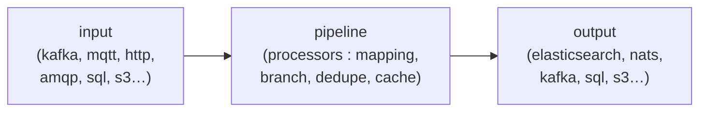

**Redpanda Connect** (l'ancien **Benthos**, Go) est un **processeur de flux** en un seul binaire : il lit des messages depuis une source, les **transforme** et les écrit vers une destination, le tout décrit dans un fichier **YAML** — sans écrire de programme. Il excelle à coller des systèmes entre eux : d'une file [[04-kafka/01-presentation-installation|Kafka]] vers [[01-elasticsearch/01-presentation-installation|Elasticsearch]], de [[05-mosquitto/01-presentation-configuration|MQTT]] vers une base, d'un webhook HTTP vers [[03-rabbitmq/01-presentation-installation|RabbitMQ]], avec enrichissement et reformatage au passage.



## Installation

```bash
# Binaire autonome
curl -Lsf https://connect.redpanda.com/install.sh | sh        # fournit « redpanda-connect »
# ou via rpk (CLI Redpanda)
rpk connect run ./pipeline.yaml
# ou l'ancien binaire Benthos (compatible)
docker run --rm -v $PWD/pipeline.yaml:/pipeline.yaml docker.redpanda.com/redpandadata/connect run /pipeline.yaml
```

Édition communautaire (connecteurs de base, Apache 2.0) et connecteurs **Enterprise** (certains systèmes propriétaires, licence). Vérifier la licence du connecteur voulu.

## Pipeline

```yaml pipeline.yaml
input:
  kafka_franz:
    seed_brokers: [ "broker1:9092" ]
    topics: [ "commandes" ]
    consumer_group: "cg-enrichissement"

pipeline:
  processors:
    # Bloblang : langage de transformation intégré
    - mapping: |
        root.id = this.order_id
        root.montant_ttc = this.montant * 1.2
        root.site = this.site.uppercase()
        root.recu_le = now()
    # Enrichissement par un appel HTTP (ou une requête SQL avec branch + sql_select)
    - branch:
        request_map: 'root.client = this.client_id'
        processors:
          - http:
              url: "http://crm.corp.exemple.fr/api/clients/${! json(\"client\") }"
              verb: GET
        result_map: 'root.client_nom = this.nom'

output:
  elasticsearch:
    urls: [ "https://es.corp.exemple.fr:9200" ]
    index: "commandes"
    id: "${! json(\"id\") }"
```

```bash
redpanda-connect lint pipeline.yaml        # vérifier la configuration
redpanda-connect run pipeline.yaml
redpanda-connect list inputs               # lister les connecteurs disponibles (inputs/processors/outputs/caches)
redpanda-connect blobl server             # éditeur interactif Bloblang (mise au point des mappings)
```

## Connecteurs et processeurs

| Catégorie | Exemples |
| --- | --- |
| **Entrées** | `kafka_franz`, `amqp_1`/`amqp_0_9` (RabbitMQ), `nats_jetstream`, `mqtt`, `redis_streams`, `http_server`, `http_client`, `sql_select`, `file`, `aws_s3`, `gcp_pubsub`, `generate` |
| **Processeurs** | `mapping` (Bloblang), `branch`, `cache`, `dedupe`, `group_by`, `split`/`archive`, `schema_registry_decode`, `jq`, `workflow`, `rate_limit`, `catch`/`try` |
| **Sorties** | `kafka_franz`, `elasticsearch`, `sql_insert`, `nats`, `mqtt`, `redis_hash`, `aws_s3`, `http_client`, `drop`, `reject`, `switch` (routage), `broker` (fan-out) |
| **Caches / ressources** | `redis`, `memory`, `sql` — pour la déduplication, l'agrégation, les jointures |

**Bloblang** est le langage de transformation : filtrage (`root = if … { deleted() }`), mise en forme, agrégations, fonctions (`uuid_v4()`, `now()`, `hash()`, `parse_timestamp`). Garanties : livraison **au moins une fois**, *back-pressure* de bout en bout, reprise sur erreur (`retry`, DLQ via `reject`/`switch`).

## Mode streams et exploitation

```bash
# Plusieurs pipelines dans un seul processus + API de gestion
redpanda-connect streams ./pipelines/*.yaml        # API REST pour ajouter/retirer des flux à chaud
```

- **Observabilité** : section `metrics: prometheus: {}` expose `/metrics` ; `tracing: open_telemetry_collector: {}` pour les traces.
- **Tests** : cadre de tests intégré (`redpanda-connect test ./…_test.yaml`) pour valider les mappings en CI.
- **Mise à l'échelle** : plusieurs instances dans le même groupe de consommateurs (Kafka/NATS) se répartissent les partitions.

Face à [[01-kafka-connect-debezium|Kafka Connect]] : Redpanda Connect ne requiert **pas de grappe Kafka** et transforme librement (Bloblang), là où Kafka Connect est centré sur Kafka et ses connecteurs. Les deux sont complémentaires (CDC avec Debezium → traitement avec Redpanda Connect). Commandes : [[90-aide-memoire|aide-mémoire]].
