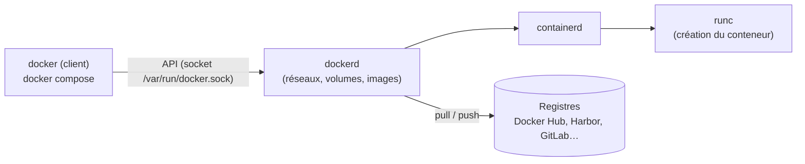

Un **conteneur** exécute une application avec ses dépendances dans un environnement isolé (espaces de noms, cgroups) qui partage le noyau de l'hôte. Une **image** est le modèle en lecture seule, constitué de couches, à partir duquel on crée des conteneurs. **Docker** a popularisé ce modèle et reste l'outil de référence pour construire et exécuter des conteneurs.

## Architecture



| Notion | Description |
| --- | --- |
| Image | Couches empilées, identifiées par `nom:tag` et un condensat `sha256` |
| Conteneur | Instance d'une image avec une couche inscriptible |
| Registre | Stockage et distribution des images |
| Volume | Données persistantes hors du cycle de vie du conteneur |
| Réseau | Réseaux virtuels (bridge, host, macvlan, overlay) |

## Docker Engine ou Docker Desktop ?

| Produit | Plate-forme | Licence |
| --- | --- | --- |
| **Docker Engine** | Linux (serveurs) | Libre (Apache 2.0) |
| **Docker Desktop** | Windows, macOS, Linux (poste) | Gratuit pour usage personnel, éducation et petites entreprises (< 250 salariés et < 10 M$ de CA) ; **payant** sinon |

## Installation sous Linux (dépôt officiel)

### Debian / Ubuntu

```bash
sudo apt install ca-certificates curl
sudo install -m 0755 -d /etc/apt/keyrings
sudo curl -fsSL https://download.docker.com/linux/debian/gpg -o /etc/apt/keyrings/docker.asc     # …/linux/ubuntu/gpg pour Ubuntu
echo "deb [arch=$(dpkg --print-architecture) signed-by=/etc/apt/keyrings/docker.asc] https://download.docker.com/linux/debian $(. /etc/os-release && echo "$VERSION_CODENAME") stable" \
  | sudo tee /etc/apt/sources.list.d/docker.list
sudo apt update
sudo apt install docker-ce docker-ce-cli containerd.io docker-buildx-plugin docker-compose-plugin
sudo systemctl enable --now docker
sudo docker run --rm hello-world
```

Le paquet `docker.io` de la distribution existe aussi (version plus ancienne, sans le greffon Compose v2 sur certaines versions).

### RHEL / Rocky / Alma

```bash
sudo dnf remove -y podman buildah runc 2>/dev/null     # RHEL fournit Podman par défaut
sudo dnf config-manager --add-repo https://download.docker.com/linux/rhel/docker-ce.repo
sudo dnf install docker-ce docker-ce-cli containerd.io docker-buildx-plugin docker-compose-plugin
sudo systemctl enable --now docker
```

Sous RHEL, [[02-podman/01-presentation-installation|Podman]] est l'outil natif et largement compatible.

### Accès sans sudo

```bash
sudo usermod -aG docker alice          # effectif à la prochaine connexion
```

> [!WARNING]
> Être membre du groupe **docker** équivaut à être **root** sur l'hôte (monter `/` dans un conteneur privilégié, par exemple). Réservez-le aux administrateurs ou utilisez le mode *rootless* (voir [[05-securite-exploitation]]).

## Windows

| Besoin | Solution |
| --- | --- |
| Poste de développement (conteneurs Linux) | **Docker Desktop** avec moteur **WSL 2** : `winget install Docker.DockerDesktop` |
| Conteneurs **Windows** sur Windows Server | Docker Engine (script Microsoft `install-docker-ce.ps1`, Mirantis Container Runtime) ou containerd + nerdctl ; images `mcr.microsoft.com/windows/servercore` |
| Sans Docker Desktop | Docker Engine dans une distribution WSL 2 |

Les conteneurs Windows exigent une version d'image compatible avec la version de l'hôte (isolation processus) ou l'isolation Hyper-V.

## macOS

| Solution | Remarque |
| --- | --- |
| **Docker Desktop** | `brew install --cask docker` ; machine virtuelle Linux intégrée |
| **Colima** | Libre : `brew install colima docker docker-compose && colima start --cpu 4 --memory 8` |
| OrbStack | Commercial, très léger |

## Premiers pas

```bash
docker version && docker info
docker run -d --name web -p 8080:80 nginx:1.27
docker ps
docker logs -f web
docker exec -it web sh
docker stop web && docker rm web
docker images
docker pull debian:12
```

| Commande | Rôle |
| --- | --- |
| `docker run -d --name x -p hôte:conteneur image` | Créer et démarrer |
| `docker ps -a` | Conteneurs (y compris arrêtés) |
| `docker logs -f --since 10m x` | Journaux |
| `docker exec -it x bash` | Shell dans le conteneur |
| `docker inspect x` | Configuration détaillée (JSON) |
| `docker stats` | Consommation en temps réel |
| `docker system df` | Espace disque utilisé |

## Suite du parcours

1. [[02-images-dockerfile-registres|Images, Dockerfile et registres]]
2. [[03-reseaux-volumes|Réseaux et volumes]]
3. [[04-compose|Docker Compose]]
4. [[05-securite-exploitation|Sécurité, exploitation et dépannage]]
