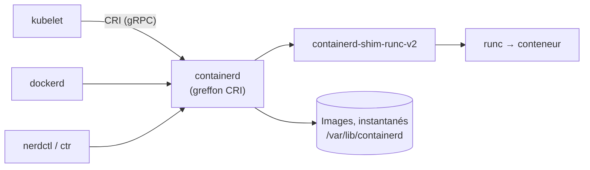

**containerd** (projet CNCF) gère le cycle de vie des conteneurs : téléchargement des images, stockage, création des conteneurs via **runc**, réseau de base. Docker l'utilise en interne, et c'est l'environnement d'exécution le plus courant des nœuds **Kubernetes** (via l'interface **CRI**).



## Installation

| Méthode | Commande |
| --- | --- |
| Debian / Ubuntu | `sudo apt install containerd` (distribution) ou `containerd.io` (dépôt Docker) |
| RHEL | `sudo dnf install containerd.io` (dépôt Docker) |
| Binaires officiels | Archive `containerd-2.x-linux-amd64.tar.gz` + unité systemd + runc + greffons CNI |
| Windows Server | containerd pour les conteneurs Windows (nœuds Kubernetes Windows) |

```bash
sudo mkdir -p /etc/containerd
containerd config default | sudo tee /etc/containerd/config.toml
sudo systemctl enable --now containerd
```

## config.toml pour Kubernetes

```ini /etc/containerd/config.toml (extrait, containerd 1.7)
version = 2
[plugins."io.containerd.grpc.v1.cri"]
  sandbox_image = "registry.k8s.io/pause:3.10"
  [plugins."io.containerd.grpc.v1.cri".containerd.runtimes.runc.options]
    SystemdCgroup = true
  [plugins."io.containerd.grpc.v1.cri".registry]
    config_path = "/etc/containerd/certs.d"
```

> [!IMPORTANT]
> `SystemdCgroup = true` est indispensable quand le kubelet utilise le pilote de cgroups **systemd** (cas par défaut de kubeadm) : sinon les pods redémarrent de façon erratique. Avec **containerd 2.x** (format de configuration `version = 3`), les chemins de sections changent (`plugins."io.containerd.cri.v1.runtime"`…) : régénérez la configuration par défaut plutôt que de copier une ancienne.

### Miroirs et registres privés

```ini /etc/containerd/certs.d/docker.io/hosts.toml
server = "https://registry-1.docker.io"

[host."https://miroir-hub.corp.exemple.fr"]
  capabilities = ["pull", "resolve"]
```

```ini /etc/containerd/certs.d/registre.corp.exemple.fr/hosts.toml
server = "https://registre.corp.exemple.fr"

[host."https://registre.corp.exemple.fr"]
  ca = "/etc/containerd/certs.d/registre.corp.exemple.fr/ca.crt"
```

## Espaces de noms

containerd isole les ressources par **espace de noms** : `k8s.io` (Kubernetes), `moby` (Docker), `default` (ctr/nerdctl). Une image téléchargée par Docker n'est pas visible par le kubelet, et inversement.

## Outils

| Outil | Usage |
| --- | --- |
| `ctr` | Outil de bas niveau fourni (débogage), peu ergonomique |
| **nerdctl** | CLI compatible Docker pour containerd (`nerdctl run`, `compose`, `build` avec BuildKit) |
| **crictl** | Client CRI pour les nœuds Kubernetes (pods, conteneurs, images vus par le kubelet) |

```bash
# nerdctl
sudo nerdctl run -d --name web -p 8080:80 nginx:1.27
sudo nerdctl --namespace k8s.io ps            # conteneurs gérés par Kubernetes

# crictl (configurer le point d'accès une fois)
echo 'runtime-endpoint: unix:///run/containerd/containerd.sock' | sudo tee /etc/crictl.yaml
sudo crictl pods
sudo crictl ps -a
sudo crictl logs <id-conteneur>
sudo crictl images
sudo crictl pull registre.corp.exemple.fr/reseau/inventaire:1.4.2
sudo crictl rmi --prune                       # images inutilisées

# ctr
sudo ctr -n k8s.io images ls
sudo ctr -n k8s.io images import image.tar    # importer une image hors ligne
```

## Dépannage

| Symptôme | Cause | Solution |
| --- | --- | --- |
| Pods qui redémarrent en boucle, `cgroup` incohérent | `SystemdCgroup = false` alors que le kubelet utilise systemd | `SystemdCgroup = true`, redémarrer containerd et kubelet |
| `failed to pull image … x509: certificate signed by unknown authority` | AC du registre non approuvée | `hosts.toml` avec `ca`, ou AC dans le magasin système |
| Image importée invisible pour Kubernetes | Mauvais espace de noms | `ctr -n k8s.io images import` |
| `crictl` : `connect: no such file or directory` | Point d'accès CRI non configuré | `/etc/crictl.yaml` |
| Disque plein (`/var/lib/containerd`) | Images accumulées | `crictl rmi --prune`, seuils de collecte du kubelet (`imageGCHighThresholdPercent`) |
| Configuration ignorée après mise à jour 1.7 → 2.x | Ancien format de configuration | Régénérer avec `containerd config default` et reporter les réglages |

```bash
sudo journalctl -u containerd -f
sudo containerd config dump | less          # configuration effective
```
