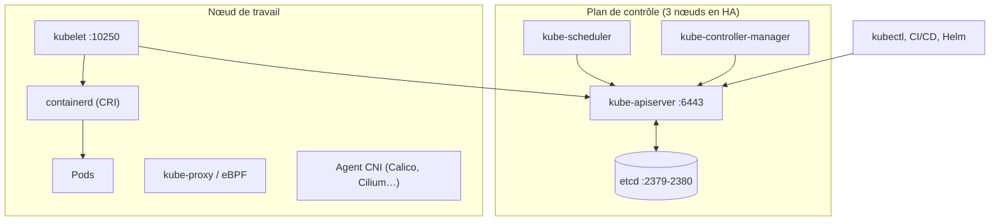

**Kubernetes** orchestre des conteneurs sur un ensemble de machines : il les place, les redémarre, les met à l'échelle, les expose sur le réseau et réalise les mises à jour progressives. On lui décrit l'**état souhaité** (manifestes YAML) ; des contrôleurs comparent en permanence l'état réel à cet état et corrigent les écarts.

## Architecture

| Composant | Rôle |
| --- | --- |
| **kube-apiserver** | Point d'entrée unique (API REST), authentification, autorisation, admission |
| **etcd** | Base clé-valeur distribuée : **tout l'état du cluster** (à sauvegarder) |
| **kube-scheduler** | Choisit le nœud de chaque nouveau pod |
| **kube-controller-manager** | Contrôleurs (Deployments, nœuds, jetons…) |
| **kubelet** | Agent de chaque nœud : démarre les pods via le runtime CRI |
| **kube-proxy** | Règles de service (iptables/IPVS/nftables) ; remplacé par eBPF avec Cilium |
| **CNI** | Réseau des pods (adressage, routage, politiques réseau) |
| CoreDNS | Résolution des noms de services |

## Objets principaux

| Objet | Rôle |
| --- | --- |
| **Pod** | Un ou plusieurs conteneurs partageant réseau et volumes ; unité de déploiement |
| **Deployment** | Pods sans état répliqués, mises à jour progressives |
| StatefulSet | Pods avec identité et stockage stables (bases de données) |
| DaemonSet | Un pod par nœud (agents de supervision, de journalisation) |
| Job / CronJob | Tâches ponctuelles / planifiées |
| **Service** | Adresse et nom stables devant un groupe de pods |
| **Ingress** / Gateway | Exposition HTTP(S) avec routage par nom et chemin |
| ConfigMap / Secret | Configuration / données sensibles |
| PersistentVolumeClaim | Demande de stockage persistant |
| **Namespace** | Cloisonnement logique (équipes, environnements) |

## Modèle réseau

| Règle | Conséquence |
| --- | --- |
| Chaque pod a sa **propre IP** | Plage *pod CIDR* (ex. `10.244.0.0/16`) |
| Tous les pods communiquent sans NAT | Par défaut tout est ouvert : les **NetworkPolicies** restreignent |
| Les services ont une IP virtuelle | Plage *service CIDR* (défaut `10.96.0.0/12`) |
| Noms DNS | `service.namespace.svc.cluster.local` |

> [!WARNING]
> Choisissez les plages **pods** et **services** pour qu'elles ne chevauchent **aucun** réseau de l'entreprise (VPN, sites, datacenters) : un chevauchement rend des réseaux réels injoignables depuis les pods. Les valeurs par défaut (`10.96.0.0/12`, `10.244.0.0/16`, `192.168.0.0/16` pour Calico) sont souvent en conflit avec des plans d'adressage en `10.0.0.0/8`.

## Ports

| Port | Composant |
| --- | --- |
| **6443** | kube-apiserver |
| 2379-2380 | etcd (clients, pairs) |
| 10250 | kubelet |
| 10257 / 10259 | controller-manager / scheduler (local) |
| 30000-32767 | Services `NodePort` |
| Selon le CNI | BGP 179 (Calico), VXLAN 4789/8472, Geneve 6081, WireGuard 51820/51871 |

## Versions

Trois versions mineures par an (1.32, 1.33, 1.34…), chacune maintenue **environ 14 mois**. Les mises à jour se font **une version mineure à la fois**. Les nœuds peuvent être d'une à trois versions mineures plus anciens que le plan de contrôle.

## Distributions

| Type | Exemples |
| --- | --- |
| Installation standard | **kubeadm** ([[02-installation-kubeadm]]) |
| Légères | [[05-k3s/01-presentation-installation\|K3s]], k0s, MicroK8s |
| Locales / tests | [[06-minikube/01-installation-utilisation\|Minikube]], [[07-kind/01-installation-utilisation\|Kind]] |
| Entreprise | OpenShift, Rancher RKE2, Tanzu, Talos Linux |
| Gérées (cloud) | AKS, EKS, GKE, OVHcloud, Scaleway |

## Outils

| Outil | Usage |
| --- | --- |
| **kubectl** | CLI officielle |
| **Helm** | Gestionnaire de paquets (*charts*) |
| k9s, Lens/Freelens, Headlamp | Interfaces (terminal, graphique) |
| kubectx / kubens | Changer de contexte / de namespace |
| Kustomize (intégré à kubectl) | Variantes de manifestes par environnement |
| Argo CD, Flux | Déploiement GitOps |

## Suite du parcours

1. [[02-installation-kubeadm|Installation avec kubeadm]]
2. [[03-charges-de-travail|Charges de travail, kubectl et Helm]]
3. [[04-reseau-services-ingress|Réseau : services, Ingress, politiques]]
4. [[05-stockage-configuration|Stockage, ConfigMaps et Secrets]]
5. [[06-securite-rbac|Sécurité : RBAC, admission, secrets]]
6. [[07-exploitation-depannage|Exploitation, mises à niveau et dépannage]]
