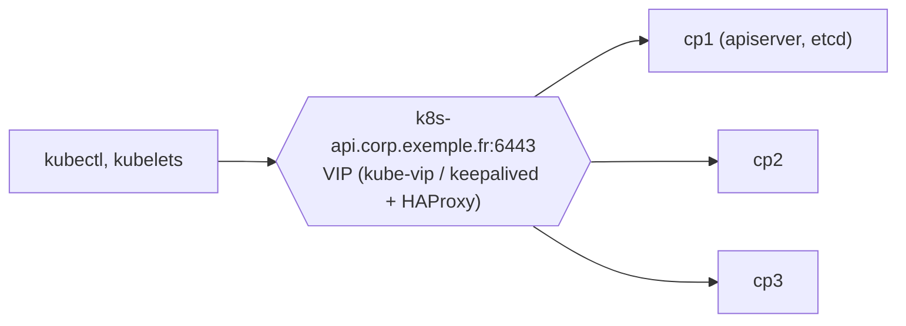

## Prérequis de chaque nœud

| Élément | Exigence |
| --- | --- |
| Système | Debian 12, Ubuntu 22.04/24.04, RHEL 9 et dérivées ; 2 vCPU, 2 Go de RAM minimum (plan de contrôle : 4 Go conseillés) |
| Identité | Nom d'hôte, adresse MAC et `product_uuid` uniques |
| Réseau | Connectivité complète entre nœuds, ports ouverts (voir [[01-presentation-architecture]]) |
| Swap | Désactivé (ou configuré explicitement pour le kubelet) |
| Heure | Synchronisée |

```bash
# Swap
sudo swapoff -a && sudo sed -i '/\sswap\s/ s/^/#/' /etc/fstab

# Modules et paramètres noyau
cat <<'EOF' | sudo tee /etc/modules-load.d/k8s.conf
overlay
br_netfilter
EOF
sudo modprobe overlay && sudo modprobe br_netfilter
cat <<'EOF' | sudo tee /etc/sysctl.d/99-k8s.conf
net.bridge.bridge-nf-call-iptables  = 1
net.bridge.bridge-nf-call-ip6tables = 1
net.ipv4.ip_forward                 = 1
EOF
sudo sysctl --system

# Runtime : containerd avec cgroups systemd
sudo apt install -y containerd
sudo mkdir -p /etc/containerd && containerd config default | sudo tee /etc/containerd/config.toml
sudo sed -i 's/SystemdCgroup = false/SystemdCgroup = true/' /etc/containerd/config.toml
sudo systemctl restart containerd
```

Détails de containerd : [[03-containerd/01-presentation-utilisation|containerd]].

## Paquets Kubernetes (pkgs.k8s.io)

```bash
# Debian / Ubuntu — dépôt d'une version mineure précise
sudo apt install -y apt-transport-https ca-certificates curl gpg
curl -fsSL https://pkgs.k8s.io/core:/stable:/v1.33/deb/Release.key | sudo gpg --dearmor -o /etc/apt/keyrings/kubernetes-apt-keyring.gpg
echo 'deb [signed-by=/etc/apt/keyrings/kubernetes-apt-keyring.gpg] https://pkgs.k8s.io/core:/stable:/v1.33/deb/ /' \
  | sudo tee /etc/apt/sources.list.d/kubernetes.list
sudo apt update && sudo apt install -y kubelet kubeadm kubectl
sudo apt-mark hold kubelet kubeadm kubectl
sudo systemctl enable kubelet
```

```ini /etc/yum.repos.d/kubernetes.repo (RHEL)
[kubernetes]
name=Kubernetes
baseurl=https://pkgs.k8s.io/core:/stable:/v1.33/rpm/
enabled=1
gpgcheck=1
gpgkey=https://pkgs.k8s.io/core:/stable:/v1.33/rpm/repodata/repomd.xml.key
exclude=kubelet kubeadm kubectl cri-tools kubernetes-cni
```

```bash
sudo dnf install -y kubelet kubeadm kubectl --disableexcludes=kubernetes
sudo systemctl enable kubelet
```

## Initialiser le plan de contrôle

```yaml kubeadm-config.yaml
apiVersion: kubeadm.k8s.io/v1beta4
kind: ClusterConfiguration
kubernetesVersion: v1.33.4
clusterName: k8s-prod
controlPlaneEndpoint: "k8s-api.corp.exemple.fr:6443"     # VIP ou équilibreur (même pour un seul nœud : facilite l'évolution)
networking:
  podSubnet: "172.20.0.0/16"
  serviceSubnet: "172.21.0.0/16"
  dnsDomain: cluster.local
apiServer:
  certSANs: [ "k8s-api.corp.exemple.fr", "10.0.40.10" ]
---
apiVersion: kubelet.config.k8s.io/v1beta1
kind: KubeletConfiguration
cgroupDriver: systemd
```

```bash
sudo kubeadm config images pull --config kubeadm-config.yaml
sudo kubeadm init --config kubeadm-config.yaml --upload-certs
mkdir -p ~/.kube && sudo cp /etc/kubernetes/admin.conf ~/.kube/config && sudo chown $(id -u):$(id -g) ~/.kube/config
kubectl get nodes          # NotReady tant qu'aucun CNI n'est installé
```

## Réseau des pods (CNI)

| CNI | Points forts |
| --- | --- |
| **Calico** | Routage BGP natif (annonce des réseaux de pods aux routeurs), politiques réseau avancées, VXLAN/IP-in-IP |
| **Cilium** | eBPF (remplace kube-proxy), observabilité (Hubble), politiques L7, chiffrement WireGuard, BGP |
| Flannel | Simple (VXLAN), sans politiques réseau |

```bash
# Cilium (CLI cilium)
cilium install --version 1.17.6 --set ipam.operator.clusterPoolIPv4PodCIDRList=172.20.0.0/16
cilium status --wait

# ou Calico (opérateur Tigera) : appliquer l'opérateur puis une ressource Installation avec cidr: 172.20.0.0/16
kubectl get pods -n kube-system
kubectl get nodes          # Ready
```

## Ajouter des nœuds

```bash
# Sur le plan de contrôle : commande de jonction (jeton valable 24 h)
kubeadm token create --print-join-command
# Sur le nœud de travail
sudo kubeadm join k8s-api.corp.exemple.fr:6443 --token abcdef.0123456789abcdef \
     --discovery-token-ca-cert-hash sha256:…
# Plan de contrôle supplémentaire : ajouter --control-plane --certificate-key <clé affichée par --upload-certs>
```

## Plan de contrôle hautement disponible



- **3 nœuds** de plan de contrôle (etcd « empilé ») ou etcd externe sur 3 serveurs dédiés.
- Adresse de l'API portée par un **équilibreur** (HAProxy + keepalived, F5, équilibreur cloud) ou **kube-vip** (pod statique qui porte la VIP).

## Nœuds Windows

Kubernetes accepte des **nœuds de travail Windows Server** (2019, 2022, 2025) pour des conteneurs Windows (plan de contrôle toujours Linux), avec containerd et un CNI compatible (Calico, Flannel). Les pods se placent grâce à `nodeSelector: kubernetes.io/os: windows`.

## kubectl sur les postes

| Système | Installation |
| --- | --- |
| Windows | `winget install Kubernetes.kubectl` |
| macOS | `brew install kubectl` |
| Linux | Paquet `kubectl` (dépôt ci-dessus) |

Le fichier `~/.kube/config` contient des identifiants : ne distribuez pas `admin.conf`, créez des accès nominatifs ([[06-securite-rbac]]).
