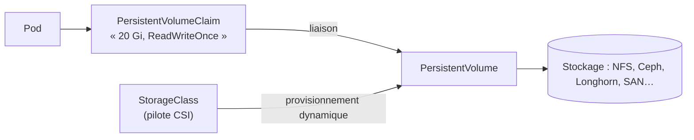

## Volumes persistants



```yaml pvc-inventaire-db.yaml
apiVersion: v1
kind: PersistentVolumeClaim
metadata: { name: donnees-db, namespace: reseau }
spec:
  accessModes: [ ReadWriteOnce ]
  storageClassName: longhorn
  resources:
    requests: { storage: 20Gi }
```

| Mode d'accès | Signification |
| --- | --- |
| `ReadWriteOnce` (RWO) | Monté en écriture par un seul nœud (blocs : Ceph RBD, Longhorn, iSCSI, disques cloud) |
| `ReadWriteOncePod` | Un seul pod |
| `ReadOnlyMany` (ROX) | Lecture par plusieurs nœuds |
| `ReadWriteMany` (RWX) | Écriture partagée (NFS, CephFS, Azure Files) |

| `reclaimPolicy` | Effet à la suppression du PVC |
| --- | --- |
| `Delete` | Le volume est supprimé (défaut de la plupart des StorageClass) |
| `Retain` | Le volume et ses données sont conservés (à récupérer manuellement) |

## Pilotes de stockage sur site

| Solution | Type | Remarques |
| --- | --- | --- |
| **csi-driver-nfs** | Fichiers (RWX) | Sous-répertoires dynamiques sur un serveur [[02-nfs/01-presentation\|NFS]] existant |
| **Longhorn** | Blocs répliqués sur les disques des nœuds | Simple, sauvegardes S3, instantanés |
| **Rook-Ceph** | Blocs, fichiers, objets | Puissant, plus exigeant (3+ nœuds, réseau rapide) |
| Pilotes des baies (NetApp Trident, Pure, Dell…) | SAN / NAS | Intégration avec le stockage existant |
| `local-path` / volumes locaux | Disque du nœud | Pas de haute disponibilité ; tests, bases répliquées par l'application |

```bash
helm repo add csi-driver-nfs https://raw.githubusercontent.com/kubernetes-csi/csi-driver-nfs/master/charts
helm install csi-driver-nfs csi-driver-nfs/csi-driver-nfs -n kube-system
```

```yaml storageclass-nfs.yaml
apiVersion: storage.k8s.io/v1
kind: StorageClass
metadata:
  name: nfs
provisioner: nfs.csi.k8s.io
parameters:
  server: nfs01.corp.exemple.fr
  share: /srv/nfs/k8s
reclaimPolicy: Retain
mountOptions: [ "nfsvers=4.2", "hard" ]
```

## ConfigMaps et Secrets

```bash
kubectl create configmap inventaire-config -n reseau --from-file=config.yaml --from-literal=LOG_LEVEL=info
kubectl create secret generic inventaire-db -n reseau --from-literal=password='MotDePasseLong'
kubectl create secret tls inventaire-tls -n reseau --cert=inventaire.crt --key=inventaire.key
kubectl create secret docker-registry registre-interne -n reseau \
  --docker-server=registre.corp.exemple.fr --docker-username=k8s --docker-password='…'
```

```yaml extrait-pod.yaml
spec:
  imagePullSecrets: [ { name: registre-interne } ]
  containers:
    - name: web
      envFrom: [ { configMapRef: { name: inventaire-config } } ]
      env:
        - name: DB_PASSWORD
          valueFrom: { secretKeyRef: { name: inventaire-db, key: password } }
      volumeMounts:
        - { name: config, mountPath: /etc/inventaire, readOnly: true }
  volumes:
    - name: config
      configMap: { name: inventaire-config }
```

> [!WARNING]
> Un **Secret** n'est qu'encodé en **base64** : quiconque peut lire les Secrets d'un namespace (ou accéder à etcd, ou aux sauvegardes d'etcd) les lit en clair. Restreignez l'accès par RBAC, chiffrez etcd et ne versionnez jamais de Secret brut dans Git.

## Gérer les secrets proprement

| Approche | Principe |
| --- | --- |
| **Chiffrement au repos d'etcd** | `EncryptionConfiguration` (aescbc/secretbox, ou KMS) sur l'apiserver |
| **Sealed Secrets** | Secrets chiffrés avec la clé publique du contrôleur : versionnables dans Git |
| **External Secrets Operator** | Synchronise depuis Vault, AWS/Azure/GCP, Bitwarden… |
| **Vault** (agent injector, CSI) | Secrets dynamiques, rotation, audit |
| SOPS | Fichiers chiffrés (age, PGP, KMS) déchiffrés au déploiement (Flux, Helm Secrets) |

## Instantanés de volumes

Avec un pilote CSI compatible et le contrôleur d'instantanés : `VolumeSnapshotClass` + `VolumeSnapshot` pour capturer un PVC, puis restauration en créant un PVC à partir de l'instantané. Pour une sauvegarde complète (ressources + volumes vers S3), utilisez **Velero**.
