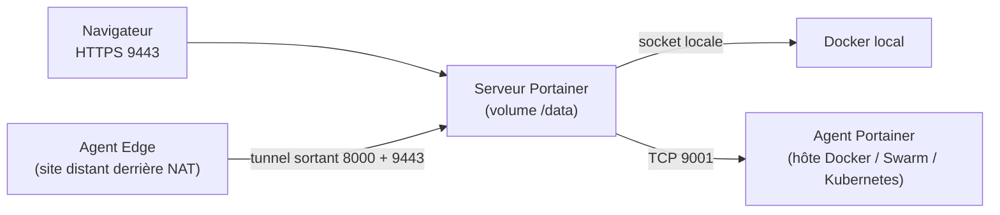

**Portainer** fournit une interface web pour gérer des hôtes **Docker**, des clusters **Swarm** et **Kubernetes**, et des hôtes **Podman** : conteneurs, images, volumes, réseaux, piles Compose, journaux, consoles, avec des droits par utilisateur et par équipe. Il simplifie l'exploitation de conteneurs par des équipes qui ne vivent pas en ligne de commande.

## Éditions

| Édition | Licence | Fonctions |
| --- | --- | --- |
| **Community Edition (CE)** | Libre | Gestion complète, utilisateurs et équipes, LDAP, OAuth, piles GitOps |
| **Business Edition (BE)** | Commerciale (gratuite sur un petit nombre de nœuds) | RBAC fin, Active Directory, journaux d'audit, sauvegarde S3, gestion Kubernetes avancée, support |

## Architecture



| Composant | Rôle |
| --- | --- |
| Serveur | Interface, API, base de configuration (`/data`) |
| **Agent** | Déployé sur chaque hôte/cluster géré ; le serveur s'y connecte (port 9001) |
| **Agent Edge** | Initie la connexion vers le serveur : sites distants sans port entrant |

## Installation sur Docker (Linux)

```bash
docker volume create portainer_data
docker run -d --name portainer --restart=always \
  -p 9443:9443 -p 8000:8000 \
  -v /var/run/docker.sock:/var/run/docker.sock \
  -v portainer_data:/data \
  portainer/portainer-ce:lts
```

Ouvrez `https://serveur:9443` et créez le compte administrateur **dans les 5 minutes** : passé ce délai, l'instance se verrouille par sécurité (redémarrer le conteneur).

> [!WARNING]
> Le serveur (ou l'agent) accède au **socket Docker** : quiconque contrôle Portainer contrôle l'hôte. Restreignez l'accès réseau à l'interface, imposez des mots de passe forts ou le SSO, et tenez Portainer à jour.

### Hôte Windows

```powershell
docker run -d --name portainer --restart=always -p 9443:9443 `
  -v \\.\pipe\docker_engine:\\.\pipe\docker_engine -v portainer_data:C:\data portainer/portainer-ce:lts
```

Docker Desktop propose aussi Portainer comme **extension**.

### Podman

Activez le socket (`systemctl enable --now podman.socket`) et montez-le à la place du socket Docker (`-v /run/podman/podman.sock:/var/run/docker.sock`), conteneur lancé en `--privileged` selon la documentation de la version.

## Installation sur Kubernetes

```bash
helm repo add portainer https://portainer.github.io/k8s/
helm upgrade --install portainer portainer/portainer -n portainer --create-namespace \
  --set service.type=LoadBalancer --set tls.force=true --set image.tag=lts
```

## Ajouter des environnements

```bash
# Agent sur un autre hôte Docker
docker run -d --name portainer_agent --restart=always -p 9001:9001 \
  -v /var/run/docker.sock:/var/run/docker.sock \
  -v /var/lib/docker/volumes:/var/lib/docker/volumes \
  portainer/agent:lts
```

Dans *Environments → Add environment*, choisir **Docker Standalone → Agent** et saisir `hote:9001`. Pour un site distant, choisir **Edge Agent** : Portainer fournit la commande à exécuter sur l'hôte distant (identifiant et clé Edge).

| Port | Usage |
| --- | --- |
| 9443 | Interface et API (HTTPS) |
| 8000 | Tunnel des agents Edge |
| 9001 | Agent (connexion du serveur vers l'agent) |

## Suite

[[02-utilisation-securite|Utilisation, droits, sauvegarde et dépannage]]
