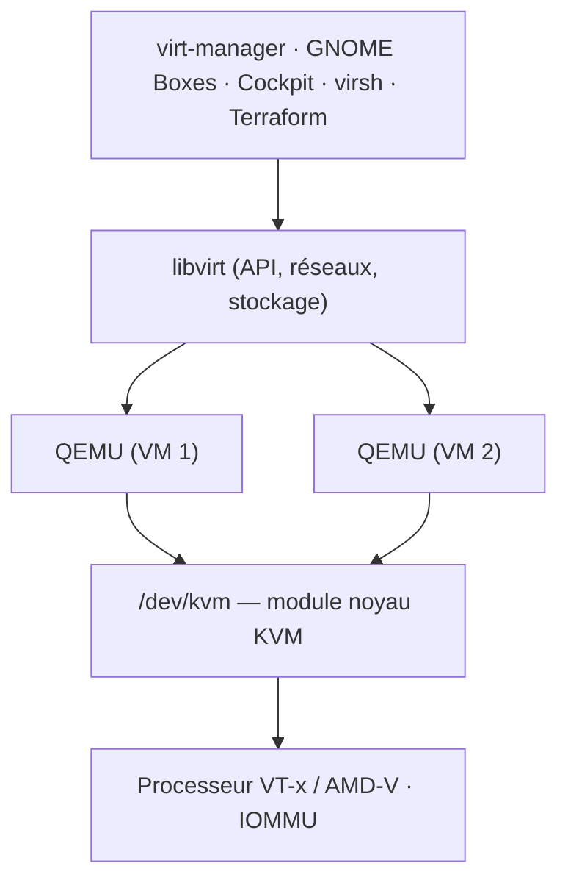

La virtualisation native de Linux repose sur trois briques complémentaires, utilisées aussi par [[11-proxmox-ve/01-presentation-installation|Proxmox VE]], OpenStack, oVirt et la plupart des clouds publics :

| Brique | Rôle | Licence |
| --- | --- | --- |
| **KVM** (*Kernel-based Virtual Machine*) | Module du noyau Linux qui transforme Linux en hyperviseur de type 1 grâce à VT-x/AMD-V | GPL |
| **QEMU** | Émulateur et moniteur de machines : processeur virtuel, disques, cartes réseau, BIOS/UEFI. Avec KVM il exécute le code invité à vitesse native ; sans KVM il émule (lent) | GPL |
| **libvirt** | Couche de gestion : API, démon (`libvirtd` ou démons modulaires `virtqemud`…), réseaux virtuels, pools de stockage, migration à chaud ; outil en ligne de commande `virsh` | LGPL |

Interfaces graphiques au-dessus de libvirt : **virt-manager**, **GNOME Boxes**, **Cockpit** (module *Machines*) — voir [[03-interface-graphique|Interface graphique]].



## Prérequis

```bash
# Le processeur expose-t-il la virtualisation ? (vmx = Intel, svm = AMD ; > 0 = oui)
grep -Ec '(vmx|svm)' /proc/cpuinfo
# Vérification complète (paquet libvirt-clients / libvirt)
virt-host-validate qemu
# Modules chargés
lsmod | grep kvm
```

Activez **VT-x/AMD-V** et **VT-d/AMD-Vi (IOMMU)** dans le BIOS/UEFI (l'IOMMU sert au *passthrough* PCI). Dans une VM (virtualisation imbriquée), activez le *nested* sur l'hôte : `cat /sys/module/kvm_intel/parameters/nested` doit valoir `Y`.

## Installation

### Debian / Ubuntu

```bash
sudo apt update
sudo apt install qemu-system-x86 qemu-utils libvirt-daemon-system libvirt-clients virtinst bridge-utils ovmf
sudo systemctl enable --now libvirtd
sudo usermod -aG libvirt,kvm "$USER"     # gérer les VM sans sudo (reconnexion nécessaire)
virsh --connect qemu:///system list --all
```

Poste de travail : ajoutez `virt-manager` (ou `gnome-boxes`).

### RHEL / Rocky / Alma / Oracle Linux / Fedora

```bash
sudo dnf install @virtualization        # groupe : qemu-kvm, libvirt, virt-install, virt-viewer
# ou, au plus juste :
sudo dnf install qemu-kvm libvirt virt-install edk2-ovmf
sudo systemctl enable --now libvirtd     # Fedora / RHEL 9+ : démons modulaires, voir ci-dessous
sudo usermod -aG libvirt "$USER"
```

Sur RHEL 9 et Fedora, libvirt utilise des **démons modulaires** (`virtqemud`, `virtnetworkd`, `virtstoraged`…) activés par socket :

```bash
for d in qemu network nodedev nwfilter secret storage interface; do sudo systemctl enable --now virt${d}d.socket; done
```

### openSUSE

```bash
sudo zypper install -t pattern kvm_server kvm_tools
sudo systemctl enable --now libvirtd
```

### Arch Linux

```bash
sudo pacman -S qemu-full libvirt virt-install dnsmasq edk2-ovmf
sudo systemctl enable --now libvirtd
sudo usermod -aG libvirt "$USER"
```

### Alpine Linux

```bash
apk add qemu-system-x86_64 qemu-img libvirt-daemon libvirt-client
rc-update add libvirtd && rc-service libvirtd start
```

### Windows (QEMU seul)

KVM n'existe que sous Linux ; sous Windows, QEMU s'accélère avec **WHPX** (*Windows Hypervisor Platform*, la couche d'Hyper-V).

```powershell
winget install SoftwareFreedomConservancy.QEMU
Enable-WindowsOptionalFeature -Online -FeatureName HypervisorPlatform   # puis redémarrer
& "C:\Program Files\qemu\qemu-img.exe" create -f qcow2 C:\VM\debian.qcow2 30G
& "C:\Program Files\qemu\qemu-system-x86_64.exe" -accel whpx -m 4096 -smp 2 `
  -drive file=C:\VM\debian.qcow2,if=virtio -cdrom C:\ISO\debian-13-amd64-netinst.iso -boot d -nic user,model=virtio-net-pci
```

Pour un usage graphique quotidien sous Windows, [[09-hyper-v/01-presentation-installation|Hyper-V]] ou [[12-virtualbox/01-installation-utilisation|VirtualBox]] sont plus simples.

### macOS (QEMU seul)

QEMU s'accélère avec **HVF** (*Hypervisor.framework*) ; [[16-utm/01-presentation-installation|UTM]] en fournit une interface graphique.

```bash
brew install qemu
qemu-img create -f qcow2 ~/VM/debian.qcow2 30G
# Mac Apple Silicon : invité ARM64 accéléré (UEFI fourni par QEMU)
qemu-system-aarch64 -machine virt -accel hvf -cpu host -m 4096 -smp 4 \
  -bios "$(brew --prefix qemu)/share/qemu/edk2-aarch64-code.fd" \
  -drive file=~/VM/debian.qcow2,if=virtio -cdrom ~/ISO/debian-13-arm64-netinst.iso -nic user,model=virtio-net-pci
```

## Première machine virtuelle (virt-install)

```bash
# Depuis une ISO, en UEFI, avec console série (installation sans interface graphique)
sudo virt-install \
  --name srv-web-01 --memory 4096 --vcpus 2 --cpu host-passthrough \
  --disk path=/var/lib/libvirt/images/srv-web-01.qcow2,size=40,bus=virtio,discard=unmap \
  --network network=default,model=virtio \
  --os-variant debian12 --boot uefi \
  --location https://deb.debian.org/debian/dists/stable/main/installer-amd64/ \
  --graphics none --extra-args "console=ttyS0,115200n8"

# Depuis une image cloud + cloud-init (déploiement en quelques secondes)
sudo wget -P /var/lib/libvirt/images https://cloud.debian.org/images/cloud/trixie/latest/debian-13-genericcloud-amd64.qcow2
sudo qemu-img create -f qcow2 -F qcow2 -b /var/lib/libvirt/images/debian-13-genericcloud-amd64.qcow2 \
  /var/lib/libvirt/images/srv-app-01.qcow2 20G
sudo virt-install --name srv-app-01 --memory 2048 --vcpus 2 --import \
  --disk /var/lib/libvirt/images/srv-app-01.qcow2,bus=virtio --os-variant debian12 \
  --network bridge=br0,model=virtio --graphics none --noautoconsole \
  --cloud-init root-ssh-key=$HOME/.ssh/id_ed25519.pub
```

`osinfo-query os | grep -i debian` liste les valeurs possibles de `--os-variant`.

| Réglage | Recommandation |
| --- | --- |
| Disque | Format **qcow2** (instantanés, allocation fine) ou volume LVM/ZFS brut pour les bases de données ; bus **virtio** ; `discard=unmap` sur SSD |
| Processeur | `host-passthrough` (performances) ; modèle nommé (`--cpu Skylake-Server`) si migration entre processeurs différents |
| Réseau | **virtio** ; pont `br0` pour une VM visible du réseau, réseau NAT `default` pour un labo |
| Microprogramme | UEFI (`--boot uefi`, paquet OVMF/edk2) ; TPM logiciel (`swtpm`) pour Windows 11 : `--tpm backend.type=emulator,model=tpm-crb` |
| Agent invité | Paquet `qemu-guest-agent` dans la VM : arrêt propre, adresse IP, gel des systèmes de fichiers pour les sauvegardes |

Invité Windows : montez l'ISO **virtio-win** (pilotes disque, réseau, ballon mémoire, agent) pendant l'installation.

Suite : [[02-libvirt-reseau-stockage|réseaux, stockage, instantanés et migration]].
