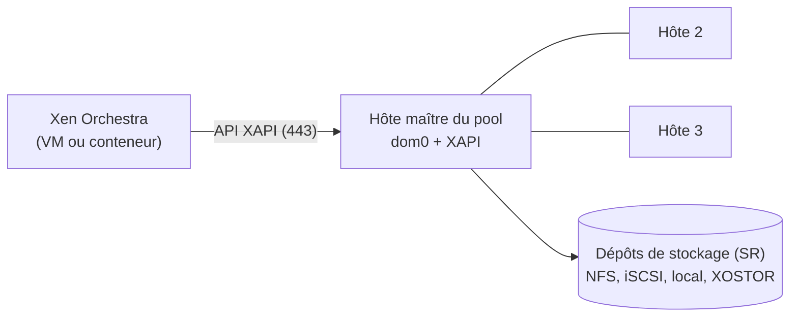

**Xen** (Linux Foundation, GPL) est un hyperviseur de **type 1** : il démarre avant tout système et exécute un domaine privilégié, **dom0** (un Linux qui pilote le matériel et administre), et les machines invitées **domU**. Il équipe historiquement AWS EC2 et Citrix Hypervisor.

**XCP-ng** (*Xen Cloud Platform – next generation*, projet Linux Foundation porté par **Vates**) est la distribution libre et complète de Xen : hyperviseur, dom0 prêt à l'emploi, pile de gestion **XAPI** (pools, migration, haute disponibilité), outil `xe`, et l'interface web **Xen Orchestra**. C'est l'alternative libre à Citrix XenServer et à VMware vSphere.

| Mode d'invité | Principe | Usage |
| --- | --- | --- |
| **HVM** | Virtualisation matérielle complète (VT-x/AMD-V), pilotes PV pour disque et réseau | Windows, Linux — mode par défaut de XCP-ng |
| **PV** | Invité modifié, sans assistance matérielle | Ancien, déconseillé |
| **PVH** | Hybride léger, sans émulation de matériel | Linux et BSD modernes |

| Version | Notes |
| --- | --- |
| XCP-ng 8.2 LTS | Ancienne version longue durée |
| **XCP-ng 8.3 LTS** | Version longue durée actuelle (UEFI, Secure Boot, vTPM, IPv6 de gestion) |

## Architecture



Un **pool** regroupe jusqu'à 64 hôtes identiques ; l'un est **maître** (reçoit les appels API). Le stockage partagé (*SR*, *Storage Repository*) permet la migration à chaud et la haute disponibilité.

## Prérequis

| Élément | Recommandation |
| --- | --- |
| Processeur | 64 bits avec VT-x/AMD-V ; VT-d/AMD-Vi pour le passthrough |
| Mémoire | 8 Go minimum (dom0 en prend 2 à 4 Go), davantage selon les VM |
| Disque système | 46 Go minimum (SSD), RAID1 matériel ou logiciel |
| Réseau | Interfaces séparées : gestion, stockage, VM (VLAN), migration |
| Compatibilité | Liste matérielle (HCL) de XCP-ng ; cartes RAID et réseau courantes prises en charge |

## Installation de XCP-ng

1. Télécharger l'ISO sur `xcp-ng.org`, l'écrire sur une clé USB (`dd if=xcp-ng-8.3.0.iso of=/dev/sdX bs=4M status=progress`) ou la monter par l'iLO/iDRAC.
2. Démarrer : clavier `fr`, disque système, *Local storage* (EXT, allocation fine, conseillé) sur le même disque ou un autre, mot de passe **root**.
3. Réseau de gestion : interface, **adresse IP fixe** (`10.0.20.31/24`), passerelle, DNS, **nom d'hôte FQDN** (`xcp-01.corp.exemple.fr`), serveur NTP.
4. Redémarrer : la console **xsconsole** s'affiche (réseau, stockage, redémarrage des services, mises à jour).

```bash
# Sur l'hôte (SSH root ou console) : mises à jour
yum update -y && reboot
xe host-list params=name-label,address,software-version
```

## Premier accès

| Interface | Accès | Remarque |
| --- | --- | --- |
| **XO Lite** | `https://xcp-01.corp.exemple.fr` (intégré à l'hôte) | Gestion d'un seul hôte, premiers pas |
| **Xen Orchestra (XOA)** | Appliance de Vates, déployée depuis XO Lite ou `bash -c "$(curl -sS https://xoa.io/deploy)"` | Gestion complète du parc, sauvegardes ; fonctions selon l'abonnement |
| **Xen Orchestra « depuis les sources »** | Installation manuelle sur une VM Debian (Node.js, Yarn) | Toutes les fonctions, sans support |

Voir [[03-interface-graphique|Interface graphique (Xen Orchestra)]].

## Première VM en ligne de commande (xe)

```bash
xe sr-list params=uuid,name-label,type
xe template-list | grep -i "name-label ( RW): Debian"
UUID=$(xe vm-install template="Debian Bookworm 12" new-name-label=srv-web-01 sr-name-label="Local storage")
xe vif-create vm-uuid=$UUID network-uuid=$(xe network-list bridge=xenbr0 --minimal) device=0
xe vm-cd-add vm=srv-web-01 cd-name="debian-13-amd64-netinst.iso" device=3   # ISO dans un SR ISO
xe vm-memory-limits-set vm=srv-web-01 static-min=2GiB dynamic-min=2GiB dynamic-max=4GiB static-max=4GiB
xe vm-param-set uuid=$UUID VCPUs-max=2 VCPUs-at-startup=2
xe vm-start vm=srv-web-01
```

**Outils invités** (indispensables : arrêt propre, adresses IP, migration, mémoire dynamique) :

```bash
# Debian / Ubuntu invité
sudo apt install xe-guest-utilities || sudo apt install xen-guest-agent
# RHEL / Rocky invité : paquet xe-guest-utilities-latest (dépôt de XCP-ng) ou ISO « guest-tools » montée dans la VM
```

Windows : pilotes **XCP-ng Windows PV Tools** (signés) installés depuis le site de XCP-ng ou l'ISO des outils.

## Xen « nu » sur Debian

Pour un laboratoire ou un hôte unique sans XAPI, Xen s'installe sur Debian et s'administre avec `xl` :

```bash
sudo apt install xen-system-amd64 xen-tools
sudo reboot                                   # GRUB démarre désormais Xen puis Debian (dom0)
sudo xl info | grep -e xen_version -e total_memory
# Image Debian prête à l'emploi (xen-tools)
sudo xen-create-image --hostname=srv-test-01 --dist=bookworm --memory=1024M --vcpus=2 \
  --lvm=vg0 --size=20G --ip=10.0.20.41 --gateway=10.0.20.1 --netmask=255.255.255.0 --pygrub
sudo xl create /etc/xen/srv-test-01.cfg
sudo xl list
sudo xl console srv-test-01                   # Ctrl+] pour quitter
```

Xen fonctionne aussi comme dom0 **FreeBSD** (`pkg install xen-kernel xen-tools`), mais KVM ([[14-kvm-qemu-libvirt/01-presentation-installation|KVM, QEMU et libvirt]]) est plus répandu sous Linux.

Suite : [[02-pool-stockage-reseau-sauvegarde|pools, stockage, réseau et sauvegarde]].
