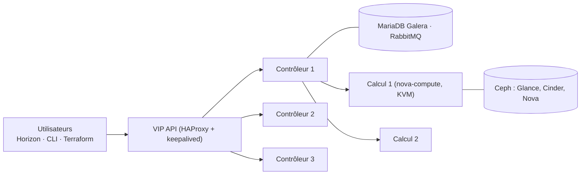

**OpenStack** (OpenInfra Foundation, Apache 2.0) est une plateforme de **cloud privé IaaS** : libre-service de machines virtuelles, réseaux, volumes et stockage objet par API, avec projets (locataires), quotas et facturation à l'usage. Utilisée par des opérateurs, des hébergeurs et de grandes entreprises ; plus lourde à exploiter qu'un hyperviseur comme [[11-proxmox-ve/01-presentation-installation|Proxmox VE]].

| Service | Rôle |
| --- | --- |
| **Keystone** | Identité : utilisateurs, projets, rôles, catalogue des services, jetons |
| **Nova** | Calcul : création et cycle de vie des instances (KVM via libvirt) |
| **Placement** | Inventaire des ressources des hôtes pour l'ordonnancement |
| **Neutron** | Réseau : réseaux de projet, routeurs, IP flottantes, groupes de sécurité (OVN ou Open vSwitch) |
| **Glance** | Images (qcow2, raw) |
| **Cinder** | Volumes blocs (LVM, Ceph RBD, baies SAN) |
| **Swift** / Ceph RGW | Stockage objet compatible S3 |
| **Horizon** | Tableau de bord web — voir [[03-interface-graphique\|interface graphique]] |
| Octavia, Heat, Magnum, Designate | Répartition de charge, orchestration, Kubernetes, DNS |

Deux versions par an (`AAAA.1` au printemps, `AAAA.2` à l'automne), chacune portant un nom (2025.1 *Epoxy*, 2025.2 *Flamingo*…) ; les versions « SLURP » permettent de sauter une version lors des mises à jour.

## Architecture type



Trois contrôleurs (API, bases, files de messages), N nœuds de calcul, un réseau de fournisseur (sortie Internet, IP flottantes), et idéalement **Ceph** pour le stockage partagé.

## Méthodes de déploiement

| Outil | Usage |
| --- | --- |
| **DevStack** | Laboratoire de développement sur une seule VM ; jamais en production |
| **Kolla-Ansible** | Production : chaque service dans un conteneur, déploiement et mises à jour par Ansible — le plus répandu |
| OpenStack-Ansible | Production : services en conteneurs LXC ou sur l'hôte |
| Canonical Sunbeam / Charmed OpenStack | Ubuntu, avec snaps et Juju |
| Distributions commerciales | Red Hat OpenStack Services on OpenShift, Mirantis… |

## Déploiement avec Kolla-Ansible (tout-en-un de démonstration)

Hôte Ubuntu 24.04 ou Rocky 9, 8 vCPU, 16 Go, 100 Go, **deux interfaces** (`ens3` gestion avec IP, `ens4` sans IP pour le réseau externe).

```bash
sudo apt install -y git python3-dev libffi-dev gcc libssl-dev python3-venv
python3 -m venv ~/kolla && source ~/kolla/bin/activate
pip install -U pip
pip install 'ansible-core>=2.17,<2.19'
pip install git+https://opendev.org/openstack/kolla-ansible@stable/2025.2
kolla-ansible install-deps
sudo mkdir -p /etc/kolla && sudo chown $USER:$USER /etc/kolla
cp -r ~/kolla/share/kolla-ansible/etc_examples/kolla/* /etc/kolla/
cp ~/kolla/share/kolla-ansible/ansible/inventory/all-in-one .
kolla-genpwd                                     # génère /etc/kolla/passwords.yml
```

```yaml /etc/kolla/globals.yml (extrait)
kolla_base_distro: "ubuntu"
kolla_internal_vip_address: "10.0.20.250"       # adresse libre du réseau de gestion
network_interface: "ens3"
neutron_external_interface: "ens4"
neutron_plugin_agent: "ovn"
enable_cinder: "yes"
enable_cinder_backend_lvm: "yes"                 # labo ; Ceph en production
```

```bash
kolla-ansible bootstrap-servers -i all-in-one
kolla-ansible prechecks -i all-in-one
kolla-ansible deploy -i all-in-one
kolla-ansible post-deploy -i all-in-one          # crée /etc/kolla/admin-openrc.sh
pip install python-openstackclient
source /etc/kolla/admin-openrc.sh
openstack service list
```

Production : inventaire `multinode` (3 contrôleurs, calcul, stockage), certificats TLS (`kolla_enable_tls_external`), Ceph externe, sauvegarde de MariaDB (`kolla-ansible mariadb_backup`).

## DevStack (laboratoire)

```bash
sudo useradd -s /bin/bash -d /opt/stack -m stack && echo "stack ALL=(ALL) NOPASSWD: ALL" | sudo tee /etc/sudoers.d/stack
sudo -u stack -i
git clone https://opendev.org/openstack/devstack && cd devstack
cat > local.conf <<'EOF'
[[local|localrc]]
ADMIN_PASSWORD=Labo-Openstack-2026
DATABASE_PASSWORD=$ADMIN_PASSWORD
RABBIT_PASSWORD=$ADMIN_PASSWORD
SERVICE_PASSWORD=$ADMIN_PASSWORD
HOST_IP=10.0.20.60
EOF
./stack.sh
```

## Premiers pas

```bash
openstack image create debian-13 --disk-format qcow2 --container-format bare --public \
  --file debian-13-genericcloud-amd64.qcow2
openstack flavor create m1.small --vcpus 1 --ram 2048 --disk 20
openstack network create interne && openstack subnet create interne-v4 --network interne --subnet-range 192.168.10.0/24 --dns-nameserver 10.0.10.53
openstack router create routeur && openstack router set routeur --external-gateway public && openstack router add subnet routeur interne-v4
openstack security group rule create default --protocol tcp --dst-port 22 --remote-ip 10.0.0.0/8
openstack keypair create --public-key ~/.ssh/id_ed25519.pub admin
openstack server create srv-web-01 --image debian-13 --flavor m1.small --network interne --key-name admin
openstack floating ip create public && openstack server add floating ip srv-web-01 <ip>
```

Suite : [[02-exploitation|exploitation]] · [[90-aide-memoire|aide-mémoire]].
