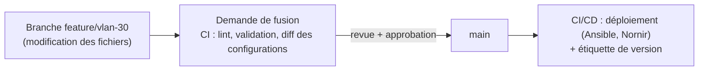

## Commandes du quotidien

| Commande | Rôle |
| --- | --- |
| `git status` | Fichiers modifiés, indexés, non suivis |
| `git diff` / `git diff --staged` | Différences non indexées / indexées |
| `git add -p` | Indexer par morceaux (revue avant commit) |
| `git commit -m "…"` | Enregistrer |
| `git log --oneline --graph --all` | Historique en graphe |
| `git log -p -- routeurs/r1.cfg` | Historique d'un fichier avec les différences |
| `git blame routeurs/r1.cfg` | Qui a modifié chaque ligne |
| `git show <commit>` | Détail d'un commit |
| `git pull` / `git push` | Synchroniser avec le distant |

## Annuler

| Situation | Commande |
| --- | --- |
| Abandonner les modifications d'un fichier | `git restore fichier` |
| Retirer un fichier de l'index | `git restore --staged fichier` |
| Corriger le dernier commit (non poussé) | `git commit --amend` |
| Annuler un commit **déjà partagé** | `git revert <commit>` (crée un commit inverse) |
| Revenir localement à un état antérieur (non partagé) | `git reset --hard <commit>` (destructif) |
| Retrouver un commit « perdu » | `git reflog` |

> [!WARNING]
> Ne réécrivez pas (`reset`, `rebase`, `push --force`) une branche **partagée** : les autres clones divergent. Sur les branches protégées, la forge doit l'interdire.

## Branches

```bash
git switch -c feature/vlan-30-lyon       # créer et basculer
# … modifications, commits …
git push -u origin feature/vlan-30-lyon  # publier la branche
git switch main && git pull
git merge --no-ff feature/vlan-30-lyon   # fusion avec commit de fusion
git branch -d feature/vlan-30-lyon
git push origin --delete feature/vlan-30-lyon
```

### Fusion ou rebasage

| Méthode | Effet | Usage |
| --- | --- | --- |
| `git merge` | Commit de fusion, historique réel conservé | Intégrer une branche terminée |
| `git rebase main` | Rejoue les commits de la branche au-dessus de `main` : historique linéaire | Mettre à jour **sa** branche avant de la proposer |
| *Squash* (forge) | Un seul commit pour toute la branche | Historique de `main` lisible |

### Conflits

```bash
git merge feature/acl-dmz
# CONFLICT (content): Merge conflict in pare-feu/dmz.conf
git status                     # fichiers en conflit
# éditer : garder la bonne version entre <<<<<<<, ======= et >>>>>>>
git add pare-feu/dmz.conf
git commit                     # (ou git rebase --continue)
git merge --abort              # abandonner la fusion
```

## Étiquettes et versions

```bash
git tag -a v2025.10.29 -m "Configuration déployée le 29/10/2025"
git push origin v2025.10.29
git tag -l "v2025*"
git checkout v2025.10.29 -- routeurs/r1.cfg     # récupérer un fichier tel qu'à cette version
```

## Remiser

```bash
git stash push -m "essai en cours"
git stash list
git stash pop
```

## Ce qui ne doit pas entrer dans Git

```text .gitignore
# Secrets et fichiers locaux
*.key
*.pem
.env
secrets/
*.tfstate
*.tfstate.backup
.terraform/
# Fichiers générés
__pycache__/
*.retry
.DS_Store
Thumbs.db
```

> [!IMPORTANT]
> Un secret commité reste dans l'**historique** même après suppression du fichier. Changez immédiatement le secret, puis nettoyez l'historique (`git filter-repo`) si nécessaire. Prévenez avec des outils comme **gitleaks** (hook `pre-commit`, CI) et chiffrez les secrets nécessaires (Ansible Vault, SOPS).

## Flux de travail

| Flux | Principe | Adapté à |
| --- | --- | --- |
| **Trunk-based** | Branches courtes, fusion fréquente dans `main`, déploiement continu | Infrastructure as code, équipes réduites |
| **GitLab flow** | `main` + branches d'environnement ou de version | Déploiements par environnement (recette → production) |
| Git flow | `develop`, `release/*`, `hotfix/*` | Logiciels à versions planifiées |

### Exemple : configurations réseau



- `main` **protégée** : pas de push direct, fusion après revue et CI verte.
- La CI valide la syntaxe (yamllint, ansible-lint), génère les configurations et en montre le **diff**.
- Messages de commit explicites : `r1-lyon : ajout du VLAN 30 (téléphonie)` ou conventions *Conventional Commits* (`feat:`, `fix:`).
