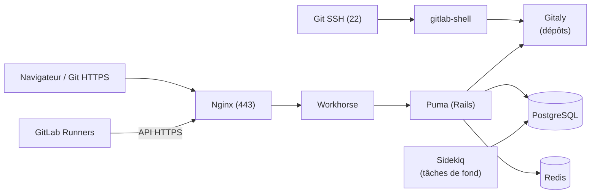

**GitLab** réunit dans une seule application la gestion des dépôts Git, les **demandes de fusion** (revue de code), l'**intégration et le déploiement continus**, les registres (conteneurs, paquets), les tickets, le wiki et la sécurité applicative. Il s'auto-héberge facilement grâce au paquet **Omnibus**, qui embarque tous les composants.

## Éditions

| Édition | Licence | Remarque |
| --- | --- | --- |
| **CE** (Community) | MIT | Fonctions de base complètes (dépôts, CI/CD, registre, LDAP) |
| **EE** (Enterprise) sans licence | Propriétaire, fonctionne comme CE | Recommandé par GitLab : passage à un palier payant sans réinstallation |
| EE Premium / Ultimate | Abonnement | Groupes LDAP synchronisés, approbations multiples, sécurité avancée, géo-réplication |

## Architecture



## Dimensionnement

| Utilisateurs | Ressources indicatives (installation unique) |
| --- | --- |
| Jusqu'à ~500 | 4 vCPU, 8 Go de RAM (16 Go confortables), disque SSD selon les dépôts |
| ~1 000 | 8 vCPU, 16 Go |
| Au-delà | Architectures de référence (composants séparés, haute disponibilité) |

Les **runners** CI s'exécutent sur d'autres machines.

## Installation (Omnibus)

### Debian / Ubuntu

```bash
sudo apt install -y curl ca-certificates openssh-server perl tzdata
curl -fsSL https://packages.gitlab.com/install/repositories/gitlab/gitlab-ee/script.deb.sh | sudo bash
sudo EXTERNAL_URL="https://gitlab.corp.exemple.fr" GITLAB_ROOT_PASSWORD='MotDePasseInitialLong!' apt install gitlab-ee
```

### RHEL / Rocky / Alma

```bash
sudo dnf install -y curl policycoreutils openssh-server perl
curl -fsSL https://packages.gitlab.com/install/repositories/gitlab/gitlab-ee/script.rpm.sh | sudo bash
sudo EXTERNAL_URL="https://gitlab.corp.exemple.fr" dnf install -y gitlab-ee
sudo firewall-cmd --permanent --add-service={http,https,ssh} && sudo firewall-cmd --reload
```

Sans `GITLAB_ROOT_PASSWORD`, le mot de passe initial de `root` est dans `/etc/gitlab/initial_root_password` (supprimé automatiquement après 24 h).

### Docker

```bash
docker run -d --name gitlab --hostname gitlab.corp.exemple.fr --shm-size 256m \
  -p 443:443 -p 80:80 -p 2222:22 \
  -e GITLAB_OMNIBUS_CONFIG="external_url 'https://gitlab.corp.exemple.fr'; gitlab_rails['gitlab_shell_ssh_port'] = 2222" \
  -v /srv/gitlab/config:/etc/gitlab -v /srv/gitlab/logs:/var/log/gitlab -v /srv/gitlab/data:/var/opt/gitlab \
  gitlab/gitlab-ee:latest
```

Windows et macOS ne sont pas pris en charge comme serveurs (Docker possible pour des tests).

## gitlab.rb : paramètres essentiels

```gitlabrb /etc/gitlab/gitlab.rb (extrait)
external_url 'https://gitlab.corp.exemple.fr'

# Certificat de l'AC interne (sinon letsencrypt['enable'] = true pour un nom public)
letsencrypt['enable'] = false
nginx['ssl_certificate'] = "/etc/gitlab/ssl/gitlab.corp.exemple.fr.crt"
nginx['ssl_certificate_key'] = "/etc/gitlab/ssl/gitlab.corp.exemple.fr.key"
nginx['redirect_http_to_https'] = true

# Fuseau horaire et courriel
gitlab_rails['time_zone'] = 'Europe/Paris'
gitlab_rails['gitlab_email_from'] = 'gitlab@exemple.fr'
gitlab_rails['smtp_enable'] = true
gitlab_rails['smtp_address'] = "relais.corp.exemple.fr"
gitlab_rails['smtp_port'] = 25
gitlab_rails['smtp_tls'] = false
gitlab_rails['smtp_enable_starttls_auto'] = true

# Registre de conteneurs
registry_external_url 'https://registre-gitlab.corp.exemple.fr'
```

```bash
sudo gitlab-ctl reconfigure        # applique gitlab.rb (à relancer après chaque modification)
sudo gitlab-ctl status
```

## Premier accès

1. Se connecter en `root`, changer le mot de passe, activer la **double authentification**.
2. *Admin → Settings → General → Sign-up restrictions* : **désactiver l'inscription libre** (ou la restreindre à un domaine avec approbation).
3. Créer des groupes (`reseau`, `systeme`), y ranger les projets, attribuer les rôles.
4. Configurer l'authentification par l'annuaire ([[02-configuration-ldap-securite]]).

## Suite du parcours

1. [[02-configuration-ldap-securite|LDAP / Active Directory et sécurité]]
2. [[03-ci-cd-runners|CI/CD et GitLab Runner]]
3. [[04-sauvegarde-exploitation-depannage|Sauvegarde, mises à jour et dépannage]]
