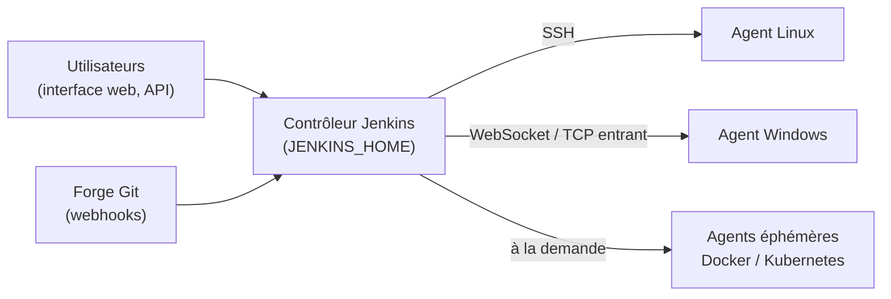

**Jenkins** est le serveur d'intégration et de déploiement continus libre le plus répandu. Son écosystème de plus de 1 800 **greffons** lui permet d'automatiser à peu près tout : compilation, tests, déploiements, tâches d'exploitation planifiées, sauvegardes de configurations réseau…

## Architecture



| Élément | Rôle |
| --- | --- |
| **Contrôleur** | Interface, ordonnancement, configuration, historique (`JENKINS_HOME`) |
| **Agents** | Exécutent les builds (le contrôleur ne devrait exécuter aucun build : 0 exécuteur intégré) |
| Greffons | Fonctions (Git, Pipeline, LDAP, Docker, Kubernetes…) |
| Job / Pipeline | Tâche automatisée ; un **Pipeline** est décrit en code (`Jenkinsfile`) |

## Versions et prérequis

- Lignes **LTS** (stable, toutes les 12 semaines, correctifs) et hebdomadaire. Utilisez la LTS en production.
- **Java 17 ou 21** requis (versions récentes).
- Ressources : 2 vCPU, 4 Go de RAM au minimum pour le contrôleur ; disque selon l'historique conservé.

## Installation

### Debian / Ubuntu

```bash
sudo apt install -y fontconfig openjdk-17-jre
sudo wget -O /etc/apt/keyrings/jenkins-keyring.asc https://pkg.jenkins.io/debian-stable/jenkins.io-2023.key
echo "deb [signed-by=/etc/apt/keyrings/jenkins-keyring.asc] https://pkg.jenkins.io/debian-stable binary/" \
  | sudo tee /etc/apt/sources.list.d/jenkins.list
sudo apt update && sudo apt install jenkins
sudo systemctl enable --now jenkins
```

### RHEL / Rocky / Alma

```bash
sudo wget -O /etc/yum.repos.d/jenkins.repo https://pkg.jenkins.io/redhat-stable/jenkins.repo
sudo rpm --import https://pkg.jenkins.io/redhat-stable/jenkins.io-2023.key
sudo dnf install -y fontconfig java-17-openjdk jenkins
sudo systemctl enable --now jenkins
sudo firewall-cmd --permanent --add-port=8080/tcp && sudo firewall-cmd --reload
```

La clé de signature du dépôt change périodiquement : en cas d'erreur de signature, récupérez la clé courante indiquée sur `pkg.jenkins.io`.

### Windows, macOS, Docker

| Plate-forme | Installation |
| --- | --- |
| Windows | Installateur MSI LTS (service *Jenkins*, compte de service à choisir, JDK 17/21 requis) |
| macOS | `brew install jenkins-lts && brew services start jenkins-lts` |
| Docker | `docker run -d --name jenkins -p 8080:8080 -p 50000:50000 -v jenkins_home:/var/jenkins_home jenkins/jenkins:lts-jdk21` |

## Premier démarrage

```bash
sudo cat /var/lib/jenkins/secrets/initialAdminPassword
```

1. Ouvrir `http://serveur:8080`, saisir le mot de passe initial.
2. Installer les **greffons suggérés** (Git, Pipeline, Credentials, etc.).
3. Créer le compte administrateur, définir l'**URL de Jenkins** (*Manage Jenkins → System → Jenkins URL*).
4. *Manage Jenkins → Nodes → Built-In Node* : **0 exécuteur**.

## Réglages du service

```bash
sudo systemctl edit jenkins
```

```ini Surcharge systemd
[Service]
Environment="JENKINS_PORT=8080"
Environment="JENKINS_LISTEN_ADDRESS=127.0.0.1"
Environment="JAVA_OPTS=-Xms1g -Xmx4g -Djava.awt.headless=true"
```

| Élément | Emplacement (Linux) |
| --- | --- |
| `JENKINS_HOME` | `/var/lib/jenkins` (configuration, jobs, greffons, historique) |
| Journaux | `journalctl -u jenkins` |
| Port des agents entrants (TCP) | 50000 (ou WebSocket sur 443, sans port supplémentaire) |

## Reverse proxy

```nginx /etc/nginx/sites-available/jenkins.conf (extrait)
location / {
    proxy_pass http://127.0.0.1:8080;
    proxy_http_version 1.1;
    proxy_set_header Host $host;
    proxy_set_header X-Real-IP $remote_addr;
    proxy_set_header X-Forwarded-For $proxy_add_x_forwarded_for;
    proxy_set_header X-Forwarded-Proto $scheme;
    proxy_set_header Upgrade $http_upgrade;          # agents en WebSocket
    proxy_set_header Connection "upgrade";
    proxy_request_buffering off;
    client_max_body_size 100m;
}
```

Si l'avertissement « *It appears that your reverse proxy set up is broken* » apparaît, vérifiez l'URL de Jenkins et les en-têtes `X-Forwarded-*`.

## Suite du parcours

1. [[02-pipelines-agents|Pipelines, agents et identifiants]]
2. [[03-securite-exploitation|Sécurité, configuration as code et exploitation]]
