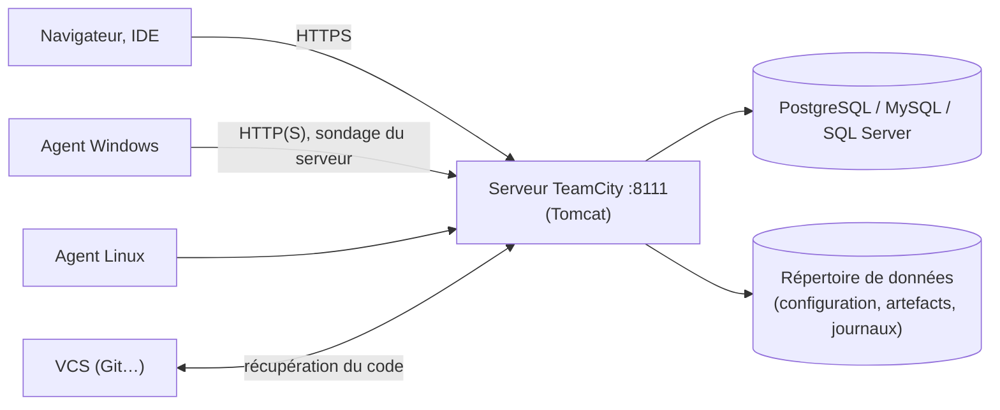

**TeamCity** est le serveur d'intégration continue de **JetBrains**. Très apprécié des équipes .NET, Java et Kotlin, il se distingue par une interface soignée, une configuration graphique ou en code (**Kotlin DSL**), des chaînes de builds avec dépendances, la réutilisation de builds identiques et des intégrations poussées (IDE JetBrains, Visual Studio, tests).

## Éditions

| Édition | Licence |
| --- | --- |
| **TeamCity On-Premises Professional** | Gratuite : jusqu'à 100 configurations de build et 3 agents (agents supplémentaires payants) |
| On-Premises Enterprise | Commerciale (configurations illimitées, fonctions avancées) |
| TeamCity Cloud | Service hébergé par JetBrains |

## Architecture



| Élément | Rôle |
| --- | --- |
| Serveur | Interface, configuration, file d'attente, historique, artefacts |
| **Agents** | Exécutent les builds ; se connectent **au serveur** (pas de port entrant nécessaire sur l'agent) |
| Répertoire de données | `TeamCity Data Directory` : configuration (`config/`), artefacts (`system/artifacts`) |
| Base de données | Historique, utilisateurs, statistiques |

## Installation du serveur

### Windows

Exécutable `TeamCity-<version>.exe` : installe le serveur (et un agent par défaut) comme services Windows, avec un JRE intégré. Port par défaut **8111**.

### Linux

```bash
sudo useradd -r -m -d /opt/teamcity -s /bin/bash teamcity
cd /opt && sudo -u teamcity curl -LO https://download.jetbrains.com/teamcity/TeamCity-2025.07.2.tar.gz
sudo -u teamcity tar -xzf TeamCity-2025.07.2.tar.gz -C /opt/teamcity --strip-components=1
sudo -u teamcity /opt/teamcity/bin/teamcity-server.sh start
```

```ini /etc/systemd/system/teamcity.service
[Unit]
Description=TeamCity Server
After=network.target postgresql.service

[Service]
Type=forking
User=teamcity
Environment="TEAMCITY_DATA_PATH=/srv/teamcity/data"
Environment="TEAMCITY_SERVER_MEM_OPTS=-Xmx4g"
ExecStart=/opt/teamcity/bin/teamcity-server.sh start
ExecStop=/opt/teamcity/bin/teamcity-server.sh stop

[Install]
WantedBy=multi-user.target
```

### Docker

```bash
docker run -d --name teamcity-server -p 8111:8111 \
  -v /srv/teamcity/data:/data/teamcity_server/datadir -v /srv/teamcity/logs:/opt/teamcity/logs \
  jetbrains/teamcity-server
docker run -d --name teamcity-agent -e SERVER_URL="https://teamcity.corp.exemple.fr" \
  -v /srv/teamcity/agent-conf:/data/teamcity_agent/conf jetbrains/teamcity-agent
```

## Premier démarrage

1. Ouvrir `http://serveur:8111`, choisir le répertoire de données.
2. Choisir une **base externe** (PostgreSQL recommandé ; la base interne HSQLDB ne convient qu'aux essais) et fournir le pilote JDBC si demandé.
3. Accepter la licence, créer le compte administrateur.

```bash
sudo -u postgres psql -c "CREATE ROLE teamcity LOGIN PASSWORD 'MotDePasse';"
sudo -u postgres psql -c "CREATE DATABASE teamcity OWNER teamcity ENCODING 'UTF8' TEMPLATE template0;"
```

## Agents

| Plate-forme | Installation |
| --- | --- |
| Windows | Installateur de l'agent (téléchargeable depuis *Agents → Install Build Agents*), service Windows |
| Linux / macOS | Archive `buildAgent.zip` ; `conf/buildAgent.properties` (`serverUrl`, `name`) puis `bin/agent.sh start` |
| Docker / Kubernetes | Images `jetbrains/teamcity-agent`, profils cloud (agents à la demande) |

Un nouvel agent apparaît comme **non autorisé** : l'administrateur l'autorise dans *Agents → Unauthorized*. Les agents ont besoin des outils de build (SDK .NET, JDK, Docker, Ansible…).

## Reverse proxy

Publiez TeamCity derrière Nginx/HAProxy en HTTPS (transmettre `Host`, `X-Forwarded-Proto`, et les en-têtes `Upgrade`/`Connection` pour les WebSockets de l'interface), puis déclarez l'URL publique dans *Administration → Global Settings → Server URL*.

## Suite

[[02-configuration-exploitation|Configuration des builds, sécurité et exploitation]]
