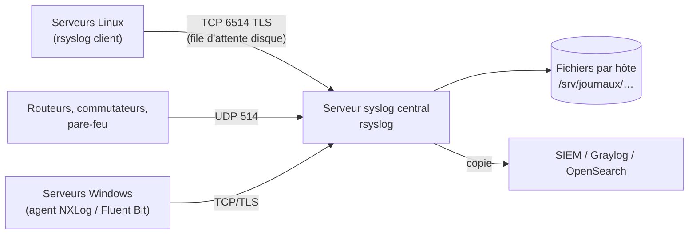

## Architecture



## Serveur central

```rsyslog /etc/rsyslog.d/00-serveur-central.conf
# Certificats (paquet rsyslog-gnutls)
global(
  DefaultNetstreamDriver="gtls"
  DefaultNetstreamDriverCAFile="/etc/rsyslog.d/tls/ca.crt"
  DefaultNetstreamDriverCertFile="/etc/rsyslog.d/tls/syslog.corp.exemple.fr.crt"
  DefaultNetstreamDriverKeyFile="/etc/rsyslog.d/tls/syslog.corp.exemple.fr.key"
)

module(load="imudp")
module(load="imtcp" StreamDriver.Name="gtls" StreamDriver.Mode="1" StreamDriver.AuthMode="x509/certvalid")
module(load="imrelp")

# UDP 514 pour les équipements réseau (restreint par pare-feu)
input(type="imudp" port="514" ruleset="distant")
# TLS 6514 pour les serveurs (certificat client signé par l'AC exigé)
input(type="imtcp" port="6514" ruleset="distant")
# RELP 2514 (transport sans perte)
input(type="imrelp" port="2514" ruleset="distant")

# Un fichier par hôte, par jour et par programme
template(name="ParHote" type="string"
         string="/srv/journaux/%FROMHOST%/%$YEAR%-%$MONTH%-%$DAY%/%PROGRAMNAME:::secpath-replace%.log")

ruleset(name="distant") {
    action(type="omfile" dynaFile="ParHote" dirCreateMode="0750" fileCreateMode="0640"
           dirOwner="syslog" dirGroup="adm" fileOwner="syslog" fileGroup="adm")
    # Copie vers le SIEM (voir l'article d'exploitation)
}
```

```bash
sudo mkdir -p /srv/journaux && sudo chown syslog:adm /srv/journaux
sudo rsyslogd -N1 && sudo systemctl restart rsyslog
sudo ss -lntup | grep -E ':(514|6514|2514)'
# Pare-feu : UDP 514 depuis les réseaux d'administration des équipements, TCP 6514/2514 depuis les serveurs
```

| Propriété du chemin | Signification |
| --- | --- |
| `%FROMHOST%` / `%FROMHOST-IP%` | Nom résolu / adresse de l'émetteur (préférez l'IP si le DNS inverse n'est pas fiable) |
| `%HOSTNAME%` | Nom annoncé dans le message (peut être faux ou absent) |
| `%PROGRAMNAME:::secpath-replace%` | Nom du programme, nettoyé pour un chemin sûr |

> [!TIP]
> Utilisez un **ruleset** dédié aux messages distants : ils ne se mélangent pas aux journaux locaux du serveur (`/var/log/syslog`) et n'y sont pas dupliqués.

## Client : transfert chiffré et fiable

```rsyslog /etc/rsyslog.d/90-vers-central.conf (serveurs Linux)
global(
  DefaultNetstreamDriverCAFile="/etc/rsyslog.d/tls/ca.crt"
  DefaultNetstreamDriverCertFile="/etc/rsyslog.d/tls/client.crt"
  DefaultNetstreamDriverKeyFile="/etc/rsyslog.d/tls/client.key"
)

# File d'attente assistée par disque : les messages sont conservés si le serveur est injoignable
action(type="omfwd"
       target="syslog.corp.exemple.fr" port="6514" protocol="tcp"
       StreamDriver="gtls" StreamDriverMode="1"
       StreamDriverAuthMode="x509/name" StreamDriverPermittedPeers="syslog.corp.exemple.fr"
       queue.type="LinkedList" queue.filename="vers_central"
       queue.maxDiskSpace="2g" queue.saveOnShutdown="on"
       action.resumeRetryCount="-1" action.resumeInterval="10")
```

| Paramètre | Rôle |
| --- | --- |
| `StreamDriverAuthMode="x509/name"` | Vérifie le certificat du serveur **et** son nom |
| `queue.type="LinkedList"` + `queue.filename` | File en mémoire débordant sur disque |
| `action.resumeRetryCount="-1"` | Réessayer indéfiniment |
| RELP (`omrelp`) | Alternative avec accusés applicatifs, chiffrable (`tls="on"`) |

## Équipements réseau

### Cisco IOS / IOS XE

```cisco
service timestamps log datetime msec localtime show-timezone
logging source-interface Vlan99
logging host 10.0.99.40 transport udp port 514
logging trap informational
logging facility local7
logging buffered 64000 informational
```

### Juniper Junos

```text
set system syslog host 10.0.99.40 any notice
set system syslog host 10.0.99.40 authorization info
set system syslog host 10.0.99.40 source-address 10.0.99.2
set system syslog time-format millisecond
```

### FortiGate

```text
config log syslogd setting
    set status enable
    set server "10.0.99.40"
    set mode reliable                 # TCP (RFC 6587) ; « udp » par défaut
    set port 514
    set format rfc5424
end
```

Synchronisez l'**heure** (NTP) de tous les équipements et envoyez des horodatages complets (fuseau, millisecondes) : sans cela, la corrélation des événements est impossible.

## Serveurs Windows

| Agent | Remarque |
| --- | --- |
| **NXLog Community Edition** | Lit les journaux d'événements et les envoie en syslog (TCP/TLS) ou JSON |
| [[03-fluent-bit/01-presentation-installation\|Fluent Bit]] (entrée `winevtlog`) | Léger, sorties multiples |
| Winlogbeat | Vers Logstash/Elasticsearch |
| Windows Event Forwarding | Collecte native vers un collecteur Windows (prévu dans la feuille de route), puis un agent sur le collecteur |
