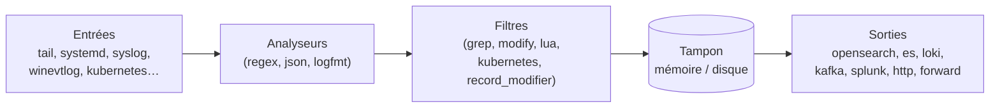

**Fluent Bit** (projet CNCF, écrit en C, licence Apache 2.0) collecte, analyse, filtre et transfère journaux, métriques et traces avec une très faible empreinte (quelques Mo de RAM). C'est l'agent de référence sur les serveurs, les objets connectés et dans **Kubernetes**, pour alimenter Elasticsearch/OpenSearch, Loki, Splunk, Graylog, Kafka, des services cloud, etc.



| Fluent Bit | Fluentd |
| --- | --- |
| C, très léger, agent | Ruby, plus lourd, agrégateur riche en greffons |
| Idéal sur chaque nœud | Souvent utilisé en agrégateur central (ou remplacé par Fluent Bit lui-même) |

## Installation

```bash
# Linux : script officiel (ajoute le dépôt et installe le paquet « fluent-bit »)
curl https://raw.githubusercontent.com/fluent/fluent-bit/master/install.sh | sh
sudo systemctl enable --now fluent-bit
/opt/fluent-bit/bin/fluent-bit --version
```

| Plate-forme | Installation |
| --- | --- |
| Debian / Ubuntu / RHEL | Dépôt `packages.fluentbit.io` (script ci-dessus) ; binaire dans `/opt/fluent-bit/bin/` |
| Windows | Installateur MSI ou ZIP ; service : `sc.exe create fluent-bit binpath= "\"C:\Program Files\fluent-bit\bin\fluent-bit.exe\" -c \"C:\Program Files\fluent-bit\conf\fluent-bit.yaml\""` |
| macOS | `brew install fluent-bit` |
| Docker | `docker run -v ./fluent-bit.yaml:/fluent-bit/etc/fluent-bit.yaml cr.fluentbit.io/fluent/fluent-bit -c /fluent-bit/etc/fluent-bit.yaml` |
| Kubernetes | Chart Helm `fluent/fluent-bit` (DaemonSet) — voir [[02-kubernetes-exploitation]] |

## Configuration YAML

Le format **YAML** est recommandé (le format « classique » `[INPUT]`/`[OUTPUT]` reste pris en charge).

```yaml /etc/fluent-bit/fluent-bit.yaml
service:
  flush: 5
  log_level: info
  http_server: on
  http_listen: 127.0.0.1
  http_port: 2020
  parsers_file: /etc/fluent-bit/parsers.conf
  storage.path: /var/lib/fluent-bit/tampon
  storage.sync: normal

pipeline:
  inputs:
    - name: tail
      tag: nginx.acces
      path: /var/log/nginx/access.log
      parser: nginx
      db: /var/lib/fluent-bit/tail-nginx.db
      storage.type: filesystem

    - name: systemd
      tag: systemd.ssh
      systemd_filter: _SYSTEMD_UNIT=ssh.service
      read_from_tail: on

    - name: syslog
      tag: reseau
      mode: udp
      listen: 0.0.0.0
      port: 5140
      parser: syslog-rfc3164

  filters:
    - name: record_modifier
      match: '*'
      record:
        - hote ${HOSTNAME}
        - site paris

  outputs:
    - name: opensearch
      match: '*'
      host: opensearch.corp.exemple.fr
      port: 9200
      tls: on
      tls.verify: on
      tls.ca_file: /etc/fluent-bit/ca.crt
      http_user: fluentbit
      http_passwd: ${OS_PASSWORD}
      suppress_type_name: on
      logstash_format: on
      logstash_prefix: logs-serveurs
```

| Élément | Rôle |
| --- | --- |
| **tag** | Étiquette d'un flux ; `match` des filtres et sorties s'y réfère (jokers `*`) |
| `db` (tail) | Mémorise la position de lecture : pas de doublons ni de pertes au redémarrage |
| `storage.type: filesystem` | Tampon sur **disque** : les journaux survivent à une indisponibilité de la sortie |
| `${VARIABLE}` | Variables d'environnement (secrets) |

## Windows

```yaml C:\Program Files\fluent-bit\conf\fluent-bit.yaml (extrait)
pipeline:
  inputs:
    - name: winevtlog
      tag: windows.evenements
      channels: Security,System,Application,Microsoft-Windows-Sysmon/Operational
      interval_sec: 1
      db: C:\ProgramData\fluent-bit\winevtlog.sqlite
      render_event_as_xml: false
  outputs:
    - name: forward
      match: '*'
      host: collecteur.corp.exemple.fr
      port: 24224
      tls: on
```

## Tester

```bash
/opt/fluent-bit/bin/fluent-bit -c /etc/fluent-bit/fluent-bit.yaml --dry-run      # validation
/opt/fluent-bit/bin/fluent-bit -i cpu -o stdout -f 1                              # essai rapide en ligne de commande
curl -s http://127.0.0.1:2020/api/v1/metrics | jq                                 # compteurs internes
```

## Suite

[[02-kubernetes-exploitation|Kubernetes, sorties, performances et dépannage]]
