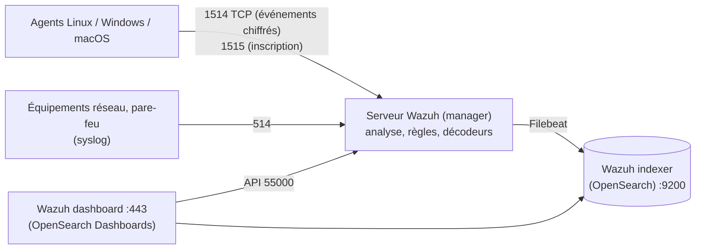

**Wazuh** (licence GPLv2, issu d'OSSEC) est une plate-forme de sécurité libre qui combine **SIEM** (collecte et corrélation des journaux) et **XDR/HIDS** (agents sur les postes et serveurs) : détection d'intrusions, **surveillance de l'intégrité des fichiers**, **inventaire et vulnérabilités**, **évaluation de configuration** (CIS), conformité (PCI DSS, RGPD, NIS2, ISO 27001), **réponse active** (blocage automatique).

## Architecture



| Composant | Rôle |
| --- | --- |
| **Wazuh indexer** | Stockage et recherche des alertes (fork d'OpenSearch) |
| **Wazuh server** (manager) | Reçoit les événements des agents et du syslog, applique **décodeurs** et **règles**, génère les alertes, pilote les agents, API |
| **Wazuh dashboard** | Interface (fork d'OpenSearch Dashboards) avec modules de sécurité |
| **Agent** | Collecte journaux, intégrité, inventaire, configuration ; exécute la réponse active |

| Port | Usage |
| --- | --- |
| **1514/TCP** | Connexion des agents |
| **1515/TCP** | Inscription des agents |
| 514/UDP-TCP | Réception syslog (si activée) |
| **55000/TCP** | API du serveur |
| 9200 | Indexer |
| 443 | Tableau de bord |

## Installation tout-en-un

Pour quelques centaines d'agents, un seul serveur (8 vCPU, 16 Go de RAM, 200 Go+ de SSD) héberge les trois composants :

```bash
curl -sO https://packages.wazuh.com/4.12/wazuh-install.sh
sudo bash ./wazuh-install.sh -a                 # tout-en-un ; affiche le mot de passe « admin » à la fin
sudo tar -O -xvf wazuh-install-files.tar wazuh-install-files/wazuh-passwords.txt   # tous les mots de passe générés
```

Accès : `https://serveur` (certificat auto-signé à remplacer). Conservez précieusement l'archive `wazuh-install-files.tar` (certificats et mots de passe).

## Installation distribuée

```bash
# 1. Décrire les nœuds dans config.yml (indexer ×3, server ×2, dashboard) et générer certificats et configuration
sudo bash wazuh-install.sh --generate-config-files
# 2. Sur chaque nœud indexer
sudo bash wazuh-install.sh --wazuh-indexer indexer-1
# 3. Initialiser le cluster d'indexation (depuis un nœud indexer)
sudo bash wazuh-install.sh --start-cluster
# 4. Serveurs, puis tableau de bord
sudo bash wazuh-install.sh --wazuh-server wazuh-1
sudo bash wazuh-install.sh --wazuh-dashboard dashboard
```

Les paquets peuvent aussi être installés manuellement depuis le dépôt `packages.wazuh.com` (Debian/Ubuntu, RHEL). Images Docker et déploiements Kubernetes officiels existent.

## Agents

Le tableau de bord (*Agents → Deploy new agent*) génère la commande exacte. Exemples :

```bash
# Debian / Ubuntu (dépôt Wazuh configuré)
sudo WAZUH_MANAGER="wazuh.corp.exemple.fr" WAZUH_AGENT_GROUP="linux,web" apt install wazuh-agent
sudo systemctl daemon-reload && sudo systemctl enable --now wazuh-agent
```

```powershell
# Windows
Invoke-WebRequest -Uri https://packages.wazuh.com/4.x/windows/wazuh-agent-4.12.0-1.msi -OutFile $env:TEMP\wazuh-agent.msi
msiexec.exe /i $env:TEMP\wazuh-agent.msi /q WAZUH_MANAGER="wazuh.corp.exemple.fr" WAZUH_AGENT_GROUP="windows,ad" WAZUH_REGISTRATION_PASSWORD="MotDePasseInscription"
NET START WazuhSvc
```

```bash
# macOS
curl -so wazuh-agent.pkg https://packages.wazuh.com/4.x/macos/wazuh-agent-4.12.0-1.intel64.pkg
echo "WAZUH_MANAGER='wazuh.corp.exemple.fr'" > /tmp/wazuh_envs && sudo installer -pkg ./wazuh-agent.pkg -target /
sudo /Library/Ossec/bin/wazuh-control start
```

> [!IMPORTANT]
> Protégez l'**inscription** : mot de passe d'inscription (`<auth><use_password>yes</use_password>` côté serveur, fichier `authd.pass`) ou certificats, pour qu'une machine inconnue ne puisse pas s'enregistrer. La version de l'agent ne doit pas être **plus récente** que celle du serveur.

## Premiers pas

| Module du tableau de bord | Contenu |
| --- | --- |
| *Threat Hunting* / événements de sécurité | Alertes par règle, niveau, agent |
| *File Integrity Monitoring* | Modifications des fichiers sensibles |
| *Vulnerability Detection* | Logiciels vulnérables (CVE) par agent |
| *Configuration Assessment* | Résultats des politiques CIS |
| *MITRE ATT&CK* | Alertes classées par technique |
| *Regulatory Compliance* | PCI DSS, RGPD, HIPAA, NIST 800-53, TSC |

## Suite du parcours

1. [[02-detection-conformite|Règles, intégrité, vulnérabilités, syslog et réponse active]]
2. [[03-exploitation-depannage|Exploitation, cluster, mises à jour et dépannage]]
