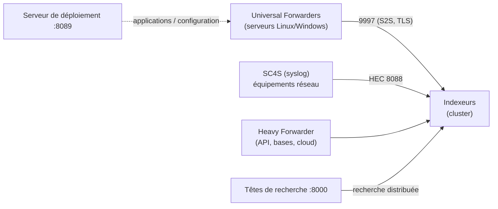

**Splunk Enterprise** indexe n'importe quelles données machine (journaux, événements, métriques) et permet de les interroger avec le langage **SPL**, de construire tableaux de bord, rapports et alertes. Très répandu dans les grandes organisations, il sert de socle à des SIEM (Splunk Enterprise Security) et à l'observabilité.

## Composants



| Composant | Rôle |
| --- | --- |
| **Indexeur** | Analyse et stocke les données (index, *buckets*) ; répond aux recherches |
| **Tête de recherche** (*search head*) | Interface web, recherches, tableaux de bord, alertes |
| **Universal Forwarder** (UF) | Agent léger : lit fichiers et journaux d'événements, envoie aux indexeurs |
| Heavy Forwarder | Splunk complet en mode transfert : collecte par API, filtrage, routage |
| **Serveur de déploiement** | Distribue les configurations (*apps*) aux forwarders |
| Cluster manager / license manager / monitoring console | Gestion des clusters d'indexeurs, des licences, supervision de Splunk |

Petites installations : une seule instance fait indexeur + tête de recherche.

## Licence

| Licence | Caractéristiques |
| --- | --- |
| Enterprise | Selon le **volume ingéré par jour** (Go/jour) ou selon la charge (*workload*) |
| Essai | 60 jours, fonctions complètes |
| **Free** | 500 Mo/jour, mono-utilisateur, sans authentification ni alertes : pour tester |

Les dépassements répétés de quota génèrent des avertissements (et, selon la licence, des restrictions) : filtrez les données inutiles **avant** l'indexation.

## Ports

| Port | Usage |
| --- | --- |
| **8000** | Interface web |
| **8089** | Gestion (API REST splunkd, serveur de déploiement) |
| **9997** | Réception des forwarders |
| 8088 | HTTP Event Collector (HEC) |
| 8191 | KV Store |
| 9887, 8080 | Réplication entre indexeurs du cluster |

## Installation (Linux)

```bash
sudo useradd -r -m -d /opt/splunk splunk
sudo tar -xzf splunk-9.4.3-…-linux-amd64.tgz -C /opt          # ou paquet .deb / .rpm
sudo chown -R splunk: /opt/splunk
sudo -u splunk /opt/splunk/bin/splunk start --accept-license --answer-yes --no-prompt --seed-passwd 'MotDePasseAdminLong!'
sudo /opt/splunk/bin/splunk enable boot-start -user splunk -systemd-managed 1
sudo systemctl start Splunkd
```

Réglages système : `ulimit -n` ≥ 64000, **THP désactivées**, horloge synchronisée, disques rapides pour les index « chauds ».

## Installation (Windows)

```powershell
msiexec.exe /i splunk-9.4.3-…-x64-release.msi AGREETOLICENSE=Yes SPLUNKUSERNAME=admin SPLUNKPASSWORD="MotDePasseAdminLong!" /quiet
```

macOS : paquet `.dmg`/`.tgz` pour les tests.

## Universal Forwarder

```bash
# Linux
sudo tar -xzf splunkforwarder-9.4.3-…-linux-amd64.tgz -C /opt
sudo /opt/splunkforwarder/bin/splunk start --accept-license --answer-yes --no-prompt --seed-passwd 'MotDePasse'
sudo /opt/splunkforwarder/bin/splunk set deploy-poll ds.corp.exemple.fr:8089 -auth admin:MotDePasse
sudo /opt/splunkforwarder/bin/splunk add forward-server idx1.corp.exemple.fr:9997 -auth admin:MotDePasse
sudo /opt/splunkforwarder/bin/splunk enable boot-start -systemd-managed 1
```

```powershell
# Windows : journaux de sécurité et système, envoi vers l'indexeur, serveur de déploiement
msiexec.exe /i splunkforwarder-9.4.3-…-x64-release.msi AGREETOLICENSE=Yes `
  DEPLOYMENT_SERVER="ds.corp.exemple.fr:8089" RECEIVING_INDEXER="idx1.corp.exemple.fr:9997" `
  WINEVENTLOG_SEC_ENABLE=1 WINEVENTLOG_SYS_ENABLE=1 SPLUNKUSERNAME=admin SPLUNKPASSWORD="MotDePasse" /quiet
```

Sur l'indexeur, activez la réception : `splunk enable listen 9997` (ou *Paramètres → Transfert et réception*).

## Suite du parcours

1. [[02-collecte-recherche|Collecte, index, sourcetypes et SPL]]
2. [[03-exploitation-securite|Alertes, sécurité, clusters et exploitation]]
