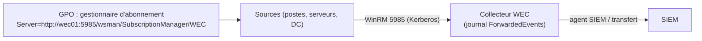

Le **transfert d'événements Windows** (*Windows Event Forwarding*, WEF) envoie des événements choisis de milliers de postes et serveurs vers un ou plusieurs **collecteurs** (*Windows Event Collector*, WEC), **sans agent** : il s'appuie sur [[09-winrm/01-presentation-configuration|WinRM]] et sur les GPO. Le collecteur sert ensuite de point unique de collecte pour le SIEM ([[06-splunk/01-presentation-installation|Splunk]], [[05-wazuh/01-presentation-installation|Wazuh]], [[04-graylog/01-presentation-installation|Graylog]], Microsoft Sentinel).

## Modes d'abonnement

| Mode | Fonctionnement | Usage |
| --- | --- | --- |
| Initié par le collecteur (*pull*) | Le collecteur se connecte à une liste fixe de sources | Quelques serveurs |
| **Initié par la source** (*push*) | Les sources, configurées par GPO, contactent le collecteur et reçoivent leurs abonnements | **Recommandé** : tout le parc, nouvelles machines incluses automatiquement |



## Collecteur

```powershell
# Sur le serveur collecteur (serveur membre dédié)
wecutil qc /q                                 # configure et démarre le service Wecsvc, WinRM
Set-Service Wecsvc -StartupType Automatic
# Agrandir le journal de réception (ex. 4 Go)
wevtutil sl ForwardedEvents /ms:4294967296
```

Abonnement initié par la source (fichier XML importé avec `wecutil cs`) :

```xml C:\WEC\abonnement-securite.xml
<Subscription xmlns="http://schemas.microsoft.com/2006/03/windows/events/subscription">
  <SubscriptionId>Securite-Serveurs</SubscriptionId>
  <SubscriptionType>SourceInitiated</SubscriptionType>
  <Description>Événements de sécurité essentiels des serveurs</Description>
  <Enabled>true</Enabled>
  <Uri>http://schemas.microsoft.com/wbem/wsman/1/windows/EventLog</Uri>
  <ConfigurationMode>Custom</ConfigurationMode>
  <Delivery Mode="Push">
    <Batching>
      <MaxItems>50</MaxItems>
      <MaxLatencyTime>30000</MaxLatencyTime>
    </Batching>
    <PushSettings>
      <Heartbeat Interval="900000"/>
    </PushSettings>
  </Delivery>
  <Query><![CDATA[
    <QueryList>
      <Query Id="0">
        <Select Path="Security">*[System[(EventID=4624 or EventID=4625 or EventID=4634 or EventID=4648 or EventID=4672 or EventID=4720 or EventID=4722 or EventID=4725 or EventID=4726 or EventID=4728 or EventID=4732 or EventID=4740 or EventID=4756 or EventID=4768 or EventID=4769 or EventID=4771 or EventID=1102)]]</Select>
        <Select Path="Microsoft-Windows-PowerShell/Operational">*[System[(EventID=4104)]]</Select>
        <Select Path="System">*[System[(EventID=7045 or EventID=104)]]</Select>
        <Select Path="Microsoft-Windows-Windows Defender/Operational">*[System[(EventID=1116 or EventID=1117 or EventID=5001 or EventID=5007)]]</Select>
      </Query>
    </QueryList>
  ]]></Query>
  <ReadExistingEvents>false</ReadExistingEvents>
  <TransportName>HTTP</TransportName>
  <ContentFormat>RenderedText</ContentFormat>
  <Locale Language="fr-FR"/>
  <LogFile>ForwardedEvents</LogFile>
  <AllowedSourceDomainComputers>O:NSG:BAD:P(A;;GA;;;DC)(A;;GA;;;DD)S:</AllowedSourceDomainComputers>
</Subscription>
```

```powershell
wecutil cs C:\WEC\abonnement-securite.xml
wecutil es                                    # liste des abonnements
wecutil gr Securite-Serveurs                  # état des sources (actives, inactives)
```

`AllowedSourceDomainComputers` définit en SDDL quels ordinateurs peuvent s'abonner (ici *Ordinateurs du domaine* `DC` et *Contrôleurs de domaine* `DD`) ; utilisez plutôt un **groupe dédié** par abonnement pour cibler (ex. serveurs, DC, postes). Des listes d'abonnements prêtes à l'emploi existent (dépôts publics de la NSA, de Palantir) : à adapter au volume supportable.

| Événement | Intérêt |
| --- | --- |
| 4624 / 4625 / 4648 | Ouvertures de session réussies, échouées, avec identifiants explicites |
| 4672 | Privilèges spéciaux (comptes administrateurs) |
| 4720–4726, 4728, 4732, 4756 | Comptes créés/modifiés, ajouts aux groupes privilégiés |
| 4740 | Verrouillage de compte |
| 4768 / 4769 / 4771 | Kerberos (TGT, tickets de service — détection du *Kerberoasting*, échecs de pré-authentification) |
| 1102 / 104 | Effacement du journal Sécurité / d'un journal |
| 7045 | Nouveau service installé |
| 4104 | Blocs de scripts PowerShell |

## Sources (GPO)

*Configuration ordinateur → Stratégies → Modèles d'administration → Composants Windows → Transfert d'événements → Configurer le gestionnaire d'abonnement cible* :

```text
Server=http://srv-wec-01.corp.exemple.fr:5985/wsman/SubscriptionManager/WEC,Refresh=60
```

Et dans la même GPO :

- service **WinRM** en démarrage automatique (*Services système*), écouteur non nécessaire côté source pour le mode push
- droit de lecture du **journal Sécurité** pour le compte **Service réseau** : ajouter `NETWORK SERVICE` au groupe intégré **Lecteurs des journaux d'événements** (*Groupes restreints* ou *Utilisateurs et groupes locaux* des préférences) — sur les DC, ajouter le compte au groupe de domaine *Lecteurs des journaux d'événements*
- stratégie d'audit avancée cohérente avec les événements collectés (un événement non audité ne sera jamais transféré)

## Dimensionnement

| Volume | Recommandation |
| --- | --- |
| Jusqu'à ~2 000–4 000 sources actives par collecteur | 4–8 vCPU, 16 Go, disques rapides |
| Au-delà | Plusieurs collecteurs (répartir les sources par GPO ou par abonnement), un collecteur par grand site |
| Journaux | Journaux personnalisés par catégorie (manifeste de canaux) plutôt que tout dans *ForwardedEvents*, pour l'archivage et la rotation |

Le format `RenderedText` inclut le message lisible (plus volumineux) ; `Events` (XML brut) est plus léger si le SIEM ne s'en sert pas.

## Hors domaine

Pour des machines non jointes (DMZ) : transport **HTTPS** (5986), certificats ordinateur sur les sources et le collecteur, mappage de certificat (`AllowedSubjectList`, `AllowedIssuerCAList` dans l'abonnement) et URL `Server=HTTPS://…:5986/wsman/SubscriptionManager/WEC,Refresh=60,IssuerCA=<empreinte de l'AC>`.

## Envoi vers le SIEM

Installez l'agent du SIEM (Splunk Universal Forwarder, agent Wazuh, Winlogbeat, NXLog, agent Azure Monitor) **sur le collecteur** et lisez le journal *ForwardedEvents* (ou les journaux personnalisés) : un seul agent pour tout le parc. Le champ `Computer` de chaque événement conserve l'origine.

## Dépannage

| Symptôme | Cause | Solution |
| --- | --- | --- |
| Aucune source dans `wecutil gr` | GPO non appliquée, URL du gestionnaire erronée, pare-feu 5985 du collecteur | `gpresult /r`, journal *Microsoft-Windows-Forwarding/Operational* de la source, `Test-NetConnection srv-wec-01 -Port 5985` |
| Source active mais aucun événement Sécurité | `NETWORK SERVICE` sans droit de lecture du journal Sécurité | Groupe *Lecteurs des journaux d'événements*, redémarrer WinRM |
| Erreur 0x138C / 5004 sur la source | Abonnement refusé (SDDL `AllowedSourceDomainComputers`) | Ajouter l'ordinateur au groupe autorisé, redémarrer pour rafraîchir les groupes |
| Événements en retard | Lots (`MaxLatencyTime`), collecteur surchargé | Réduire la latence pour les événements critiques, ajouter des collecteurs |
| Collecteur saturé (CPU de `svchost` WinRM) | Trop de sources, requêtes trop larges | Filtres XPath ciblés, répartition, journaux personnalisés |
| Journal ForwardedEvents plein et écrasé | Taille trop petite, SIEM en retard | Agrandir, vérifier l'agent SIEM |
