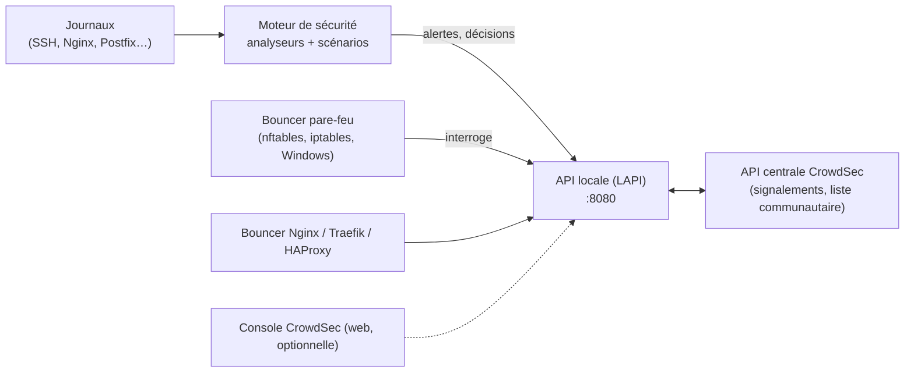

**CrowdSec** (éditeur français, cœur sous licence MIT) analyse les journaux pour détecter des **comportements** malveillants (force brute, balayage, exploitation web, robots) et déclenche des **décisions** (bannissement, captcha) appliquées par des **composants de remédiation** (*bouncers*) : pare-feu, Nginx, Traefik, HAProxy, Cloudflare… Les signalements de tous les utilisateurs alimentent une **liste de blocage communautaire**.

## Architecture



| Composant | Rôle |
| --- | --- |
| **Analyseurs** (*parsers*) | Extraient les champs des journaux |
| **Scénarios** | Détectent un comportement (seau à fuite : N événements en T secondes) |
| **Collections** | Ensembles prêts à l'emploi par service (`crowdsecurity/sshd`, `crowdsecurity/nginx`, `crowdsecurity/windows`) |
| **LAPI** | Stocke alertes et décisions ; interrogée par les bouncers |
| **Bouncers** | Appliquent les décisions |
| CAPI / console | Partage communautaire, listes de blocage, tableau de bord multi-serveurs |

## Fail2ban ou CrowdSec ?

| Critère | [[01-fail2ban/01-presentation-configuration\|Fail2ban]] | CrowdSec |
| --- | --- | --- |
| Détection | Expressions régulières par prison | Analyseurs + scénarios comportementaux (Hub) |
| Remédiation | Action locale | Bouncers multiples, centralisés |
| Multi-serveurs | Non natif | LAPI centrale |
| Renseignement | Non | Liste communautaire, listes tierces |
| Windows | Non | Oui (moteur + bouncer pare-feu Windows) |

## Installation

```bash
# Debian / Ubuntu / RHEL : dépôt officiel
curl -s https://install.crowdsec.net | sudo sh
sudo apt install crowdsec                      # ou : sudo dnf install crowdsec
sudo apt install crowdsec-firewall-bouncer-nftables
sudo systemctl status crowdsec crowdsec-firewall-bouncer
```

À l'installation, CrowdSec détecte les services présents et installe les collections correspondantes.

```powershell
# Windows : installateur MSI du moteur, puis du bouncer pare-feu Windows
msiexec /i crowdsec_x64.msi /qn
msiexec /i crowdsec-windows-firewall-bouncer.msi /qn
& "C:\Program Files\CrowdSec\cscli.exe" collections install crowdsecurity/windows
```

## Collections et acquisition

```bash
sudo cscli hub update
sudo cscli collections list
sudo cscli collections install crowdsecurity/nginx crowdsecurity/postfix crowdsecurity/http-cve
sudo systemctl reload crowdsec
```

```yaml /etc/crowdsec/acquis.d/nginx.yaml
filenames:
  - /var/log/nginx/access.log
  - /var/log/nginx/error.log
labels:
  type: nginx
```

```yaml /etc/crowdsec/acquis.d/sshd.yaml
source: journalctl
journalctl_filter:
  - "_SYSTEMD_UNIT=ssh.service"
labels:
  type: syslog
```

## Vérifier

```bash
sudo cscli metrics                     # lignes lues, analysées, scénarios déclenchés, décisions
sudo cscli alerts list
sudo cscli decisions list
sudo cscli bouncers list
```

## Suite

[[02-remediation-exploitation|Décisions, bouncers, multi-serveurs et exploitation]]
