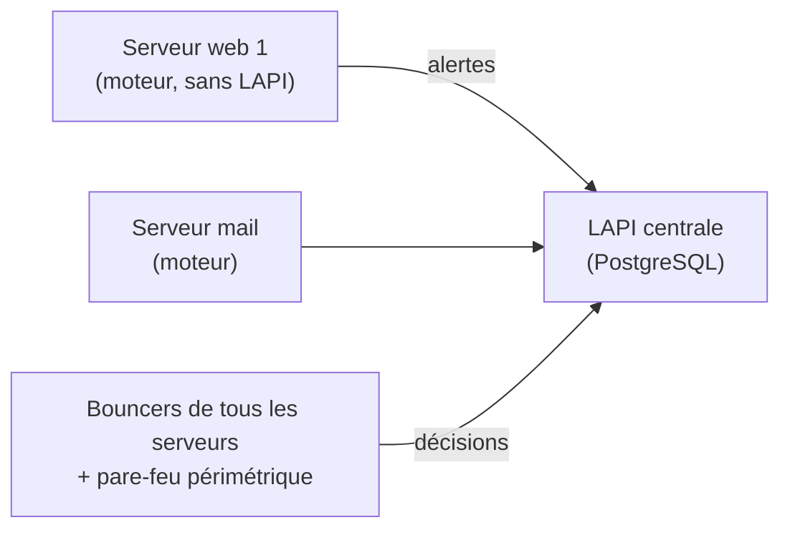

## Décisions

```bash
sudo cscli decisions list
sudo cscli decisions add --ip 203.0.113.66 --duration 24h --reason "scan manuel"
sudo cscli decisions add --range 198.51.100.0/24 --duration 4h
sudo cscli decisions delete --ip 203.0.113.66
sudo cscli alerts inspect 42 -d            # détail d'une alerte (événements, scénario)
```

### Ne pas bannir l'administration

```yaml /etc/crowdsec/parsers/s02-enrich/allowlist-entreprise.yaml
name: entreprise/allowlist
description: "Réseaux d'administration et de supervision"
whitelist:
  reason: "réseaux internes de confiance"
  cidr:
    - "10.0.99.0/24"
    - "192.0.2.10/32"
```

Les versions récentes proposent aussi des **listes d'autorisation** centralisées (`cscli allowlists create …`).

## Composants de remédiation

| Bouncer | Effet |
| --- | --- |
| **Pare-feu** (nftables, iptables, pf, Windows) | Bloque l'adresse sur l'hôte |
| **Nginx / OpenResty**, Traefik, HAProxy, Caddy | Refus ou **captcha** au niveau HTTP (utile derrière un CDN ou un proxy) |
| Cloudflare | Applique les décisions dans le CDN |
| Routeurs/pare-feu (OPNsense, pfSense, MikroTik) | Greffons ou listes dynamiques |

```bash
sudo cscli bouncers add pare-feu-dmz          # clé API pour un bouncer distant
```

```yaml /etc/crowdsec/bouncers/crowdsec-firewall-bouncer.yaml (extrait)
mode: nftables
api_url: http://127.0.0.1:8080/
api_key: <clé>
update_frequency: 10s
deny_action: DROP
```

### AppSec (pare-feu applicatif)

Le composant **AppSec** inspecte les requêtes HTTP transmises par un bouncer web (règles virtuelles contre les CVE, règles compatibles CRS) et bloque en temps réel : `cscli collections install crowdsecurity/appsec-virtual-patching crowdsecurity/appsec-generic-rules`.

## Architecture multi-serveurs



```bash
# Sur un agent : désactiver la LAPI locale (config.yaml : api.server.enable: false) puis s'inscrire
sudo cscli lapi register --url https://lapi.corp.exemple.fr:8080 --machine srv-web-01
# Sur la LAPI centrale
sudo cscli machines list
sudo cscli machines validate srv-web-01
```

Une attaque détectée sur un serveur entraîne le blocage sur **tous** les bouncers. Pour plusieurs agents, utilisez PostgreSQL ou MySQL comme base de la LAPI et TLS entre agents et LAPI.

## Listes de blocage et console

- `sudo cscli console enroll <clé>` : rattache l'instance à la **console** (tableau de bord, gestion de flotte, abonnement à des listes).
- Liste communautaire (adresses signalées par la communauté) appliquée automatiquement ; listes tierces (Tor, robots, réputation) selon l'offre.
- `sudo cscli capi status` : état de la connexion à l'API centrale.

## Notifications

`/etc/crowdsec/notifications/` : greffons HTTP (webhook, Teams, Slack), courriel, Splunk, Elasticsearch ; référencés dans `profiles.yaml` (`notifications: [ http_default ]`).

## Supervision

```yaml /etc/crowdsec/config.yaml (extrait)
prometheus:
  enabled: true
  level: full
  listen_addr: 127.0.0.1
  listen_port: 6060
```

Tableaux de bord Grafana officiels ; `cscli metrics` en ligne de commande.

## Problèmes fréquents

| Symptôme | Cause | Solution |
| --- | --- | --- |
| `cscli metrics` : lignes lues mais non analysées | Mauvais `type` dans l'acquisition, collection manquante | `labels.type`, installer la collection |
| Aucune décision appliquée | Bouncer non enregistré ou arrêté | `cscli bouncers list` (dernière connexion), journal du bouncer |
| Adresse interne bannie | Pas de liste blanche, IP du proxy dans les journaux | Liste d'autorisation, IP réelle dans les journaux |
| Agent refusé par la LAPI | Machine non validée, URL/TLS | `cscli machines validate`, certificats |
| Faux positifs d'un scénario | Comportement légitime (robot interne) | Liste blanche ciblée ou désactivation du scénario (`cscli scenarios remove`) |
| `cscli hub update` en échec | Accès Internet/proxy | Variables `HTTPS_PROXY` du service |
