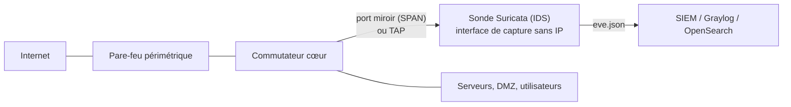

**Suricata** (Open Information Security Foundation, GPLv2) inspecte le trafic réseau pour détecter des attaques (**IDS**), les bloquer en coupure (**IPS**) et produire une **télémétrie riche** (NSM) : journaux des flux, DNS, HTTP, TLS (certificats, JA3/JA4), fichiers extraits, SMB, SSH… au format **EVE JSON**, directement exploitable par un SIEM.

## Où placer la sonde ?



| Mode | Principe | Usage |
| --- | --- | --- |
| **IDS passif** (SPAN, TAP) | Copie du trafic, aucune incidence sur le réseau | Point de départ recommandé |
| **IPS en coupure** (AF_PACKET inline entre deux interfaces, ou NFQUEUE sur un routeur/pare-feu Linux) | Peut bloquer (`drop`) | Après validation des règles (risque de faux positifs bloquants, point de panne) |
| Sur l'hôte | Analyse du trafic d'un serveur | Cas particuliers |

Positionnez les sondes là où le trafic est **en clair et significatif** : derrière le pare-feu périmétrique, entre zones (DMZ, serveurs, utilisateurs), et aux points de sortie Internet. Le trafic chiffré n'est analysé que par ses métadonnées (SNI, certificats, JA3/JA4).

## Installation

```bash
# Ubuntu : PPA officiel (version stable récente)
sudo add-apt-repository ppa:oisf/suricata-stable && sudo apt update && sudo apt install suricata
# Debian : paquet de la distribution ou des backports
sudo apt install suricata
# RHEL : dépôt COPR de l'OISF
sudo dnf install epel-release dnf-plugins-core
sudo dnf copr enable @oisf/suricata-7.0 && sudo dnf install suricata
suricata --build-info | head -20
```

Windows et macOS ne sont pas des plates-formes de production (Suricata y fonctionne pour des tests ou via pfSense/OPNsense, qui l'intègrent).

## Interface de capture

```bash
# Interface dédiée, sans adresse IP, en mode promiscuité, sans délestage matériel qui fausse l'analyse
sudo ip link set ens224 up promisc on
sudo ethtool -K ens224 gro off lro off tso off gso off
sudo ethtool -G ens224 rx 4096          # tampons de réception
```

Rendez ces réglages persistants (unité systemd ou configuration réseau).

## suricata.yaml : l'essentiel

```yaml /etc/suricata/suricata.yaml (extraits)
vars:
  address-groups:
    HOME_NET: "[10.0.0.0/8,192.168.0.0/16,172.16.0.0/12]"
    EXTERNAL_NET: "!$HOME_NET"
    DNS_SERVERS: "[10.0.10.53,10.0.10.54]"
    HTTP_SERVERS: "[10.0.20.0/24]"

af-packet:
  - interface: ens224
    threads: auto
    cluster-id: 99
    cluster-type: cluster_flow
    defrag: yes
    use-mmap: yes
    tpacket-v3: yes

outputs:
  - eve-log:
      enabled: yes
      filetype: regular
      filename: eve.json
      community-id: true
      types:
        - alert: { tagged-packets: yes }
        - anomaly
        - http: { extended: yes }
        - dns
        - tls: { extended: yes }
        - files: { force-magic: no }
        - smb
        - ssh
        - flow

default-rule-path: /var/lib/suricata/rules
rule-files:
  - suricata.rules
```

**HOME_NET** doit contenir tous vos réseaux internes : beaucoup de règles en dépendent.

## Règles et premier lancement

```bash
sudo suricata-update                       # télécharge ET Open (par défaut) dans /var/lib/suricata/rules/suricata.rules
sudo suricata-update list-sources
sudo suricata-update enable-source oisf/trafficid
sudo suricata -T -c /etc/suricata/suricata.yaml -v      # tester la configuration
sudo systemctl enable --now suricata
sudo tail -f /var/log/suricata/fast.log
```

```bash
# Test : requête déclenchant la règle de test d'ET (« GPL ATTACK_RESPONSE id check returned root »)
curl -s http://testmynids.org/uid/index.html
sudo grep -i "root" /var/log/suricata/fast.log | tail -1
```

## Suite du parcours

1. [[02-regles-ips|Règles, réglage fin et mode IPS]]
2. [[03-exploitation-integration|Performances, intégration SIEM et exploitation]]
