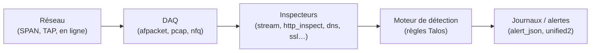

**Snort** est l'IDS/IPS libre historique, aujourd'hui développé par **Cisco Talos** (moteur des pare-feu Cisco Secure Firewall). **Snort 3** est une réécriture complète : multithread, configuration en **Lua**, inspecteurs de protocoles modulaires, journaux JSON. Snort 2 est en fin de vie : tout nouveau déploiement doit utiliser Snort 3.

## Architecture



## Ensembles de règles

| Ensemble | Accès | Délai |
| --- | --- | --- |
| **Community** | Gratuit, sans compte | Sous-ensemble GPL |
| **Registered** | Gratuit avec un compte (*oinkcode*) | Règles Talos avec **30 jours** de retard |
| **Subscriber** | Abonnement payant | Règles le jour de leur publication |

Les **politiques** (*connectivity*, *balanced*, *security*, *max-detect*) sélectionnent les règles selon le compromis détection / faux positifs ; **balanced** est le point de départ habituel.

## Snort ou Suricata ?

| Critère | Snort 3 | [[05-suricata/01-presentation-installation\|Suricata]] |
| --- | --- | --- |
| Éditeur | Cisco Talos | OISF |
| Règles | Talos (Community/Registered/Subscriber) | ET Open/Pro, nombreuses sources ; lit aussi beaucoup de règles Snort |
| Journaux | `alert_json`, unified2 | **EVE JSON** très riche (protocoles, flux, fichiers) |
| Paquets dans les distributions | Rares (compilation fréquente) | Paquets officiels courants |
| Intégration | Cisco Secure Firewall, pfSense/OPNsense | Security Onion, SELKS, pfSense/OPNsense |

## Installation (compilation sous Debian/Ubuntu)

```bash
sudo apt install -y build-essential cmake pkg-config libpcap-dev libpcre2-dev libdumbnet-dev \
  libhwloc-dev libluajit-5.1-dev libssl-dev zlib1g-dev libunwind-dev libmnl-dev flex bison \
  libhyperscan-dev libjemalloc-dev liblzma-dev uuid-dev git

# Bibliothèque d'acquisition (DAQ)
git clone https://github.com/snort3/libdaq.git && cd libdaq
./bootstrap && ./configure && make -j"$(nproc)" && sudo make install && cd ..

# Snort 3
git clone https://github.com/snort3/snort3.git && cd snort3
./configure_cmake.sh --prefix=/usr/local --enable-jemalloc
cd build && make -j"$(nproc)" && sudo make install
sudo ldconfig
snort -V
```

Des images Docker et des paquets tiers existent ; Windows n'est plus une plate-forme cible de Snort 3.

## Configuration de base

```lua /usr/local/etc/snort/snort.lua (extraits)
HOME_NET = '[10.0.0.0/8,192.168.0.0/16,172.16.0.0/12]'
EXTERNAL_NET = '!$HOME_NET'

include 'snort_defaults.lua'

ips =
{
    enable_builtin_rules = true,
    variables = default_variables,
    include = '/usr/local/etc/rules/snort.rules',
}

alert_json =
{
    file = true,
    limit = 100,
    fields = 'timestamp pkt_num proto pkt_gen pkt_len dir src_ap dst_ap rule action msg class priority',
}
```

```bash
sudo snort -c /usr/local/etc/snort/snort.lua -T                  # valider
sudo snort -c /usr/local/etc/snort/snort.lua -i ens224 -A alert_fast -l /var/log/snort -k none
```

L'interface de capture se prépare comme pour Suricata (sans IP, `promisc`, délestages désactivés).

## Suite

[[02-regles-ips-exploitation|Règles, PulledPork 3, mode IPS et exploitation]]
