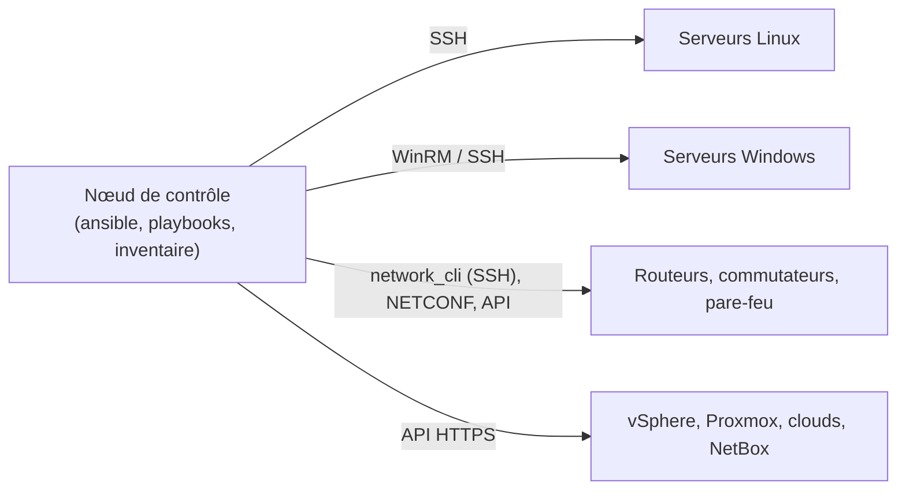

**Ansible** (Red Hat, GPL) automatise la configuration de serveurs, d'**équipements réseau**, de postes Windows et de services cloud **sans agent** : il se connecte en SSH (ou WinRM, ou par l'API des équipements), exécute des **modules** idempotents (ils ne changent que ce qui doit l'être) et décrit l'état voulu dans des **playbooks** YAML versionnés.

## Concepts



| Notion | Description |
| --- | --- |
| **Inventaire** | Liste des hôtes et groupes (fichier ou source dynamique) |
| **Module** | Unité d'action (`apt`, `template`, `service`, `cisco.ios.ios_config`, `ansible.windows.win_feature`) |
| **Tâche** | Appel d'un module avec des paramètres |
| **Playbook** | Fichier YAML : quelles tâches sur quels hôtes |
| **Rôle** | Paquet réutilisable (tâches, modèles, variables, gestionnaires) |
| **Collection** | Distribution de modules, rôles et greffons (`cisco.ios`, `community.general`) |
| **Idempotence** | Rejouer un playbook ne change rien si l'état est déjà conforme |

## Installation

```bash
# Recommandé : pipx (versions récentes, isolées)
sudo apt install pipx && pipx ensurepath
pipx install --include-deps ansible
pipx inject ansible paramiko pywinrm netaddr jmespath     # dépendances utiles (réseau, Windows, filtres)
ansible --version

# Paquets
sudo apt install ansible                 # Debian / Ubuntu (version de la distribution)
sudo dnf install ansible-core            # RHEL (cœur seul ; collections via ansible-galaxy)
brew install ansible                     # macOS
```

Le nœud de contrôle tourne sous **Linux ou macOS** ; sous Windows, utilisez **WSL**. Les hôtes gérés n'ont besoin que de **Python** (Linux), de **WinRM/PowerShell** (Windows), ou rien de particulier (équipements réseau).

Pour des environnements reproductibles : **environnements d'exécution** (conteneurs contenant Ansible, collections et dépendances) avec `ansible-navigator` / `ansible-builder`.

## ansible.cfg

```ini ansible.cfg (racine du projet)
[defaults]
inventory = inventaires/production
remote_user = ansible
host_key_checking = True
forks = 20
timeout = 30
interpreter_python = auto_silent
stdout_callback = yaml
retry_files_enabled = False
vault_identity_list = prod@~/.ansible/vault-prod.txt

[ssh_connection]
pipelining = True
ssh_args = -o ControlMaster=auto -o ControlPersist=60s
```

## Inventaires

```yaml inventaires/production/hosts.yml
all:
  children:
    linux:
      children:
        web:
          hosts:
            srv-web-01.corp.exemple.fr:
            srv-web-02.corp.exemple.fr:
        bdd:
          hosts:
            srv-db-01.corp.exemple.fr:
    windows:
      hosts:
        srv-ad-01.corp.exemple.fr:
    reseau:
      children:
        ios:
          hosts:
            sw-coeur-paris: { ansible_host: 10.0.0.2 }
            r1-paris: { ansible_host: 10.0.0.1 }
```

```yaml inventaires/production/group_vars/ios.yml
ansible_connection: ansible.netcommon.network_cli
ansible_network_os: cisco.ios.ios
ansible_user: ansible
ansible_password: "{{ vault_ios_password }}"
ansible_become: true
ansible_become_method: enable
```

| Source dynamique | Greffon |
| --- | --- |
| NetBox | `netbox.netbox.nb_inventory` |
| VMware vSphere | `community.vmware.vmware_vm_inventory` |
| Proxmox | `community.general.proxmox` |
| Azure / AWS | `azure.azcollection.azure_rm`, `amazon.aws.aws_ec2` |

```bash
ansible-inventory --graph
ansible-inventory --host srv-web-01.corp.exemple.fr
```

## Commandes ad hoc

```bash
ansible linux -m ping
ansible web -m ansible.builtin.shell -a "uptime"
ansible linux -b -m ansible.builtin.apt -a "name=chrony state=present update_cache=true"
ansible ios -m cisco.ios.ios_command -a "commands='show version'"
ansible windows -m ansible.windows.win_service -a "name=W32Time state=started"
```

## Suite du parcours

1. [[02-playbooks-roles|Playbooks, variables, modèles, rôles et coffre]]
2. [[03-automatisation-reseau|Automatisation des équipements réseau]]
3. [[04-windows-awx-bonnes-pratiques|Windows, AWX, tests et bonnes pratiques]]
