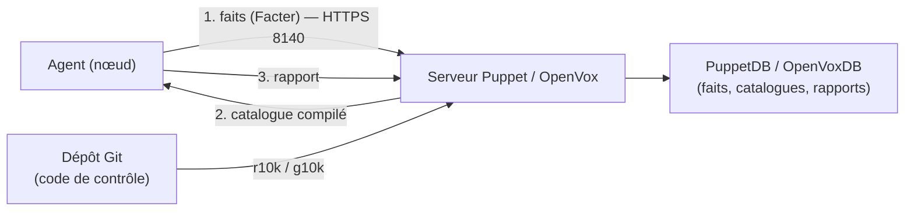

**Puppet** est un outil de gestion de configuration **déclaratif à agent** : chaque nœud exécute un **agent** qui, toutes les 30 minutes par défaut, envoie ses **faits** (Facter) au **serveur Puppet**, reçoit un **catalogue** compilé (l'état voulu) et l'applique, puis renvoie un **rapport**. Toute dérive est corrigée automatiquement.

> [!IMPORTANT]
> **Licence.** Depuis fin 2024, Perforce (propriétaire de Puppet) ne publie plus de paquets libres publics : les builds récents (*Puppet Core*) sont réservés aux clients ou à un usage gratuit limité. La communauté a créé **OpenVox** (Vox Pupuli), fork libre et compatible (`openvox-agent`, `openvox-server`, `openvoxdb`). Pour un nouveau déploiement sans contrat Perforce, partez sur **OpenVox** ; les commandes et le langage sont identiques.

## Architecture



| Élément | Rôle |
| --- | --- |
| Serveur (`puppetserver` / `openvox-server`) | Compile les catalogues, autorité de certification interne (port **8140**) |
| Agent | Applique le catalogue sur le nœud |
| Facter | Collecte les faits (OS, IP, mémoire, rôle…) |
| PuppetDB / OpenVoxDB | Stocke faits, catalogues et rapports (PostgreSQL) ; requêtes PQL ; ressources exportées |
| Hiera | Données hiérarchiques séparées du code |
| r10k / g10k | Déploie les **environnements** depuis les branches Git |

## Installation (OpenVox)

```bash
# Serveur — Debian 12 / Ubuntu 24.04
wget https://apt.voxpupuli.org/openvox8-release-debian12.deb      # Ubuntu : openvox8-release-ubuntu24.04.deb
sudo dpkg -i openvox8-release-*.deb && sudo apt update
sudo apt install openvox-server
sudo sed -i 's/-Xms2g -Xmx2g/-Xms4g -Xmx4g/' /etc/default/puppetserver   # mémoire JVM
sudo systemctl enable --now puppetserver

# Serveur — RHEL 9
sudo dnf install https://yum.voxpupuli.org/openvox8-release-el-9.noarch.rpm
sudo dnf install openvox-server
sudo firewall-cmd --permanent --add-port=8140/tcp && sudo firewall-cmd --reload

# Agent Linux
sudo apt install openvox-agent        # ou dnf install openvox-agent
```

```ini /etc/puppetlabs/puppet/puppet.conf (agent)
[main]
server = puppet.corp.exemple.fr
environment = production
runinterval = 30m
```

```powershell
# Agent Windows (MSI OpenVox ou Puppet)
msiexec /qn /norestart /i openvox-agent-x64.msi PUPPET_SERVER=puppet.corp.exemple.fr PUPPET_AGENT_ENVIRONMENT=production
```

Sur macOS : paquet `.dmg` de l'agent ; même configuration dans `/etc/puppetlabs/puppet/puppet.conf`.

### Certificats

```bash
sudo /opt/puppetlabs/bin/puppet agent -t          # sur l'agent : demande de certificat
sudo puppetserver ca list                          # sur le serveur
sudo puppetserver ca sign --certname srv-web-01.corp.exemple.fr
sudo puppetserver ca revoke --certname ancien-serveur.corp.exemple.fr
sudo puppetserver ca clean  --certname ancien-serveur.corp.exemple.fr
```

L'**autosignature** (`autosign.conf` ou script de validation de jeton dans `csr_attributes.yaml`) évite la signature manuelle lors du provisionnement automatisé — réservez-la à des réseaux de confiance ou à une validation par secret.

## Langage

```puppet manifests/site.pp
node 'srv-web-01.corp.exemple.fr', 'srv-web-02.corp.exemple.fr' {
  include role::serveur_web
}
node default {
  include role::base
}
```

```puppet site-modules/profile/manifests/chrony.pp
class profile::chrony (
  Array[String] $serveurs = ['ntp1.corp.exemple.fr', 'ntp2.corp.exemple.fr'],
) {
  package { 'chrony':
    ensure => installed,
  }

  file { '/etc/chrony/chrony.conf':
    ensure  => file,
    owner   => 'root',
    mode    => '0644',
    content => epp('profile/chrony.conf.epp', { 'serveurs' => $serveurs }),
    require => Package['chrony'],
    notify  => Service['chrony'],
  }

  service { 'chrony':
    ensure => running,
    enable => true,
  }
}
```

| Élément | Rôle |
| --- | --- |
| Ressource | `package`, `file`, `service`, `user`, `exec`… (type + titre + attributs) |
| Classe | Ensemble de ressources paramétré |
| Relations | `require`, `before`, `notify`, `subscribe`, chaînage `->` / `~>` |
| Modèles | `.epp` (Puppet) ou `.erb` (Ruby) |
| Rôles et profils | **Profil** = brique technique (chrony, ssh) ; **rôle** = assemblage de profils pour un type de serveur ; un nœud reçoit **un** rôle |

## Hiera

```yaml data/common.yaml
profile::chrony::serveurs:
  - ntp1.corp.exemple.fr
  - ntp2.corp.exemple.fr
```

```yaml hiera.yaml (environnement)
version: 5
defaults:
  datadir: data
  data_hash: yaml_data
hierarchy:
  - name: "Par nœud"
    path: "nodes/%{trusted.certname}.yaml"
  - name: "Par site"
    path: "sites/%{facts.site}.yaml"
  - name: "Par OS"
    path: "os/%{facts.os.family}.yaml"
  - name: "Commun"
    path: "common.yaml"
```

Les paramètres de classe sont **résolus automatiquement** dans Hiera (`profile::chrony::serveurs`). Pour les secrets : **hiera-eyaml** (chiffrement des valeurs) ou une recherche dans Vault.

## Modules de la Forge

```ruby Puppetfile
forge 'https://forge.puppet.com'
mod 'puppetlabs-stdlib', '9.6.0'
mod 'puppetlabs-ntp',    '10.1.0'
mod 'puppet-chrony',     '3.0.0'
mod 'profile', git: 'https://git.corp.exemple.fr/puppet/profile.git', branch: 'main'
```

Suite : [[02-controle-exploitation|code de contrôle, PuppetDB et exploitation]].
