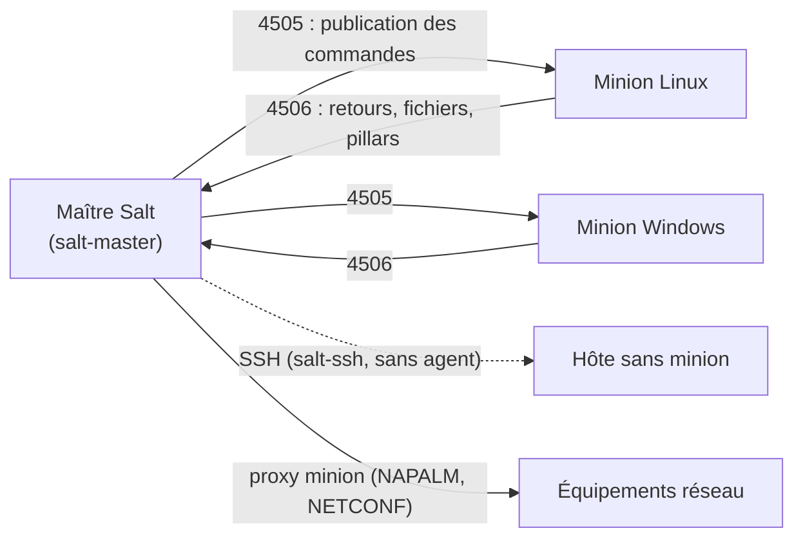

**Salt** (projet libre, Apache 2.0, maintenu par Broadcom/VMware) combine **exécution distante** massive (des milliers de nœuds en quelques secondes) et **gestion de configuration** déclarative. Les **minions** (agents) maintiennent une connexion permanente au **maître** sur un bus ZeroMQ chiffré : les commandes sont poussées instantanément.

## Architecture



| Notion | Rôle |
| --- | --- |
| **Grains** | Faits du minion (OS, IP, rôle personnalisé) — ciblage |
| **Pillar** | Données **privées** par minion (variables, secrets), calculées sur le maître |
| **États (SLS)** | Description YAML (+ Jinja) de l'état voulu |
| `top.sls` | Associe les états / pillars aux minions |
| Modules d'exécution | Commandes ad hoc (`pkg.install`, `service.restart`, `cmd.run`) |
| Beacons / réacteur | Événements des minions qui déclenchent des actions |
| Mine | Données publiées par les minions, lisibles par les autres |

Les minions **initient** les connexions vers le maître (seuls 4505/4506 entrants sur le maître sont nécessaires).

## Installation

Les paquets sont publiés sur le dépôt officiel (`packages.broadcom.com/artifactory/saltproject-…`, versions **LTS** 3006, 3007) ; le script **bootstrap** gère les distributions :

```bash
# Maître (Debian / Ubuntu / RHEL)
curl -fsSL -o bootstrap-salt.sh https://github.com/saltstack/salt-bootstrap/releases/latest/download/bootstrap-salt.sh
sudo sh bootstrap-salt.sh -M -N stable 3006      # -M : maître, -N : sans minion
sudo systemctl enable --now salt-master
sudo firewall-cmd --permanent --add-port={4505,4506}/tcp && sudo firewall-cmd --reload

# Minion
sudo sh bootstrap-salt.sh -A salt.corp.exemple.fr stable 3006
```

```yaml /etc/salt/minion.d/maitre.conf
master: salt.corp.exemple.fr
id: srv-web-01.corp.exemple.fr
```

```powershell
# Minion Windows (MSI officiel)
msiexec /i Salt-Minion-3006.x-Py3-AMD64.msi /quiet /norestart MASTER=salt.corp.exemple.fr MINION_ID=srv-ad-01.corp.exemple.fr
```

macOS : paquet `.pkg` officiel, configuration dans `/etc/salt/minion`.

### Clés

```bash
sudo salt-key -L                      # clés acceptées, refusées, en attente
sudo salt-key -f srv-web-01.corp.exemple.fr   # empreinte (à comparer avec salt-call --local key.finger sur le minion)
sudo salt-key -a srv-web-01.corp.exemple.fr
sudo salt-key -d ancien-serveur.corp.exemple.fr
```

## Exécution distante et ciblage

```bash
sudo salt '*' test.ping
sudo salt 'srv-web-*' cmd.run 'uptime'
sudo salt -G 'os:Debian' pkg.upgrade                 # par grain
sudo salt -L 'srv-web-01,srv-web-02' service.restart nginx
sudo salt -C 'G@role:web and G@site:paris' state.apply   # ciblage composé
sudo salt -N serveurs_web grains.items               # groupe de nœuds (nodegroups)
sudo salt '*' --batch-size 10% pkg.upgrade           # par lots
```

## États

```yaml /srv/salt/top.sls
base:
  '*':
    - socle
  'G@role:web':
    - match: compound
    - nginx
  'os:Windows':
    - match: grain
    - windows.base
```

```yaml /srv/salt/socle/init.sls
paquets_socle:
  pkg.installed:
    - pkgs: [ chrony, vim, curl ]

/etc/chrony/chrony.conf:
  file.managed:
    - source: salt://socle/files/chrony.conf.j2
    - template: jinja
    - user: root
    - mode: "0644"
    - require:
      - pkg: paquets_socle

chrony:
  service.running:
    - enable: true
    - watch:
      - file: /etc/chrony/chrony.conf
```

```jinja /srv/salt/socle/files/chrony.conf.j2
# Géré par Salt

server {{ serveur }} iburst

makestep 1.0 3
rtcsync
```

## Pillars

```yaml /srv/pillar/top.sls
base:
  '*':
    - commun
  'G@site:paris':
    - match: compound
    - sites.paris
```

```yaml /srv/pillar/commun.sls
ntp:
  serveurs:
    - ntp1.corp.exemple.fr
    - ntp2.corp.exemple.fr
```

```bash
sudo salt '*' saltutil.refresh_pillar
sudo salt 'srv-web-01*' pillar.get ntp:serveurs
sudo salt '*' state.apply test=True        # simulation
sudo salt '*' state.apply                   # application (highstate)
sudo salt 'srv-web-01*' state.apply nginx   # un seul état
```

Suite : [[02-avance-reseau-exploitation|réseau, événements et exploitation]].
