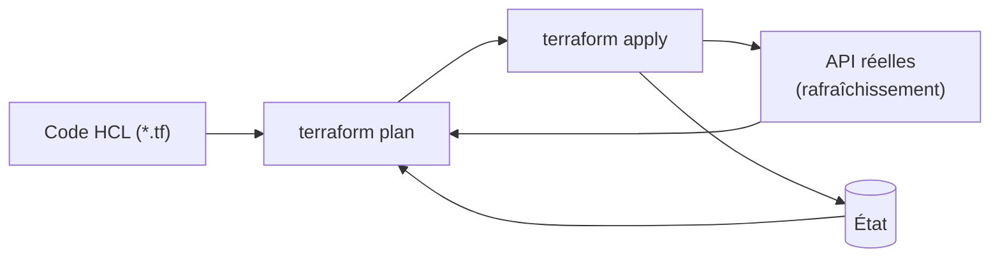

**Terraform** (HashiCorp, désormais IBM) décrit l'infrastructure — machines virtuelles, réseaux, DNS, pare-feu, enregistrements IPAM, comptes cloud — dans des fichiers **HCL** déclaratifs. Il compare l'état voulu avec l'état réel, affiche un **plan** de changements, puis l'applique via les API des **fournisseurs** (*providers*).

> [!NOTE]
> **Licence.** Depuis la version 1.6 (août 2023), Terraform est sous **BSL 1.1** (source disponible, usage interne autorisé, interdit pour concurrencer HashiCorp). La Linux Foundation maintient **OpenTofu** (MPL 2.0), fork compatible : commande `tofu` au lieu de `terraform`, même langage, mêmes fournisseurs (registre OpenTofu), plus des fonctions propres (chiffrement natif de l'état, variables dans le backend, `for_each` sur les fournisseurs, `-exclude`, registres OCI). Le contenu de ces pages s'applique aux deux ; OpenTofu est présenté en détail dans [[04-opentofu|OpenTofu — présentation et migration]].

## Concepts

| Notion | Description |
| --- | --- |
| **Fournisseur** | Greffon qui parle à une API (vsphere, proxmox, azurerm, aws, netbox, panos, fortios, dns…) |
| **Ressource** | Objet géré (`vsphere_virtual_machine`, `netbox_ip_address`) |
| **Source de données** | Lecture d'un objet existant non géré (`data "vsphere_network"`) |
| **État** (*state*) | Correspondance entre le code et les objets réels (identifiants, attributs) |
| **Plan** | Différence calculée : à créer (+), modifier (~), détruire (-), remplacer (-/+) |
| **Module** | Ensemble de ressources réutilisable avec entrées/sorties |



## Installation

```bash
# Terraform — Debian / Ubuntu
wget -O- https://apt.releases.hashicorp.com/gpg | sudo gpg --dearmor -o /usr/share/keyrings/hashicorp.gpg
echo "deb [signed-by=/usr/share/keyrings/hashicorp.gpg] https://apt.releases.hashicorp.com $(lsb_release -cs) main" | sudo tee /etc/apt/sources.list.d/hashicorp.list
sudo apt update && sudo apt install terraform

# Terraform — RHEL
sudo dnf config-manager --add-repo https://rpm.releases.hashicorp.com/RHEL/hashicorp.repo && sudo dnf install terraform

# OpenTofu — script officiel (paquets deb/rpm)
curl -fsSL https://get.opentofu.org/install-opentofu.sh -o install-opentofu.sh
chmod +x install-opentofu.sh && ./install-opentofu.sh --install-method deb     # ou rpm

# macOS
brew install hashicorp/tap/terraform   # ou : brew install opentofu
```

```powershell
winget install Hashicorp.Terraform
winget install OpenTofu.Tofu
```

Pour figer les versions par projet : **tfenv** / **tofuenv**, ou un conteneur en CI.

## Premier projet

```hcl versions.tf
terraform {
  required_version = ">= 1.6"
  required_providers {
    dns = {
      source  = "hashicorp/dns"
      version = "~> 3.4"
    }
  }
}

provider "dns" {
  update {
    server        = "10.0.10.53"
    key_name      = "terraform."
    key_algorithm = "hmac-sha256"
    key_secret    = var.tsig_secret
  }
}
```

```hcl variables.tf
variable "tsig_secret" {
  type      = string
  sensitive = true
}

variable "serveurs" {
  type = map(string)
  default = {
    "srv-web-01" = "10.0.20.11"
    "srv-web-02" = "10.0.20.12"
  }
}
```

```hcl main.tf
resource "dns_a_record_set" "serveurs" {
  for_each  = var.serveurs
  zone      = "corp.exemple.fr."
  name      = each.key
  addresses = [each.value]
  ttl       = 3600
}

output "fqdn" {
  value = [for nom in keys(var.serveurs) : "${nom}.corp.exemple.fr"]
}
```

L'enregistrement dynamique sécurisé par TSIG est décrit dans [[01-bind9/08-ddns-nsupdate|BIND9 (DDNS et nsupdate)]].

## Cycle de travail

```bash
terraform init                    # télécharge les fournisseurs, configure le backend
terraform fmt -recursive          # mise en forme
terraform validate
terraform plan -out=plan.tfplan   # plan enregistré
terraform apply plan.tfplan       # applique exactement ce plan
terraform output
terraform state list
terraform destroy                 # détruit tout ce que gère cette configuration
```

Valeurs des variables : fichiers `*.tfvars` (`-var-file=prod.tfvars`), variables d'environnement `TF_VAR_tsig_secret`, ou saisie interactive.

> [!TIP]
> Lisez **toujours** le plan : une ligne `-/+ … must be replaced` sur une VM ou un pare-feu signifie une destruction suivie d'une recréation (attribut immuable modifié).

Suite : [[02-etat-modules-import|état distant, modules et import]] · [[04-opentofu|OpenTofu : fonctions propres et migration]].
