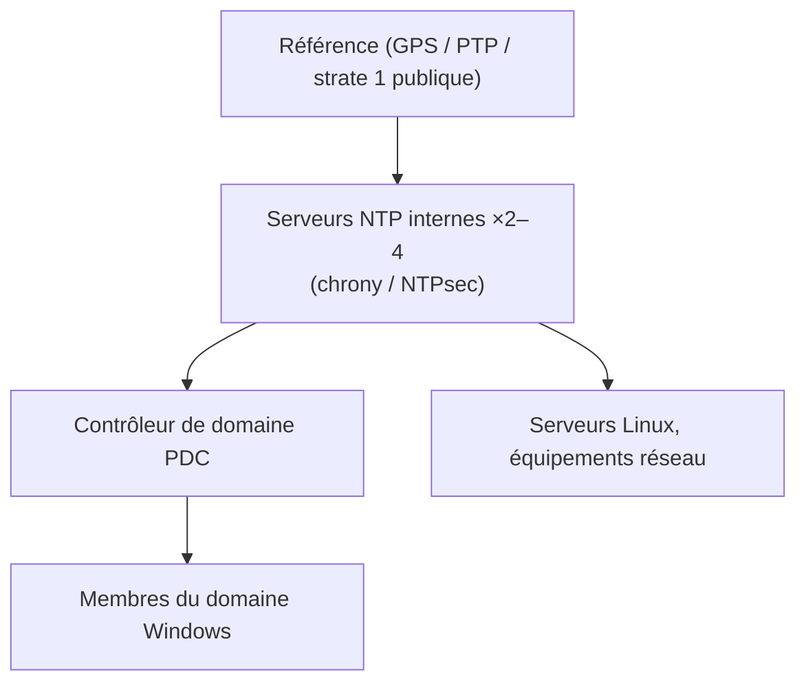

Une heure fausse casse plus de choses qu'on ne l'imagine : **Kerberos** refuse au-delà de 5 minutes d'écart, les **certificats** paraissent non encore valides ou expirés, les **journaux** deviennent impossibles à corréler dans le SIEM, les codes **TOTP** échouent, la réplication AD et les clusters dérivent. Le temps est un service d'infrastructure à part entière.

**chrony** (`chronyd` + `chronyc`) est l'implémentation NTP par défaut de RHEL, Fedora, SUSE et Ubuntu récents : convergence rapide, tolérance aux connexions intermittentes et aux VM, prise en charge de **NTS** (*Network Time Security*) et de l'horodatage matériel.

## NTP en bref

| Notion | Description |
| --- | --- |
| **Strate** | Distance à la référence : 0 = horloge (GPS, atomique), 1 = serveur relié à la référence, 2 = client d'une strate 1… (16 = non synchronisé) |
| **Décalage** (*offset*) | Écart entre l'horloge locale et la source |
| **Délai** | Aller-retour réseau vers la source |
| **Gigue** (*jitter*) | Variation du délai |
| Port | **123/UDP** ; NTS-KE : **4460/TCP** |



**Démarche** : 2 à 4 serveurs internes synchronisés sur des sources externes variées (ou un récepteur GPS), et tout le parc synchronisé sur eux. Jamais une seule source (impossible de détecter qu'elle est fausse), idéalement 3 ou plus.

## chrony et les autres

| Implémentation | Usage |
| --- | --- |
| **chrony** | Client et serveur polyvalent, VM, portables, NTS |
| [[02-ntpsec/01-presentation-configuration\|NTPsec]] | Successeur durci de ntpd, pilotes de références (GPS, PPS) |
| ntpd (ntp.org) | Historique, remplacé |
| systemd-timesyncd | Client SNTP minimal (Debian/Ubuntu de base), **pas** de serveur |
| W32Time | Service Windows ; hiérarchie du domaine AD |

## Installation

```bash
sudo apt install chrony          # Debian / Ubuntu (désactive systemd-timesyncd)
sudo dnf install chrony          # RHEL / Fedora (souvent préinstallé)
sudo systemctl enable --now chronyd     # « chrony » sous Debian/Ubuntu
timedatectl                      # « System clock synchronized: yes »
```

macOS utilise `timed` (configuration *Réglages → Général → Date et heure*, ou `sudo systemsetup -setnetworktimeserver ntp1.corp.exemple.fr`) ; chrony est disponible via Homebrew pour des besoins avancés.

## Configuration client

```chrony /etc/chrony/chrony.conf (Debian) — /etc/chrony.conf (RHEL)
# Serveurs internes
server ntp1.corp.exemple.fr iburst
server ntp2.corp.exemple.fr iburst
server ntp3.corp.exemple.fr iburst

# Ou un pool public (plusieurs adresses résolues)
# pool 2.fr.pool.ntp.org iburst maxsources 4

# Corriger brutalement un grand écart au démarrage (3 premières mises à jour)
makestep 1.0 3

# Recopier l'heure système dans l'horloge matérielle
rtcsync

driftfile /var/lib/chrony/chrony.drift
logdir /var/log/chrony
leapseclist /usr/share/zoneinfo/leap-seconds.list
```

| Directive | Effet |
| --- | --- |
| `iburst` | Rafale de requêtes au démarrage : synchronisation en quelques secondes |
| `prefer` | Source privilégiée à qualité égale |
| `minpoll` / `maxpoll` | Intervalle d'interrogation (puissances de 2 en secondes) |
| `makestep seuil limite` | Saut d'horloge autorisé (sinon ralentissement/accélération progressifs) |
| `maxdistance` | Rejet des sources trop imprécises |

### NTS côté client

```chrony
server time.cloudflare.com iburst nts
server nts.netnod.se iburst nts
ntsdumpdir /var/lib/chrony
```

NTS authentifie les réponses du serveur (TLS pour l'échange de clés sur 4460/TCP, puis NTP authentifié) : un attaquant ne peut plus décaler l'heure en usurpant le serveur.

## chronyc

```bash
chronyc tracking          # état : source de référence, strate, décalage système
chronyc sources -v        # sources ; * = sélectionnée, + = combinée, - = écartée, ? = injoignable
chronyc sourcestats -v    # dérive et écart-type par source
chronyc authdata          # état NTS des sources
chronyc activity
sudo chronyc makestep     # forcer la correction immédiate
```

```text Exemple de chronyc sources
MS Name/IP address         Stratum Poll Reach LastRx Last sample
===============================================================================
^* ntp1.corp.exemple.fr          2   6   377    35   +112us[ +140us] +/-   12ms
^+ ntp2.corp.exemple.fr          2   6   377    34   -210us[ -182us] +/-   14ms
^? ntp3.corp.exemple.fr          0   7     0     -     +0ns[   +0ns] +/-    0ns
```

`Reach` est un registre octal des 8 dernières requêtes (377 = toutes réussies, 0 = aucune).

## Clients Windows

```powershell
# Hors domaine (ou serveur PDC du domaine)
w32tm /config /manualpeerlist:"ntp1.corp.exemple.fr,0x8 ntp2.corp.exemple.fr,0x8" /syncfromflags:manual /reliable:yes /update
Restart-Service W32Time
w32tm /resync /force
w32tm /query /status
w32tm /query /peers
w32tm /stripchart /computer:ntp1.corp.exemple.fr /samples:5 /dataonly
```

Dans un domaine, seul le **PDC de la racine de la forêt** pointe vers les serveurs NTP ; les autres contrôleurs et membres suivent la hiérarchie (`/syncfromflags:domhier`). Voir [[01-active-directory/01-presentation|Active Directory]].

Suite : [[02-serveur-nts-exploitation|chrony serveur, NTS et exploitation]].
