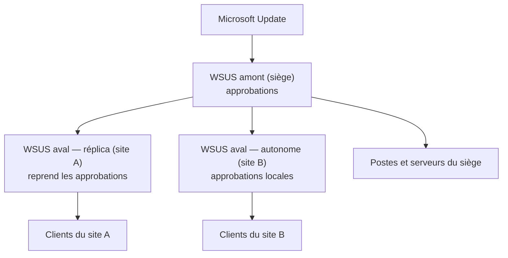

**WSUS** télécharge les mises à jour Microsoft une seule fois, permet de les **approuver** par groupe d'ordinateurs et les distribue sur le réseau local : maîtrise du calendrier, économie de bande passante, rapports de conformité.

> [!NOTE]
> **Statut.** Microsoft a annoncé en 2024 que WSUS est **déprécié** : il reste présent dans Windows Server 2025 et continue de recevoir et distribuer les mises à jour, mais n'évolue plus (la synchronisation des **pilotes** a été retirée en 2025). Alternatives : **Windows Autopatch** / **Intune** (postes), **Azure Update Manager** + Azure Arc (serveurs, y compris sur site), **Configuration Manager** (qui s'appuie lui-même sur WSUS). Pour les sites isolés, WSUS reste souvent la solution la plus simple.

## Architectures



| Choix | Options |
| --- | --- |
| Base de données | **WID** (*Windows Internal Database*, suffisant jusqu'à quelques milliers de clients) ou **SQL Server** (partagée, grands parcs, NLB de plusieurs frontaux) |
| Contenu | Stocké localement (les clients téléchargent depuis WSUS) ou téléchargé depuis Microsoft Update (WSUS ne gère que les approbations) |
| Aval | **Réplica** (approbations et groupes hérités) ou **autonome** |

## Installation

```powershell
Install-WindowsFeature UpdateServices -IncludeManagementTools        # WID
# ou avec SQL Server : Install-WindowsFeature UpdateServices-Services, UpdateServices-DB -IncludeManagementTools
New-Item -ItemType Directory -Path D:\WSUS
& "C:\Program Files\Update Services\Tools\wsusutil.exe" postinstall CONTENT_DIR=D:\WSUS
# SQL : wsusutil.exe postinstall SQL_INSTANCE_NAME="SRV-SQL-01\WSUS" CONTENT_DIR=D:\WSUS
```

Prévoyez un **volume dédié** (≥ 200 Go selon les produits et langues) pour le contenu, hors volume système.

## Produits, classifications, synchronisation

```powershell
$wsus = Get-WsusServer
$cfg = $wsus.GetConfiguration()
$cfg.AllUpdateLanguagesEnabled = $false
$cfg.SetEnabledUpdateLanguages("fr")
$cfg.Save()

# Choisir les produits (exemples) et classifications
Get-WsusProduct | Where-Object { $_.Product.Title -in @("Windows 11", "Microsoft Server operating system-24H2", "Microsoft Defender Antivirus") } | Set-WsusProduct
Get-WsusClassification | Where-Object { $_.Classification.Title -in @("Critical Updates", "Security Updates", "Definition Updates", "Update Rollups", "Updates") } | Set-WsusClassification

# Synchronisation automatique quotidienne
$sub = $wsus.GetSubscription()
$sub.SynchronizeAutomatically = $true
$sub.SynchronizeAutomaticallyTimeOfDay = (New-TimeSpan -Hours 3)
$sub.NumberOfSynchronizationsPerDay = 1
$sub.Save()
$sub.StartSynchronization()
```

> [!TIP]
> Ne cochez que les produits et langues **réellement** présents : chaque produit inutile alourdit la base, la console et les analyses des clients. Évitez la classification *Drivers* (et les mises à jour de fonctionnalités si vous ne les gérez pas par WSUS).

## HTTPS

Par défaut, WSUS écoute en HTTP sur **8530** et HTTPS sur **8531**. Les métadonnées étant signées, le HTTP n'expose pas au remplacement de mises à jour, mais une attaque réseau sur les métadonnées a déjà été démontrée (*WSUSpect*) : configurez **HTTPS**.

```powershell
# Après avoir lié un certificat au site « WSUS Administration » sur 8531 dans IIS
& "C:\Program Files\Update Services\Tools\wsusutil.exe" configuressl srv-wsus-01.corp.exemple.fr
```

Puis, dans la GPO des clients : `https://srv-wsus-01.corp.exemple.fr:8531`.

## Réglages IIS du pool WsusPool

| Paramètre | Valeur conseillée |
| --- | --- |
| Limite de la mémoire privée | 0 (illimitée) ou ≥ 8 Go |
| Longueur de la file d'attente | 2000 ou plus |
| Délai d'inactivité | 0 |
| Recyclage régulier | Désactivé (ou planifié hors heures) |

Un pool `WsusPool` qui s'arrête (erreurs 503 côté clients) est le symptôme WSUS le plus courant sur les grands parcs.

Suite : [[02-gpo-approbations-maintenance|GPO, approbations et maintenance]].
