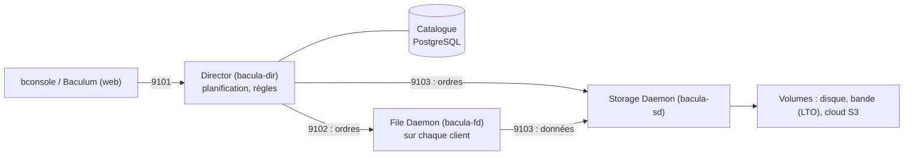

**Bacula** (AGPL v3, depuis 2000) est une solution de sauvegarde client/serveur pensée pour les grands parcs : planification centralisée, **catalogue** SQL de tous les fichiers sauvegardés, gestion fine des **volumes** sur disque, **bandes** (LTO, robotiques) ou stockage objet. L'édition **Enterprise** (Bacula Systems) ajoute des greffons (VMware, Hyper-V, Proxmox, Microsoft 365, bases), la déduplication globale et le support.

## Composants

| Composant | Rôle | Port |
| --- | --- | --- |
| **Director** | Cerveau : tâches, planifications, pools, clients, catalogue | 9101 |
| **File Daemon** (client) | Lit les fichiers à sauvegarder, écrit lors des restaurations (Linux, Windows, macOS, Unix) | 9102 |
| **Storage Daemon** | Écrit et lit les volumes (disques, bandes, robotiques, cloud) | 9103 |
| **Catalogue** | Base SQL (**PostgreSQL** recommandé) : tâches, fichiers, volumes | 5432 |
| bconsole | Console d'administration en ligne de commande | — |
| **Baculum** | Interface web et API | 9095/9096 |

Le Director initie les connexions vers les File Daemons (par défaut) ; derrière un pare-feu ou un NAT, le client peut initier la connexion (*Client Initiated Backup*, directive `ConnectToDirector`).

## Déroulement d'une tâche

1. À l'heure planifiée, le Director contacte le Storage Daemon (réservation d'un périphérique et d'un volume du pool) puis le File Daemon.
2. Le File Daemon envoie les données **directement** au Storage Daemon.
3. Les attributs des fichiers (chemin, taille, dates, empreinte) sont écrits dans le **catalogue**.
4. Un fichier *bootstrap* (`.bsr`) est écrit : il permet de restaurer même sans catalogue.

## Niveaux

| Niveau | Contenu |
| --- | --- |
| **Full** | Tout le FileSet |
| **Differential** | Changements depuis le dernier Full |
| **Incremental** | Changements depuis la dernière sauvegarde, quel que soit son niveau |
| VirtualFull | Synthèse d'un Full à partir des sauvegardes existantes, sans relire le client |

Cycle classique : Full mensuel, Différentiel hebdomadaire, Incrémental quotidien.

## Pools, volumes et rétentions

| Notion | Description |
| --- | --- |
| **Volume** | Fichier sur disque ou cartouche, étiqueté (*label*) |
| **Pool** | Ensemble de volumes partageant des règles (rétention, taille, recyclage) — ex. `Full-Pool`, `Incr-Pool`, `Externalise-Pool` |
| File Retention / Job Retention | Durée de conservation des enregistrements dans le catalogue |
| **Volume Retention** | Durée avant que le volume puisse être **recyclé** (réécrit) |

> [!IMPORTANT]
> Les rétentions doivent être cohérentes : un incrémental ne sert à rien si le Full dont il dépend a été recyclé. Le Volume Retention du pool Full doit couvrir toute la chaîne.

## Éditions et alternatives

| Produit | Remarques |
| --- | --- |
| Bacula Community | Libre, paquets officiels (dépôt bacula.org après inscription gratuite) ou paquets de distribution (souvent plus anciens) |
| Bacula Enterprise | Greffons de virtualisation et d'applications, déduplication globale, support |
| **Bareos** | Fork de 2010 (AGPL), configuration proche mais divergente, WebUI, greffons VMware/oVirt/Proxmox libres |

## Dimensionnement

- Catalogue : prévoir ~1 Ko par fichier et par sauvegarde conservée (des dizaines de Go pour un grand parc) ; PostgreSQL sur SSD.
- Storage Daemon : débit disque/bande et réseau (10 Gbit/s) ; plusieurs périphériques pour les tâches concurrentes.
- Pour la virtualisation à grande échelle sans greffons Enterprise, une solution spécialisée ([[05-veeam/01-presentation-architecture|Veeam]], [[06-nakivo/01-presentation-installation|NAKIVO]]) est souvent plus simple ; Bacula excelle sur les serveurs physiques, les bandes et les parcs hétérogènes.

Suite : [[02-installation-configuration|installation et configuration]].
