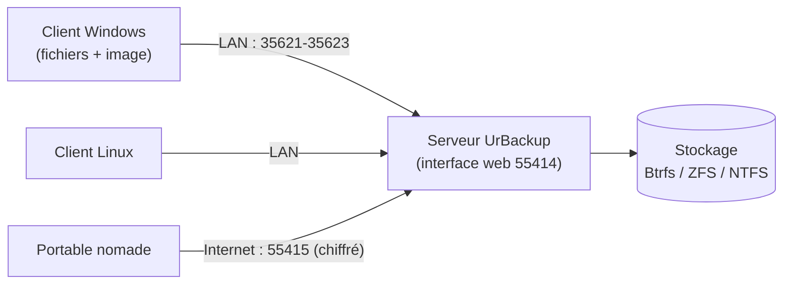

**UrBackup** (AGPL v3) sauvegarde des postes et serveurs vers un serveur central, avec une interface web simple. Il combine :

- des **sauvegardes de fichiers** (répertoires choisis, incrémentales et complètes) ;
- des **sauvegardes d'images** de volumes **Windows** (et Linux en mode expérimental), restaurables sur matériel nu avec un CD/clé de restauration.

Les sauvegardes s'effectuent pendant que le système fonctionne (instantanés **VSS** sous Windows, LVM/dattobd sous Linux). Le serveur **déduplique** les fichiers identiques entre clients (liens physiques ou fonctions de Btrfs/ZFS).

## Fonctionnement



| Port | Sens | Usage |
| --- | --- | --- |
| 55413/TCP | Serveur | FastCGI (si interface derrière un serveur web) |
| **55414/TCP** | Serveur | Interface web |
| **55415/TCP** | Serveur | Clients Internet (chiffré, authentifié) |
| 35623/UDP | Serveur → LAN | Découverte des clients (diffusion) |
| 35621/TCP, 35622/UDP, 35623/TCP | Client | Transfert de fichiers, découverte, commandes et images |

Le serveur **découvre** les clients du LAN par diffusion ; sur d'autres sous-réseaux, ajoutez les clients par leur nom ou adresse (*Ajouter un client*) ou utilisez le mode Internet.

## Installation du serveur

### Linux (recommandé)

```bash
# Debian / Ubuntu : dépôt openSUSE Build Service d'UrBackup (voir urbackup.org), puis
sudo apt install urbackup-server
# RHEL / Rocky : dépôt COPR / OBS, puis
sudo dnf install urbackup-server
sudo systemctl enable --now urbackupsrv
sudo firewall-cmd --permanent --add-port={55414,55415}/tcp --add-port=35623/udp && sudo firewall-cmd --reload
```

Au premier démarrage, l'assistant demande le **répertoire de stockage**. Choisissez un volume **Btrfs** ou **ZFS** : UrBackup utilise alors des sous-volumes/instantanés et la copie sur écriture, ce qui rend les sauvegardes incrémentales et la suppression des anciennes versions très rapides, et permet les images incrémentales sous forme de fichiers raw.

```bash
sudo mkfs.btrfs -L urbackup /dev/sdb && sudo mkdir -p /srv/urbackup
echo 'LABEL=urbackup /srv/urbackup btrfs defaults,noatime,compress=zstd 0 0' | sudo tee -a /etc/fstab && sudo mount -a
sudo urbackupsrv --version
```

Conteneur : image `uroni/urbackup-server` (montez le stockage et `/var/urbackup`), réseau en mode hôte pour la découverte.

### Windows

Installateur du serveur (`UrBackup Server x.y.z.exe`) ; stockage sur un volume **NTFS** (ou ReFS). Interface : `http://localhost:55414`.

## Installation des clients

```powershell
# Windows : installateur silencieux (choisir la variante « default » ou « Server » selon l'usage)
.\"UrBackup Client 2.5.x(x64).exe" /S
# Client préconfiguré pour un serveur Internet : télécharger depuis l'interface web
# (Statut → Ajouter un nouveau client Internet / Télécharger le client) un installateur contenant l'adresse et la clé
```

```bash
# Linux : script d'installation officiel (binaire autonome) — téléchargé depuis urbackup.org
TF=$(mktemp) && wget -O "$TF" "https://hndl.urbackup.org/Client/<version>/UrBackup%20Client%20Linux%20<version>.sh" && sudo sh "$TF"; rm -f "$TF"
# L'assistant propose la méthode d'instantané : LVM, dattobd, Btrfs ou aucun
sudo urbackupclientctl status
sudo urbackupclientctl add-backupdir -d /etc
sudo urbackupclientctl add-backupdir -d /srv
```

macOS : paquet client (`.pkg`) pour les sauvegardes de fichiers (pas d'images).

Après installation, le client apparaît dans l'interface du serveur (LAN) ; vérifiez qu'il est **en ligne** et lancez une première sauvegarde complète.

Suite : [[02-configuration-exploitation|configuration, restauration et exploitation]].
