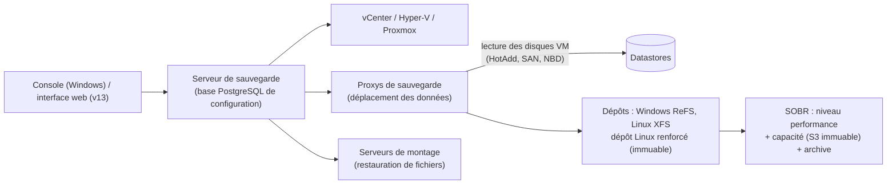

**Veeam Backup & Replication** (VBR) est la solution de sauvegarde de référence des environnements **virtualisés** : sauvegarde sans agent des VM au niveau de l'hyperviseur (instantanés + suivi des blocs modifiés), restauration très rapide (démarrage d'une VM directement depuis la sauvegarde), cohérence applicative (VSS) et restauration granulaire (fichiers, objets AD, mails Exchange, bases SQL).

## Périmètre

| Charge | Méthode |
| --- | --- |
| VMware vSphere, Hyper-V | Sans agent, via l'hyperviseur (CBT / RCT) |
| Proxmox VE, Nutanix AHV, oVirt/OLVM | Sans agent (intégrations dédiées) |
| Serveurs et postes physiques | **Veeam Agent** pour Windows, Linux, macOS, Unix |
| Partages NAS (SMB, NFS) | Sauvegarde de fichiers non structurés |
| Bases (Oracle, SAP HANA, SQL, PostgreSQL) | Greffons et traitement applicatif |
| Cloud (AWS, Azure, GCP) | Produits Veeam Backup for AWS/Azure/GCP intégrés à la console |
| Microsoft 365 | Produit séparé : Veeam Backup for Microsoft 365 |

## Composants

| Composant | Rôle |
| --- | --- |
| **Serveur de sauvegarde** | Orchestration, planification, base de configuration (PostgreSQL par défaut depuis v12) |
| **Proxy** | Lit les données des VM et les envoie au dépôt (compression, déduplication) ; modes **HotAdd** (VM proxy), **Direct SAN/NFS**, **NBD** (réseau) |
| **Dépôt** | Stockage des fichiers de sauvegarde ; **ReFS** (Windows) ou **XFS** (Linux) avec clonage de blocs (*Fast Clone*) pour des synthétiques rapides et économes |
| **Dépôt Linux renforcé** | Serveur Linux dédié, identifiants à usage unique, fichiers **immuables** pendant la durée choisie |
| **SOBR** (*Scale-Out Backup Repository*) | Agrégat de dépôts : niveau performance, niveau **capacité** (objet S3, déplacement ou copie, immuabilité), niveau archive (S3 Glacier, Azure Archive) |
| Stockage objet | Dépôt direct sur S3 compatible (MinIO, appliances, cloud) avec verrouillage d'objets |
| Serveur de montage, proxys d'interaction invité | Restauration de fichiers, traitement applicatif |
| Enterprise Manager, **Veeam ONE** | Portail multi-serveurs et libre-service ; supervision et rapports |

## Versions et plateformes

| Version | Plateforme du serveur |
| --- | --- |
| v12.x | Windows Server (console Windows) |
| **v13** (2025) | Windows **ou** **Veeam Software Appliance** (Linux renforcé, mises à jour gérées par Veeam) avec **interface web** ; composants (proxys, dépôts) également sous forme d'appliance |

## Licences

| Offre | Contenu |
| --- | --- |
| **VUL** (*Veeam Universal License*) | Par **instance** (VM, serveur, poste), portable entre charges ; éditions Foundation, Advanced, Premium (v13) |
| **Community Edition** | Gratuite jusqu'à **10 instances**, la plupart des fonctions de sauvegarde et restauration |

## Prérequis et ports

- Serveur de sauvegarde : 4 vCPU, 8–16 Go de RAM au minimum (davantage pour les grands parcs) ; **non joint** au domaine de production (ou dans un domaine/forêt d'administration dédié)
- Comptes de service distincts : vCenter (rôle avec droits Veeam), dépôts, invités Windows/Linux
- Ports principaux : **9392** (console → serveur), 2500–3300 (transfert de données entre proxys et dépôts), **6160/6162** (services d'installation et de transport sur les composants Windows), **443/902** (vCenter, ESXi), 22 (composants Linux lors du déploiement), 10006 (VIX), 1433/5432 (base)

## Installation (Windows)

1. Monter l'ISO de VBR, lancer `Setup.exe` → *Veeam Backup & Replication* → *Install*.
2. Fournir la licence (ou Community Edition), le compte de service, la base (**PostgreSQL** installée automatiquement, ou SQL Server existant).
3. Ouvrir la console, ajouter l'infrastructure : *Backup Infrastructure → Managed Servers* (vCenter, hôtes Hyper-V, serveurs Linux/Windows), puis **proxys** et **dépôts**.

Pour l'appliance v13 : déployer l'ISO/OVA de la *Veeam Software Appliance*, suivre l'assistant (réseau, compte, MFA), puis administrer par l'interface web.

Suite : [[02-travaux-restauration|travaux et restauration]].
