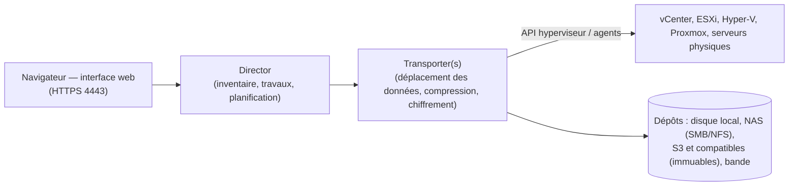

**NAKIVO Backup & Replication** protège machines virtuelles, serveurs physiques et applications avec une interface **web** unique. Sa légèreté (installable sur un **NAS** ou une petite VM) et son prix en font une alternative fréquente à [[05-veeam/01-presentation-architecture|Veeam]] pour les PME et les sites distants.

## Périmètre

| Charge | Méthode |
| --- | --- |
| VMware vSphere, Microsoft Hyper-V | Sans agent, suivi des blocs modifiés (CBT / RCT) |
| Proxmox VE, Nutanix AHV | Sans agent (intégrations natives dans les versions récentes) |
| Amazon EC2 | Instances, via API |
| Serveurs et postes Windows/Linux physiques | Agent installé par le Director |
| Partages NAS (SMB/NFS) | Sauvegarde de fichiers |
| Microsoft 365 | Exchange Online, OneDrive, SharePoint, Teams |
| Oracle Database | Via RMAN |

## Composants



| Composant | Rôle | Port |
| --- | --- | --- |
| **Director** | Gestion : inventaire, travaux, rôles, rapports ; une instance par déploiement (multi-locataires possible pour les MSP) | **4443/TCP** (interface web) |
| **Transporter** | Effectue les transferts (lecture des sources, écriture dans les dépôts) ; plusieurs Transporters pour répartir la charge ou couvrir les sites distants | **9446/TCP** |
| **Dépôt** (*Backup Repository*) | Stockage des sauvegardes : incrémental à jamais (*forever incremental*) avec déduplication et compression, ou incrémental avec complets | — |

Un **Transporter intégré** est installé avec le Director ; ajoutez des Transporters près des hôtes (une VM Transporter par cluster pour le mode HotAdd) et sur les sites distants.

## Déploiement

| Option | Remarques |
| --- | --- |
| **Appliance virtuelle** (VMware, Hyper-V, Nutanix) | Linux préconfiguré, déploiement en quelques minutes |
| Linux (Ubuntu, RHEL, SUSE…) | Installateur `.sh` |
| Windows | Installateur `.exe` |
| **NAS** (Synology, QNAP, ASUSTOR, TrueNAS, Western Digital, NETGEAR) | Paquet installé sur le NAS : le NAS devient serveur **et** dépôt |
| AWS (AMI), Raspberry Pi | Cas particuliers |

```bash
# Linux : installateur complet (Director + Transporter), mode interactif
sudo sh NAKIVO_Backup_Replication_<version>_Installer-<edition>.sh
# Interface : https://<serveur>:4443 — création du compte administrateur au premier accès
sudo ufw allow 4443/tcp && sudo ufw allow 9446/tcp
```

```powershell
# Windows : installateur graphique ; ou installation silencieuse selon la documentation de la version
.\NAKIVO_Backup_Replication_<version>_Installer.exe
New-NetFirewallRule -DisplayName "NAKIVO Director" -Direction Inbound -Protocol TCP -LocalPort 4443 -Action Allow
```

## Licences

| Modèle | Principe |
| --- | --- |
| Par charge (*per workload*) | Abonnement par VM, serveur, poste |
| Perpétuelle par socket | Hôtes de virtualisation |
| Microsoft 365 | Par utilisateur |
| Éditions | Pro Essentials, Enterprise Essentials, Enterprise, Enterprise Plus, MSP ; **Free** limitée et **essai** complet de 15 jours |

## Premiers pas

1. *Settings → Inventory* : ajouter vCenter (compte de service à droits limités), hôtes Hyper-V, Proxmox, serveurs physiques.
2. *Settings → Transporters* : ajouter/déployer les Transporters (VM Transporter par cluster, sites distants).
3. *Settings → Repositories* : créer les dépôts (local, CIFS/NFS, S3 compatible avec **immutabilité**).
4. Configurer la sauvegarde du Director lui-même (*Self-Backup*) vers un dépôt séparé.

Suite : [[02-travaux-securite-exploitation|travaux, sécurité et exploitation]].
