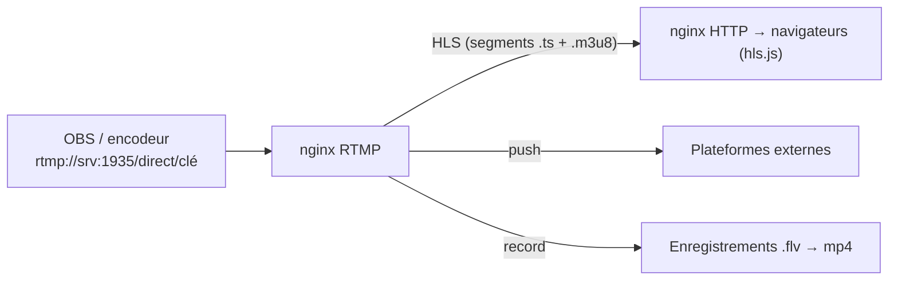

Le module **RTMP** de nginx (`nginx-rtmp-module`) reçoit un flux vidéo en direct (protocole **RTMP**, port 1935) envoyé par **OBS Studio**, un encodeur matériel ou ffmpeg, et le redistribue : en RTMP, en **HLS** (lisible dans tous les navigateurs via HTTP) ou vers d'autres plateformes. Cas d'usage : retransmission interne d'une réunion plénière, formation, événement, caméra.



## Installation

```bash
sudo apt install nginx libnginx-mod-rtmp ffmpeg       # Debian / Ubuntu
# Le module est chargé via /etc/nginx/modules-enabled/50-mod-rtmp.conf
sudo mkdir -p /var/www/hls /srv/enregistrements && sudo chown www-data: /var/www/hls /srv/enregistrements
```

Sur les autres systèmes : compiler nginx avec le module, ou utiliser une image Docker (ex. `tiangolo/nginx-rtmp`, `alfg/nginx-rtmp`). Windows/macOS : plutôt pour des tests.

## Configuration

```nginx /etc/nginx/nginx.conf (bloc rtmp au niveau principal, hors http)
rtmp {
    server {
        listen 1935;
        chunk_size 4096;

        application direct {
            live on;
            record off;

            # Publication autorisée seulement depuis la régie, vérification de la clé par une URL interne
            allow publish 10.0.70.0/24;
            deny publish all;
            on_publish http://127.0.0.1:8080/verifier-cle;

            # Lecture RTMP interdite : diffusion via HLS uniquement
            deny play all;

            # HLS
            hls on;
            hls_path /var/www/hls;
            hls_fragment 3s;
            hls_playlist_length 30s;

            # Enregistrement de l'événement
            record all;
            record_path /srv/enregistrements;
            record_unique on;

            # Relais vers une plateforme externe (optionnel)
            # push rtmp://live.plateforme.example/app/CLE_EXTERNE;
        }
    }
}
```

```nginx Diffusion HLS (bloc http)
server {
    listen 443 ssl;
    server_name direct.corp.exemple.fr;
    ssl_certificate     /etc/ssl/certs/direct.crt;
    ssl_certificate_key /etc/ssl/private/direct.key;

    location /hls/ {
        types { application/vnd.apple.mpegurl m3u8; video/mp2t ts; }
        alias /var/www/hls/;
        add_header Cache-Control no-cache;
        add_header Access-Control-Allow-Origin *;
    }
    location / { root /var/www/lecteur; }
}

# Vérification de la clé de flux (exemple minimal : la clé est le « nom » du flux)
server {
    listen 127.0.0.1:8080;
    location /verifier-cle {
        if ($arg_name = "CleSecreteDuDirect2026") { return 200; }
        return 403;
    }
}
```

Dans OBS : serveur `rtmp://srv-direct:1935/direct`, clé `CleSecreteDuDirect2026` ; lecture : `https://direct.corp.exemple.fr/hls/CleSecreteDuDirect2026.m3u8`. Pour ne pas exposer la clé dans l'URL de lecture, utilisez `hls_nested` avec un nom public, ou une redirection côté vérification (`return 302` vers un nom public dans `on_publish`).

### Plusieurs qualités

```nginx
application direct {
    live on;
    exec ffmpeg -i rtmp://localhost/direct/$name
      -c:v libx264 -preset veryfast -b:v 2500k -s 1280x720 -c:a aac -b:a 128k -f flv rtmp://localhost/hls/$name_720p
      -c:v libx264 -preset veryfast -b:v 800k  -s 854x480  -c:a aac -b:a 96k  -f flv rtmp://localhost/hls/$name_480p;
}
application hls {
    live on;
    hls on;
    hls_path /var/www/hls;
    hls_nested on;
    hls_variant _720p BANDWIDTH=2628000,RESOLUTION=1280x720;
    hls_variant _480p BANDWIDTH=896000,RESOLUTION=854x480;
}
```

Le transcodage logiciel consomme beaucoup de CPU (ou utilisez l'accélération matérielle de ffmpeg).

## Lecture dans un navigateur

Safari lit HLS nativement ; les autres navigateurs utilisent **hls.js** (bibliothèque JavaScript) dans une page simple `<video>`. Latence typique de HLS : 10 à 30 s (LL-HLS ou WebRTC pour la faible latence).

## Sécurité et exploitation

- [ ] Port **1935** ouvert seulement depuis la régie / les encodeurs ; publication filtrée par IP **et** par clé
- [ ] Lecture via HTTPS ; authentification de la page si le contenu est interne (SSO devant le site)
- [ ] Espace disque des enregistrements et de `hls_path` surveillé
- [ ] Le module RTMP n'évolue plus beaucoup : pour un usage important, évaluez **SRS**, **MediaMTX** (RTMP, SRT, WebRTC, HLS) ou **Owncast** (plateforme complète avec discussion)

| Symptôme | Cause | Solution |
| --- | --- | --- |
| OBS : « Impossible de se connecter » | 1935 filtré, `allow publish`, `on_publish` renvoie 403 | Pare-feu, règles, clé |
| Pas de fichiers `.m3u8` | Droits sur `hls_path`, `hls on` absent | Propriétaire `www-data`, journal d'erreurs nginx |
| Lecture qui saute | Intervalle d'images clés incohérent avec `hls_fragment` | OBS : intervalle d'image clé = 2 s, fragment multiple de cet intervalle |
| Enregistrement illisible | Format FLV | `ffmpeg -i fichier.flv -c copy fichier.mp4` (ou `exec_record_done`) |
