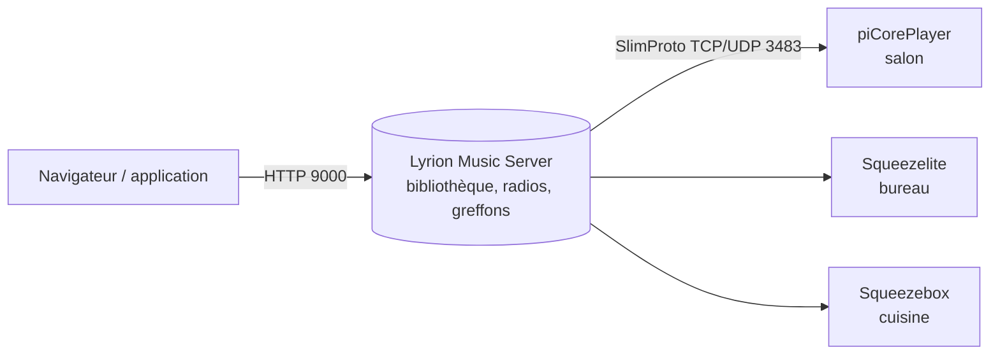

**Lyrion Music Server** (nom adopté en 2024 par l'ancien **Logitech Media Server**, abandonné par Logitech et repris par la communauté) pilote des **lecteurs réseau** : les Squeezebox historiques et, surtout aujourd'hui, des Raspberry Pi sous **piCorePlayer** ou des ordinateurs avec **Squeezelite**. Il permet une écoute **synchronisée dans plusieurs pièces**.



## Installation

```bash
# Paquet Debian/Ubuntu (télécharger la version stable sur le site de Lyrion)
sudo apt install ./lyrionmusicserver_9.0.3_all.deb      # numéro de version à adapter
sudo systemctl status lyrionmusicserver

# Docker (image de la communauté)
docker run -d --name lms --restart unless-stopped --network host \
  -v lms_config:/config -v /srv/musique:/music:ro -v lms_playlist:/playlist \
  -e TZ=Europe/Paris lmscommunity/lyrionmusicserver
```

Le mode réseau `host` simplifie la découverte des lecteurs (diffusion UDP).

## Ports

| Port | Usage |
| --- | --- |
| TCP **9000** | Interface web et API JSON-RPC |
| TCP et UDP **3483** | SlimProto : dialogue avec les lecteurs et découverte |
| TCP **9090** | Interface en ligne de commande (CLI telnet) |

## Configuration

- *Paramètres → Bibliothèque* : dossiers de musique, analyse complète ou nouveaux fichiers.
- *Paramètres → Gestionnaire de greffons* : **Material Skin** (interface moderne et application web mobile), **Spotty** (Spotify), radios, podcasts, Deezer/Qobuz/Tidal selon les greffons disponibles.
- **Synchronisation** : dans l'interface d'un lecteur, *Synchroniser avec* un autre lecteur ; les lecteurs synchronisés jouent le même flux avec un délai réglable par lecteur.

## Lecteurs logiciels

```bash
# Squeezelite sur un PC Linux ou un Raspberry Pi
sudo apt install squeezelite
squeezelite -l                                  # sorties audio disponibles
squeezelite -n Bureau -o default -s 192.168.1.20   # nom du lecteur, sortie, serveur
```

**piCorePlayer** est une distribution prête à l'emploi pour Raspberry Pi : Squeezelite (et éventuellement LMS lui-même) configurables par une page web.

## Interface en ligne de commande

```bash
printf 'players 0 10\nexit\n' | nc serveur 9090                 # lecteurs connus
printf '00:11:22:33:44:55 mixer volume 30\nexit\n' | nc serveur 9090
curl -s -H 'Content-Type: application/json' -d '{"id":1,"method":"slim.request","params":["",["serverstatus",0,10]]}' http://serveur:9000/jsonrpc.js
```

## Dépannage

| Symptôme | Piste |
| --- | --- |
| Lecteur introuvable | Port 3483 UDP/TCP filtré, VLAN différent, conteneur sans réseau `host` ; indiquer l'adresse du serveur sur le lecteur |
| Coupures de son | Wi-Fi faible, taille de tampon (Squeezelite `-b`), transcodage trop lourd sur un petit serveur |
| Pochettes ou étiquettes manquantes | Relancer une analyse complète, vérifier les étiquettes (MusicBrainz Picard) |

Voir aussi : [[01-comparatif|choisir un serveur de musique]]. Commandes : [[90-aide-memoire|aide-mémoire]].
