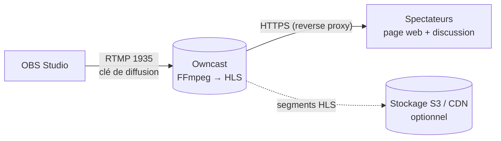

**Owncast** est une alternative auto-hébergée à Twitch ou YouTube Live pour **une chaîne** : on diffuse depuis OBS, Owncast transcode et publie le direct en **HLS** sur une page web avec **discussion** intégrée. Usages : conférences internes, formations, événements associatifs, retransmissions.



## Installation

```bash
# Script officiel (installe dans ./owncast avec FFmpeg)
curl -s https://owncast.online/install.sh | bash
cd owncast && ./owncast

# Docker
docker run -d --name owncast --restart unless-stopped \
  -p 8080:8080 -p 1935:1935 -v owncast_data:/app/data owncast/owncast:latest
```

Service systemd pour l'installation binaire :

```ini /etc/systemd/system/owncast.service
[Unit]
Description=Owncast
After=network-online.target

[Service]
User=owncast
WorkingDirectory=/opt/owncast
ExecStart=/opt/owncast/owncast
Restart=on-failure

[Install]
WantedBy=multi-user.target
```

## Premiers réglages

1. Ouvrir `http://serveur:8080/admin` ; identifiant `admin`, mot de passe par défaut **`abc123`** : à **changer immédiatement** (*Configuration → Server Setup*). Ce mot de passe sert aussi de clé de diffusion par défaut ; créer des **clés de diffusion** dédiées.
2. *General* : nom, description, logo, réseaux sociaux.
3. *Video* : **variantes** de qualité (par exemple 1080p, 720p, 480p) ; chaque variante coûte du processeur. Activer le *passthrough* pour la meilleure qualité si la bande passante des spectateurs le permet.
4. *Chat* : modération, mots interdits, comptes avec authentification (IndieAuth, Fediverse).

## Diffuser depuis OBS

| Réglage OBS | Valeur |
| --- | --- |
| Service | Personnalisé |
| Serveur | `rtmp://serveur:1935/live` |
| Clé de stream | Une clé de diffusion Owncast |
| Encodeur | x264 ou matériel (NVENC, Quick Sync), CBR, image clé toutes les 2 s |
| Débit | 4 000 à 6 000 kbit/s en 1080p30 selon le lien montant |

## Reverse proxy

```nginx
server {
    server_name live.exemple.fr;
    location / {
        proxy_pass http://127.0.0.1:8080;
        proxy_http_version 1.1;
        proxy_set_header Upgrade $http_upgrade;     # WebSocket de la discussion
        proxy_set_header Connection "upgrade";
        proxy_set_header Host $host;
        proxy_set_header X-Forwarded-For $proxy_add_x_forwarded_for;
    }
    listen 443 ssl;   # certificats Let's Encrypt
}
```

Le port **1935** (RTMP) reste ouvert directement, idéalement limité aux adresses des diffuseurs.

## Montée en charge

- Le **transcodage** dépend du processeur (ou d'un GPU) du serveur ; la **diffusion** dépend de la bande passante : 100 spectateurs à 3 Mbit/s = 300 Mbit/s sortants.
- Au-delà de quelques dizaines de spectateurs, activer le **stockage S3** (*Storage*) : les segments HLS sont servis par le stockage objet ou un CDN.
- Notifications de début de direct vers le **Fediverse**, Discord ou par webhooks (*Integrations*).

Voir aussi : [[03-peertube|PeerTube]] (lives avec rediffusion) et la page Nginx RTMP du wiki. Commandes : [[90-aide-memoire|aide-mémoire]].
