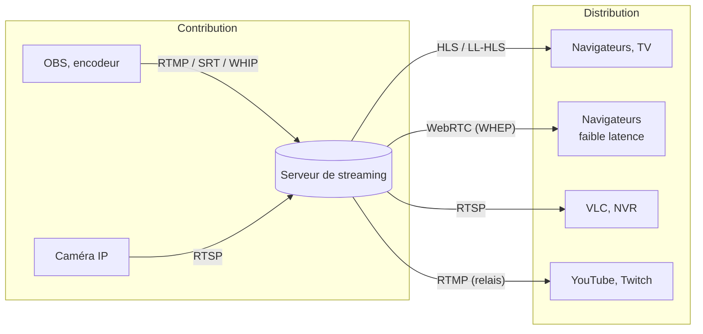

Un serveur de streaming **reçoit** un flux (contribution) et le **redistribue** à des spectateurs (distribution), souvent dans un autre protocole.

## Protocoles

| Protocole | Usage | Transport, port courant | Latence typique |
| --- | --- | --- | --- |
| **RTMP** | Contribution depuis OBS, envoi vers les plates-formes | TCP 1935 | 2-5 s (au bout de la chaîne) |
| **SRT** | Contribution fiable sur Internet (pertes, gigue), chiffrée | UDP (port au choix) | Configurable, < 1 s |
| **RTSP** | Caméras IP, vidéosurveillance | TCP 554 (et RTP en UDP) | < 1 s |
| **HLS** | Distribution universelle (navigateurs, mobiles, TV), compatible CDN | HTTP(S) | 6-30 s |
| **LL-HLS** | HLS à faible latence | HTTP(S) | 2-5 s |
| **DASH** | Équivalent ouvert de HLS | HTTP(S) | 6-30 s |
| **WebRTC** | Temps réel dans le navigateur ; **WHIP** (envoi) et **WHEP** (lecture) normalisent la signalisation | UDP (ICE), STUN/TURN | < 1 s |

> [!TIP]
> Plus la latence est faible, plus la diffusion est coûteuse et fragile. HLS suffit pour une conférence ou une retransmission ; WebRTC se justifie pour l'interaction (questions en direct, enchères, pilotage de drone).

## Serveurs

| Serveur | Langage, licence | Points forts | Pour qui |
| --- | --- | --- | --- |
| **MediaMTX** | Go, MIT | Binaire unique, tous les protocoles (RTSP, RTMP, SRT, HLS, WebRTC), enregistrement, très simple | Caméras IP, passerelle de protocoles, laboratoires |
| **SRS** | C++, MIT | Haute performance, RTMP, HLS, HTTP-FLV, WebRTC, SRT, grappes | Plates-formes de diffusion |
| **OvenMediaEngine** | C++, AGPL | **Latence sous la seconde** (WebRTC, LL-HLS) à grande échelle, transcodage | Événements interactifs |
| **Ant Media Server Community** | Java, Apache 2.0 | WebRTC en émission, HLS, interface web | Applications de visio et de diffusion (l'édition Enterprise ajoute la lecture WebRTC et la grappe) |
| **Red5** | Java, Apache 2.0 | Serveur RTMP historique | Applications existantes (Red5 Pro est commercial) |
| **Restreamer** | Go, Apache 2.0 | Interface web pour **rediffuser vers plusieurs plates-formes** et un lecteur web | Associations, églises, petites structures |
| **Nginx RTMP** | C, BSD | Module Nginx RTMP vers HLS | Besoins simples (voir la page dédiée du wiki) |

Pages : [[02-mediamtx|MediaMTX]] · [[03-srs|SRS]] · [[04-ovenmediaengine|OvenMediaEngine]] · [[05-ant-media-red5|Ant Media Server et Red5]] · [[06-restreamer|Restreamer]]. Commandes : [[90-aide-memoire|aide-mémoire]].
