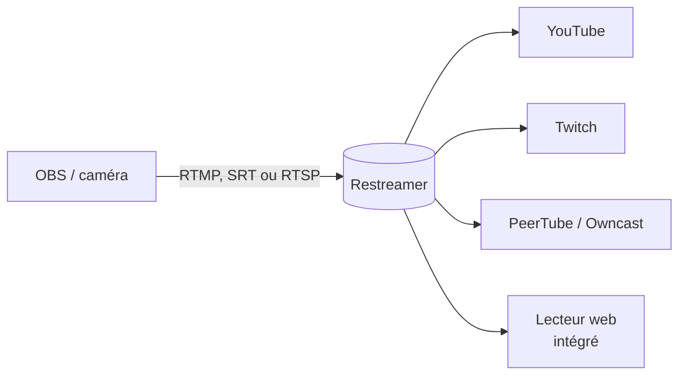

**Restreamer** reçoit **un** flux (OBS, caméra IP, encodeur) et le **rediffuse simultanément** vers plusieurs destinations, tout en proposant sa propre page de lecture. Il évite d'envoyer N flux depuis la salle quand la connexion montante est limitée.



## Installation

```bash
docker run -d --name restreamer --restart unless-stopped \
  -v /opt/restreamer/config:/core/config -v /opt/restreamer/data:/core/data \
  -p 8080:8080 -p 8181:8181 -p 1935:1935 -p 1936:1936 -p 6000:6000/udp \
  datarhei/restreamer:latest
```

| Port | Usage |
| --- | --- |
| TCP 8080 / 8181 | Interface d'administration et lecteur (HTTP / HTTPS) |
| TCP 1935 / 1936 | RTMP / RTMPS (entrée) |
| UDP 6000 | SRT (entrée) |

Ouvrir `http://serveur:8080/ui`, créer le compte administrateur, puis suivre l'**assistant** :

1. **Source** : RTMP ou SRT interne (Restreamer donne l'adresse et la clé à saisir dans OBS), caméra RTSP, flux HLS, carte d'acquisition.
2. **Encodage** : *passthrough* (pas de transcodage, recommandé) ou réencodage si une destination l'exige.
3. **Publication** : ajouter les destinations (*Publication services*) avec leur clé de diffusion : YouTube, Twitch, Facebook, LinkedIn, Vimeo, PeerTube, Owncast, serveur RTMP ou SRT quelconque.
4. **Lecteur** : page publique avec lecteur intégré, intégrable dans un site.

## HTTPS et sécurité

- Renseigner un **nom de domaine** pointant vers le serveur : Restreamer obtient un certificat **Let's Encrypt** automatiquement (port 80 accessible pendant l'opération).
- Protéger l'interface par un mot de passe fort ; ouvrir à Internet seulement les ports nécessaires (lecteur, entrée RTMP/SRT des diffuseurs).
- Le flux d'entrée RTMP est protégé par un jeton dans la clé : ne pas le divulguer.

Voir aussi : [[01-protocoles-comparatif|protocoles et comparatif]]. Commandes : [[90-aide-memoire|aide-mémoire]].
