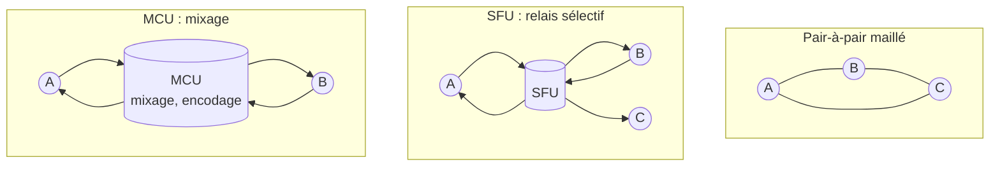

**WebRTC** permet l'audio, la vidéo et les données en temps réel directement dans le navigateur ou une application mobile, avec une latence inférieure à la seconde. Les briques à héberger sont la **signalisation**, la **traversée des NAT** (STUN/TURN) et, au-delà de quelques participants, un **serveur média**.

## Les briques

| Brique | Rôle | Hébergement |
| --- | --- | --- |
| **Signalisation** | Échange des offres et réponses SDP et des candidats ICE (WebSocket, HTTP) ; non normalisée, sauf **WHIP/WHEP** pour l'envoi et la lecture de flux | Application ou serveur média |
| **STUN** | Découvrir son adresse publique | Léger, peut être public |
| **TURN** | **Relayer** les médias quand aucune connexion directe n'est possible (pare-feu d'entreprise, NAT symétrique) | **coturn** (voir la page Prosody et visioconférence du wiki) ; consomme beaucoup de bande passante |
| **Serveur média** | Recevoir et redistribuer les flux | SFU ou MCU |
| Chiffrement | **DTLS-SRTP** obligatoire de bout en bout jusqu'au serveur média | Intégré |

## Topologies

| Topologie | Principe | Limites |
| --- | --- | --- |
| **Pair-à-pair** | Chaque participant envoie son flux à chaque autre | 3-4 participants au plus (débit montant) |
| **SFU** (*Selective Forwarding Unit*) | Chacun envoie un flux au serveur, qui le **relaie sans le décoder** ; avec le **simulcast** (plusieurs qualités) ou le **SVC**, le serveur choisit la qualité par destinataire | Standard actuel : peu de processeur, beaucoup de bande passante |
| **MCU** (*Multipoint Control Unit*) | Le serveur **décode, mixe et réencode** une mosaïque unique | Très coûteux en processeur ; utile pour l'enregistrement, la passerelle SIP, les clients faibles |

## Ports et pare-feu

- Médias en **UDP** sur une plage de ports du serveur média (à ouvrir), avec repli en TCP ou via TURN.
- **TURN sur TCP/TLS 443** pour les réseaux qui ne laissent sortir que le web.
- L'adresse IP **publique** du serveur doit être annoncée dans les candidats ICE (paramètre propre à chaque serveur) ; derrière un NAT 1:1, la déclarer explicitement.

## Choisir un serveur

| Serveur | Langage, licence | Type | Points forts |
| --- | --- | --- | --- |
| **Janus** | C, GPL 3 | SFU modulaire (greffons) | Visio, streaming, passerelle **SIP**, enregistrement ; très polyvalent |
| **LiveKit** | Go, Apache 2.0 | SFU complet | Salles, SDK pour toutes les plates-formes, enregistrement (Egress), entrées RTMP/WHIP (Ingress), agents IA vocaux |
| **mediasoup** | C++ et Node.js (ou Rust), ISC | **Bibliothèque** SFU | Brique bas niveau très performante pour construire sa propre application |
| **Pion** | Go, MIT | **Bibliothèque** WebRTC | Implémentation complète en Go : clients, passerelles, serveurs sur mesure |
| **Kurento** | C++ et Java, Apache 2.0 | Serveur média (SFU et MCU) | Traitements (mixage, filtres, vision), mais développement ralenti |
| Jitsi Meet, BigBlueButton | — | Applications complètes | Visioconférence clés en main (voir la page Jitsi et BigBlueButton du wiki) |

Pages : [[02-janus|Janus]] · [[03-livekit|LiveKit]] · [[04-mediasoup-pion-kurento|mediasoup, Pion et Kurento]]. Commandes : [[90-aide-memoire|aide-mémoire]].
