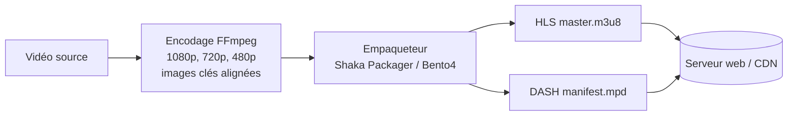

Le **streaming adaptatif** (HLS, DASH) découpe une vidéo en **segments** disponibles en plusieurs **qualités** : le lecteur choisit la qualité selon la bande passante. Les **empaqueteurs** produisent ces segments et les **manifestes** (`.m3u8` pour HLS, `.mpd` pour DASH) à partir de fichiers déjà encodés ; un simple serveur web ou un CDN suffit ensuite pour diffuser.



## Préparer les qualités

Les différentes qualités doivent avoir des **images clés aux mêmes instants** (GOP fixe, sans détection de changement de scène) :

```bash
for h in 1080 720 480; do
  ffmpeg -i source.mp4 -an -c:v libx264 -crf 22 -preset slow \
    -vf "scale=-2:$h" -g 48 -keyint_min 48 -sc_threshold 0 "video_${h}p.mp4"
done
ffmpeg -i source.mp4 -vn -c:a aac -b:a 128k audio.mp4
```

(`-g 48` = une image clé toutes les 2 secondes à 24 images/s.)

## Shaka Packager

```bash
# Binaire publié sur GitHub (packager-linux-x64…) ou image Docker
docker run --rm -v $PWD:/media -w /media google/shaka-packager packager --version
```

```bash
packager \
  in=video_1080p.mp4,stream=video,output=v1080.mp4,playlist_name=v1080.m3u8 \
  in=video_720p.mp4,stream=video,output=v720.mp4,playlist_name=v720.m3u8 \
  in=video_480p.mp4,stream=video,output=v480.mp4,playlist_name=v480.m3u8 \
  in=audio.mp4,stream=audio,output=audio.mp4,playlist_name=audio.m3u8,hls_group_id=audio,hls_name=FR \
  --segment_duration 4 \
  --mpd_output manifest.mpd \
  --hls_master_playlist_output master.m3u8
```

Une seule commande produit **DASH et HLS** sur les mêmes fichiers fragmentés (CMAF). Shaka Packager sait aussi :

- **Chiffrer** : ClearKey (`--enable_raw_key_encryption --keys …`), ou Widevine et PlayReady avec un serveur de licences (DRM) ;
- empaqueter un **direct** (entrée UDP en MPEG-TS) ;
- ajouter des **sous-titres** WebVTT et des pistes audio en plusieurs langues.

## Bento4

**Bento4** est une boîte à outils MP4 (licence GPL, ou commerciale) : inspection, fragmentation, empaquetage, chiffrement.

```bash
mp4info video_720p.mp4                     # pistes, codecs, durée, fragmentation
mp4dump --verbosity 1 video_720p.mp4       # structure des boîtes MP4
mp4fragment video_720p.mp4 f720.mp4        # MP4 fragmenté (prérequis de mp4dash)
mp4fragment video_480p.mp4 f480.mp4
mp4fragment audio.mp4 faudio.mp4
mp4dash --hls --output-dir=sortie f720.mp4 f480.mp4 faudio.mp4    # DASH + HLS
mp4hls video_720p.mp4                      # HLS seul (segments TS)
mp4encrypt --method MPEG-CENC --key 1:<clé hex>:random entree.mp4 chiffre.mp4
```

`mp4dash` et `mp4hls` sont des scripts Python fournis avec Bento4 (paquets binaires sur le site du projet, `brew install bento4`).

## Publier

- Copier le dossier de sortie sur un serveur web (Nginx, Caddy) ou un stockage objet derrière un CDN.
- Types MIME : `application/vnd.apple.mpegurl` (`.m3u8`), `application/dash+xml` (`.mpd`), `video/mp4` (`.mp4`, `.m4s`).
- **CORS** autorisé si le lecteur est sur un autre domaine.
- Lecteurs web : Shaka Player, hls.js, Video.js, dash.js.

```nginx
location /videos/ {
    types { application/vnd.apple.mpegurl m3u8; application/dash+xml mpd; video/mp4 mp4 m4s; }
    add_header Access-Control-Allow-Origin "*";
    add_header Cache-Control "public, max-age=86400";
}
```

Voir aussi : [[12-traitement-video/01-ffmpeg|FFmpeg]] · [[02-tdarr-unmanic-fileflows|Tdarr, Unmanic, FileFlows]]. Commandes : [[90-aide-memoire|aide-mémoire]].
