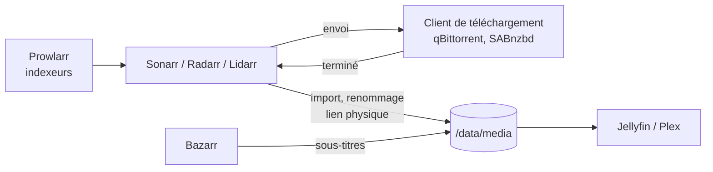

Les applications « **\*arr** » gèrent une médiathèque : elles suivent une liste de séries, films, albums ou livres, cherchent les éléments manquants auprès d'**indexeurs**, confient le téléchargement à un **client** (qBittorrent, Transmission, SABnzbd), puis **renomment et rangent** les fichiers pour le serveur multimédia (Jellyfin, Plex).

> [!IMPORTANT]
> Ces outils automatisent des téléchargements : ne les utilisez que pour des contenus que vous avez le **droit** de télécharger (œuvres libres ou du domaine public, contenus dont vous détenez les droits, offres légales). Le téléchargement d'œuvres protégées sans autorisation est illégal.

## Rôles

| Application | Rôle | Port |
| --- | --- | --- |
| **Sonarr** | Séries (par saison et épisode) | 8989 |
| **Radarr** | Films | 7878 |
| **Lidarr** | Musique (artistes, albums) | 8686 |
| **Readarr** | Livres et livres audio (**projet archivé** en 2025, plus maintenu) | 8787 |
| **Prowlarr** | Gestion **centralisée des indexeurs**, synchronisés vers les autres *arr | 9696 |
| **Jackett** | Passerelle d'indexeurs (Torznab), ancêtre de Prowlarr | 9117 |
| **Bazarr** | **Sous-titres** pour les séries et films de Sonarr et Radarr | 6767 |



## Arborescence : un seul /data et des liens physiques

Monter **le même volume** dans le client de téléchargement et dans les *arr permet l'**import par lien physique** : le fichier existe à la fois dans `torrents/` (pour continuer le partage) et dans `media/`, sans copie ni espace disque supplémentaire.

```text
/data
├── torrents/
│   ├── films/
│   ├── series/
│   └── musique/
└── media/
    ├── films/
    ├── series/
    └── musique/
```

Les liens physiques exigent que les deux dossiers soient sur le **même système de fichiers** et vus par le **même point de montage** dans les conteneurs (`/data`), et non deux montages séparés `/downloads` et `/movies`.

## Docker Compose

```yaml docker-compose.yml
x-commun: &commun
  environment: [PUID=1000, PGID=1000, TZ=Europe/Paris, UMASK=002]
  restart: unless-stopped

services:
  prowlarr:
    <<: *commun
    image: lscr.io/linuxserver/prowlarr:latest
    volumes: ["./config/prowlarr:/config"]
    ports: ["9696:9696"]
  sonarr:
    <<: *commun
    image: lscr.io/linuxserver/sonarr:latest
    volumes: ["./config/sonarr:/config", "/srv/data:/data"]
    ports: ["8989:8989"]
  radarr:
    <<: *commun
    image: lscr.io/linuxserver/radarr:latest
    volumes: ["./config/radarr:/config", "/srv/data:/data"]
    ports: ["7878:7878"]
  lidarr:
    <<: *commun
    image: lscr.io/linuxserver/lidarr:latest
    volumes: ["./config/lidarr:/config", "/srv/data:/data"]
    ports: ["8686:8686"]
  bazarr:
    <<: *commun
    image: lscr.io/linuxserver/bazarr:latest
    volumes: ["./config/bazarr:/config", "/srv/data/media:/data/media"]
    ports: ["6767:6767"]
  qbittorrent:
    <<: *commun
    image: lscr.io/linuxserver/qbittorrent:latest
    volumes: ["./config/qbittorrent:/config", "/srv/data/torrents:/data/torrents"]
    ports: ["8080:8080"]
```

```bash
sudo mkdir -p /srv/data/{torrents,media}/{films,series,musique}
sudo chown -R 1000:1000 /srv/data && sudo chmod -R a=,a+rX,u+w,g+w /srv/data
docker compose up -d
```

`PUID`/`PGID` doivent correspondre au propriétaire des fichiers ; `UMASK=002` laisse les droits d'écriture au groupe (utile si Jellyfin lit avec un autre compte du même groupe).

## Sécurité

- Activer l'**authentification** de chaque application (*Settings → General → Security*, authentification par formulaire) ; elle est obligatoire dans les versions récentes.
- Ne pas exposer ces interfaces sur Internet ; si nécessaire, passer par un **reverse proxy** avec authentification unique (Authelia, Authentik) ou un VPN.
- Faire passer le client de téléchargement par un **VPN** si la politique le demande (conteneur Gluetun).
- Les **clés d'API** (*Settings → General*) donnent un accès complet : les garder secrètes.

## Sauvegarde

Chaque application fait des **sauvegardes automatiques** de sa base et de ses réglages (*System → Backup*) ; copier le dossier `config/` de chaque conteneur dans la sauvegarde du serveur.

Suite : [[02-sonarr-radarr-lidarr-readarr|Sonarr, Radarr, Lidarr, Readarr]] · [[03-prowlarr-jackett-bazarr|Prowlarr, Jackett, Bazarr]]. Commandes : [[90-aide-memoire|aide-mémoire]].
