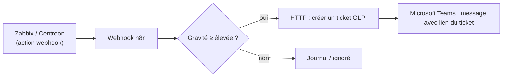

**n8n** relie des applications par des **flux** (*workflows*) visuels : un déclencheur (webhook, horaire, message, événement) puis une suite de **nœuds** (requêtes HTTP, SSH, bases de données, Microsoft 365, Slack/Teams, GLPI, IA…), avec du code JavaScript ou Python quand il le faut. Pour une équipe d'exploitation : automatiser les tâches répétitives entre outils qui ne se parlent pas.

**Licence** : *Sustainable Use License* (« fair-code ») — usage interne libre, y compris en entreprise ; revente ou hébergement pour des tiers interdits sans accord. Des fonctions (SSO, gestion des environnements Git, journaux d'audit étendus) relèvent des offres commerciales.

## Installation

```yaml /srv/n8n/compose.yaml
services:
  postgres:
    image: postgres:16
    restart: unless-stopped
    environment:
      POSTGRES_USER: n8n
      POSTGRES_PASSWORD: ${POSTGRES_PASSWORD}
      POSTGRES_DB: n8n
    volumes: ["./postgres:/var/lib/postgresql/data"]

  n8n:
    image: docker.n8n.io/n8nio/n8n:latest      # épingler une version
    restart: unless-stopped
    depends_on: [postgres]
    ports: ["127.0.0.1:5678:5678"]
    environment:
      DB_TYPE: postgresdb
      DB_POSTGRESDB_HOST: postgres
      DB_POSTGRESDB_DATABASE: n8n
      DB_POSTGRESDB_USER: n8n
      DB_POSTGRESDB_PASSWORD: ${POSTGRES_PASSWORD}
      N8N_ENCRYPTION_KEY: ${N8N_ENCRYPTION_KEY}
      N8N_HOST: n8n.corp.exemple.fr
      N8N_PROTOCOL: https
      WEBHOOK_URL: https://n8n.corp.exemple.fr/
      GENERIC_TIMEZONE: Europe/Paris
      N8N_DIAGNOSTICS_ENABLED: "false"
      N8N_RUNNERS_ENABLED: "true"
    volumes: ["./donnees:/home/node/.n8n"]
```

```bash
cd /srv/n8n
printf 'POSTGRES_PASSWORD=%s\nN8N_ENCRYPTION_KEY=%s\n' "$(openssl rand -base64 24)" "$(openssl rand -hex 32)" > .env && chmod 600 .env
docker compose up -d
```

> [!IMPORTANT]
> `N8N_ENCRYPTION_KEY` chiffre tous les **identifiants** enregistrés (mots de passe, jetons d'API). Sauvegardez-la avec la base : sans elle, les identifiants sont perdus après une restauration.

Publier derrière un reverse proxy HTTPS (WebSocket nécessaire pour l'éditeur). Le premier accès crée le compte propriétaire.

## Exemple : alerte de supervision → ticket + Teams



1. Nœud **Webhook** (`POST /webhook/alerte`, authentification par en-tête).
2. Nœud **If** sur la gravité.
3. Nœud **HTTP Request** vers l'API de [[04-glpi-installation|GLPI]] (session, création du ticket).
4. Nœud **Microsoft Teams** (ou webhook entrant) avec le résumé et le lien.

Autres idées : rapport quotidien (requêtes API vers la supervision + mise en forme + courriel), arrivée d'un collaborateur (création de comptes depuis un formulaire avec validation), vérification hebdomadaire des certificats, résumé d'incidents par un modèle d'IA local ([[04-ollama-open-webui|Ollama]]).

## Exploitation

| Sujet | Recommandation |
| --- | --- |
| Charge | Mode **file d'attente** (*queue mode* : Redis + workers) pour les volumes importants |
| Historique des exécutions | Purge (`EXECUTIONS_DATA_PRUNE=true`, `EXECUTIONS_DATA_MAX_AGE` en heures) |
| Versionnement | Export des flux en JSON (`n8n export:workflow --all`) dans Git, ou fonction Git des offres payantes |
| Supervision | Point `/healthz`, métriques Prometheus (`N8N_METRICS=true`), flux d'erreur global (*Error Workflow*) qui notifie |
| Sauvegarde | Base PostgreSQL + dossier `.n8n` + clé de chiffrement |
| Mises à jour | Fréquentes ; lire les notes de version (changements cassants), tester les flux critiques |

## Sécurité

- [ ] Interface derrière HTTPS, comptes nominatifs avec **2FA**, inscription fermée
- [ ] Webhooks protégés (authentification par en-tête ou JWT, URL non devinables), filtrage par IP si possible
- [ ] Identifiants à droits minimaux (comptes de service dédiés, jetons limités)
- [ ] Nœuds **Execute Command** / **SSH** : puissants (exécution sur l'hôte ou les serveurs) — à désactiver s'ils ne sont pas nécessaires (`NODES_EXCLUDE`)
- [ ] n8n à jour : des vulnérabilités critiques ont été corrigées dans le projet
