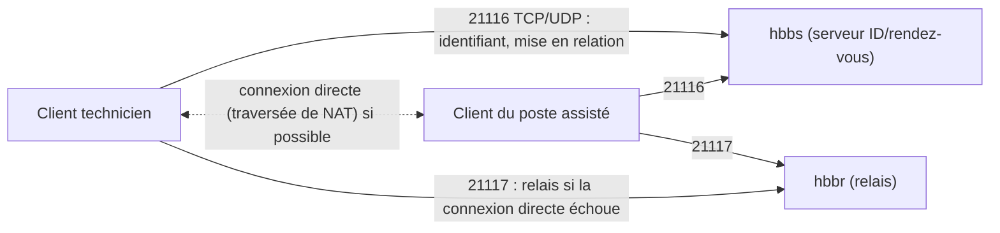

**RustDesk** (AGPL) est une alternative libre à [[01-anydesk-teamviewer|AnyDesk et TeamViewer]] : mêmes usages (bureau à distance, transfert de fichiers, sans VPN), mais avec des **serveurs que vous hébergez**, donc sans dépendre d'un éditeur pour la mise en relation. Une édition **Pro** (payante) ajoute console web, gestion des utilisateurs, LDAP/OIDC, carnet d'adresses partagé et journaux.

## Architecture



| Port | Service | Usage |
| --- | --- | --- |
| 21115/TCP | hbbs | Test du type de NAT |
| **21116/TCP et UDP** | hbbs | Enregistrement des identifiants, rendez-vous |
| **21117/TCP** | hbbr | Relais |
| 21118, 21119/TCP | hbbs, hbbr | Clients web (facultatif) |

## Installation des serveurs

```yaml /srv/rustdesk/compose.yaml
services:
  hbbs:
    image: rustdesk/rustdesk-server:latest
    command: hbbs
    volumes: ["./data:/root"]
    network_mode: host
    depends_on: [hbbr]
    restart: unless-stopped
  hbbr:
    image: rustdesk/rustdesk-server:latest
    command: hbbr
    volumes: ["./data:/root"]
    network_mode: host
    restart: unless-stopped
```

```bash
cd /srv/rustdesk && docker compose up -d
cat data/id_ed25519.pub          # clé publique à distribuer aux clients
sudo ufw allow 21115:21117/tcp && sudo ufw allow 21116/udp
```

Paquets `.deb` (`rustdesk-server-hbbs`, `rustdesk-server-hbbr`) et binaires (Linux, Windows) disponibles. La paire de clés `id_ed25519` générée au premier démarrage **authentifie** le serveur et chiffre la mise en relation ; avec la clé, les clients sans clé correcte sont refusés.

## Configuration des clients

*Paramètres → Réseau → Serveur ID/Relais* : serveur ID `rustdesk.exemple.fr`, serveur relais `rustdesk.exemple.fr`, **clé** (contenu de `id_ed25519.pub`).

Déploiement en masse :

```powershell
# Installation silencieuse puis configuration (chaîne de configuration exportée depuis un client configuré)
rustdesk-1.4.x-x86_64.exe --silent-install
& "C:\Program Files\RustDesk\rustdesk.exe" --config "<chaîne de configuration exportée>"
& "C:\Program Files\RustDesk\rustdesk.exe" --password "MotDePassePermanentUnique"     # accès sans surveillance, si requis
```

Clients disponibles pour Windows, macOS, Linux, Android, iOS (contrôle seulement sur iOS).

## Sécurité

- [ ] Clé du serveur distribuée et **obligatoire** (pas de serveur ouvert à tous)
- [ ] Accès sans surveillance seulement là où c'est nécessaire, avec mot de passe permanent **unique** par machine ; sinon acceptation par l'utilisateur
- [ ] Clients et serveurs à jour
- [ ] Édition Pro pour une gestion d'équipe : comptes, SSO/LDAP, journaux d'accès et de transferts, stratégies
- [ ] Bloquer les serveurs publics de RustDesk si l'usage hors infrastructure de l'entreprise n'est pas autorisé (les clients par défaut s'y connectent)

## Dépannage

| Symptôme | Cause | Solution |
| --- | --- | --- |
| « Key mismatch » | Clé du client différente de celle du serveur | Recopier `id_ed25519.pub` |
| Client « Not ready » | 21116 TCP/UDP filtré | Pare-feu, test `nc -vz` |
| Connexion lente | Passage par le relais | Ouvrir les flux directs, relais proche des utilisateurs |
| Identifiant non trouvé | Le poste distant utilise un autre serveur | Configuration identique sur les deux clients |
