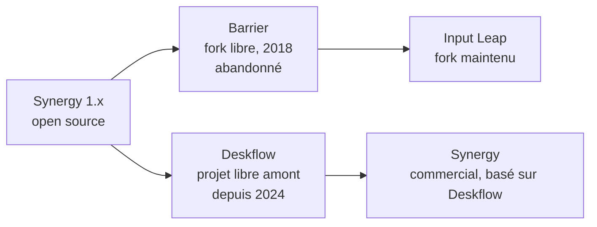

Ces logiciels forment un **KVM logiciel** sans l'écran : le clavier et la souris du poste principal passent sur l'écran voisin quand le pointeur franchit le bord, avec un **presse-papiers partagé**. Pratique pour un poste d'administration Windows à côté d'un portable Linux ou d'un Mac.

## La famille Synergy



| Logiciel | Statut | Conseil |
| --- | --- | --- |
| **Synergy Core** (open source historique) | Remplacé par **Deskflow**, qui est devenu le projet libre amont ; Synergy commercial est construit dessus | Utiliser Deskflow, ou Synergy pour le support |
| **Barrier** | Plus maintenu | À remplacer par Input Leap |
| **Input Leap** | Maintenu par la communauté, reprend la configuration de Barrier, Wayland via les portails récents | Choix libre recommandé avec Deskflow |

Tous sont compatibles dans leur principe (même architecture serveur/client, port **TCP 24800**), mais il vaut mieux utiliser **le même logiciel et la même version** sur tous les postes.

## Fonctionnement

- Le **serveur** est le poste dont le clavier et la souris sont physiquement branchés.
- Les **clients** se connectent au serveur sur le port TCP **24800**.
- La **disposition** (quel écran est à gauche, à droite, au-dessus) se règle sur le serveur.
- Le **chiffrement TLS** protège les frappes au clavier (mots de passe !) : à activer obligatoirement, avec vérification de l'empreinte du certificat du serveur à la première connexion.

## Installation

```bash
# Input Leap
sudo apt install input-leap            # Debian 13, Ubuntu récents
flatpak install flathub io.github.input_leap.input-leap
# Barrier (anciennes distributions)
sudo apt install barrier
# Deskflow : paquets et binaires sur le dépôt GitHub du projet, Flatpak
# Windows et macOS : installateurs des projets (macOS : autoriser l'accès Accessibilité)
```

## Configuration par l'interface

1. Sur le serveur : choisir **Serveur**, ouvrir *Configurer le serveur*, glisser les écrans des clients autour de l'écran du serveur, en utilisant exactement leurs **noms d'écran**.
2. Activer le **chiffrement (SSL/TLS)**.
3. Sur chaque client : choisir **Client**, saisir l'adresse IP du serveur, démarrer, puis accepter l'empreinte du serveur.

## Configuration en fichier

Le serveur peut se lancer avec un fichier texte (format commun à Synergy, Barrier et Input Leap) :

```text
section: screens
    poste-admin:
    portable-linux:
        switchCorners = none
end

section: links
    poste-admin:
        right = portable-linux
    portable-linux:
        left = poste-admin
end

section: options
    clipboardSharing = true
    switchDelay = 200
end
```

```bash
# Input Leap : serveur puis client, au premier plan pour voir les messages
input-leaps -f --name poste-admin -c ~/input-leap.conf --address :24800
input-leapc -f --name portable-linux 192.168.1.10
# Barrier : mêmes options avec barriers / barrierc
barriers -f --name poste-admin -c ~/barrier.conf
barrierc -f --name portable-linux 192.168.1.10
```

## Pare-feu

```bash
# Sur le serveur seulement
sudo ufw allow from 192.168.1.0/24 to any port 24800 proto tcp
sudo firewall-cmd --permanent --add-port=24800/tcp && sudo firewall-cmd --reload
# Windows (PowerShell administrateur)
New-NetFirewallRule -DisplayName "Input Leap" -Direction Inbound -Protocol TCP -LocalPort 24800 -Action Allow -Profile Private
```

## Dépannage

| Symptôme | Cause probable |
| --- | --- |
| Le client ne se connecte pas | Pare-feu du serveur, mauvaise adresse, VLAN différents |
| Connexion refusée « unknown screen name » | Le nom du client ne correspond pas à celui de la disposition du serveur |
| La souris ne passe pas sur l'autre écran | Disposition incomplète (lien dans un seul sens), écrans mal nommés |
| Rien ne fonctionne sous Wayland | Barrier ne gère que X11 ; utiliser Input Leap ou Deskflow récents (portails Wayland) ou une session X11 |
| macOS ne reçoit pas les frappes | Autoriser l'application dans *Réglages → Confidentialité et sécurité → Accessibilité* |
| Touches modifiées (AltGr, accents) incorrectes | Même disposition de clavier sur tous les postes ; version récente du logiciel |

> [!WARNING]
> Sans TLS, tout ce qui est tapé (y compris les mots de passe) circule **en clair** sur le réseau. Activez le chiffrement et limitez le port 24800 au réseau local de confiance.

Voir aussi : [[01-kde-connect-localsend|KDE Connect et LocalSend]]. Commandes : [[90-aide-memoire|aide-mémoire]].
