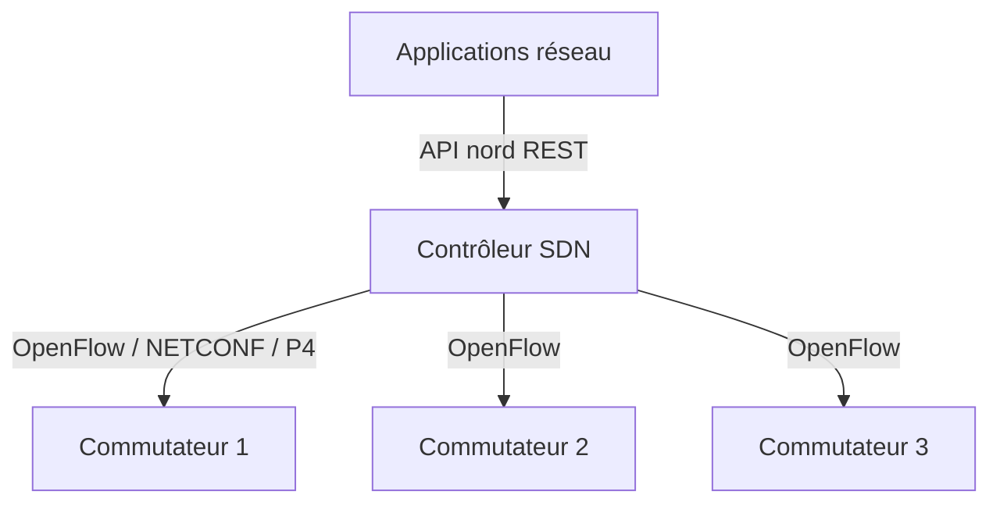

Le **SDN** (réseau défini par logiciel) sépare le **plan de contrôle** (les décisions : quelles routes, quels flux) du **plan de données** (les équipements qui transfèrent les paquets). Un **contrôleur** centralise les décisions et programme les commutateurs via un protocole sud comme **OpenFlow**, en exposant une **API nord** aux applications.



Ces outils relèvent surtout des **opérateurs**, des **data centers** et de la **recherche** ; en entreprise classique, le SDN passe souvent par des solutions intégrées du constructeur plutôt que par un contrôleur à exploiter soi-même.

## OpenDaylight (ODL)

Plate-forme modulaire (fondation OpenDaylight / Linux Foundation) bâtie sur **OSGi Apache Karaf** : on charge les **fonctions** (*features*) nécessaires à la demande. Elle gère OpenFlow, **NETCONF/YANG**, BGP-LS, PCEP.

```bash
# Java 17 ; archive Karaf du projet
tar xzf karaf-*.tar.gz && cd karaf-*/
./bin/karaf                                  # console interactive
# dans la console Karaf :
opendaylight-user@root> feature:install odl-restconf odl-openflowplugin-flow-services-ui odl-dluxapps-applications
opendaylight-user@root> feature:list -i | grep openflow
```

```bash
# API nord RESTCONF (port 8181)
curl -u admin:admin http://127.0.0.1:8181/restconf/operational/opendaylight-inventory:nodes/ | jq '.nodes.node[].id'
```

Puissant mais **lourd et exigeant** à exploiter ; l'activité de la communauté a diminué ces dernières années.

## ONOS

**ONOS** (Open Network Operating System, ONF) est un contrôleur **distribué** (grappe pour la haute disponibilité et la montée en charge), orienté réseaux **opérateurs** et data centers. Applications installables, interface web, CLI, intégration **P4/Stratum** pour le plan de données programmable.

```bash
docker run -d --name onos -p 127.0.0.1:8181:8181 -p 127.0.0.1:8101:8101 -p 6653:6653 onosproject/onos:latest
ssh -p 8101 onos@localhost              # CLI (mot de passe par défaut « rocks » à changer) :
onos> apps -a -s
onos> app activate org.onosproject.openflow org.onosproject.fwd
onos> devices ; onos> links ; onos> hosts
# Interface web : http://127.0.0.1:8181/onos/ui (onos/rocks)
```

## Ryu

**Ryu** est un **framework Python** pour écrire ses **propres applications** OpenFlow : idéal pour apprendre le SDN et prototyper, en complément de [[19-labos-reseau/02-core-ns3-mininet|Mininet]].

```bash
python3 -m pip install ryu                 # Python 3 ; attention aux versions récentes (dépendances)
ryu-manager ryu.app.simple_switch_13       # commutateur d'apprentissage OpenFlow 1.3
ryu-manager --observe-links ryu.app.gui_topology.gui_topology
```

```python
# Application minimale : installer une règle qui envoie tout au contrôleur
from ryu.base import app_manager
from ryu.controller import ofp_event
from ryu.controller.handler import set_ev_cls, MAIN_DISPATCHER

class Moniteur(app_manager.RyuApp):
    @set_ev_cls(ofp_event.EventOFPPacketIn, MAIN_DISPATCHER)
    def paquet_entrant(self, ev):
        self.logger.info("Paquet reçu sur %s", ev.msg.datapath.id)
```

```bash
# Dans Mininet, pointer les commutateurs vers Ryu (port 6653)
sudo mn --topo single,3 --mac --switch ovs --controller=remote,ip=127.0.0.1,port=6653
```

> [!NOTE]
> Ryu n'est plus activement maintenu. Pour un nouveau développement, regarder **ONOS**, **Faucet** (contrôleur de production fondé sur Ryu, pour réseaux d'entreprise et campus) ou les API **P4Runtime/gNMI** des équipements récents.

## Mise en garde production

- Le contrôleur devient un **point critique** : prévoir une grappe (ONOS) et une stratégie de repli si le contrôleur tombe.
- Sécuriser le canal OpenFlow (**TLS** entre contrôleur et commutateurs), isoler le réseau de contrôle, changer les comptes par défaut.
- **Tester en laboratoire** ([[19-labos-reseau/02-core-ns3-mininet|Mininet]], Open vSwitch) avant tout déploiement ; valider le comportement en cas de perte du contrôleur (mode autonome des commutateurs).

Commandes : [[90-aide-memoire|aide-mémoire]].
