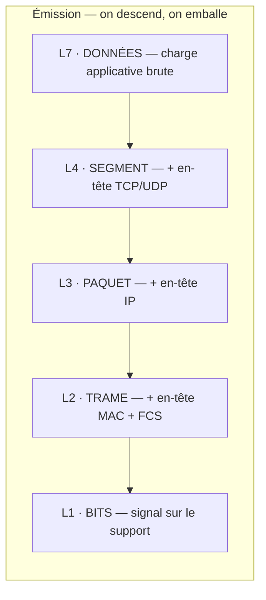

Le **modèle OSI** découpe la communication réseau en **7 couches**, de la plus basse (le signal physique) à la plus haute (l'application). Pour diagnostiquer une panne, on **remonte la pile** : on vérifie d'abord la couche 1, puis la 2, et ainsi de suite — une couche ne peut pas fonctionner si celle du dessous est cassée. C'est la méthode qui distingue un dépannage méthodique d'un tâtonnement.

| # | Couche | Rôle | Unité (PDU) | Exemple de panne |
| --- | --- | --- | --- | --- |
| **7** | Application | Services utilisés par l'utilisateur | Données | DNS ne résout pas |
| **6** | Présentation | Chiffrement, encodage, mise en forme | Données | Certificat TLS expiré |
| **5** | Session | Ouverture/maintien des dialogues | Données | Lecteur réseau SMB déconnecté |
| **4** | Transport | Bout en bout par ports (TCP/UDP) | Segment / datagramme | Port filtré par un pare-feu |
| **3** | Réseau | Acheminement entre réseaux (IP) | Paquet | Passerelle ou route absente |
| **2** | Liaison | Trames entre voisins, MAC, VLAN | Trame | Mauvais VLAN, APIPA |
| **1** | Physique | Bits sur le support | Bits | Câble coupé, SFP défectueux |

> [!NOTE]
> En TCP/IP réel, les couches 5, 6 et 7 sont souvent fondues dans l'applicatif. La séparation OSI reste utile pour **nommer précisément** la cause d'un incident.

## Encapsulation et désencapsulation

Chaque couche **emballe** les données de la couche supérieure en ajoutant son propre en-tête (**encapsulation**) ; à la réception, chaque couche **déballe** dans l'ordre inverse (**désencapsulation**).



À la réception, on remonte : les **bits** reconstituent une **trame** (la couche 2 vérifie le FCS et les adresses MAC), qui livre un **paquet** (la couche 3 lit l'IP), qui livre un **segment** (la couche 4 lit les ports), dont les **données** remontent enfin à l'application.

## Vue emboîtée — les « poupées russes »

Une trame qui circule sur le câble contient **tout** le reste, emboîté :

```text
┌─ Trame Ethernet (L2) — MAC dst · MAC src · EtherType 0x0800 ────────────┐
│ ┌─ Paquet IPv4 (L3) — IP src · IP dst · TTL · Protocol 6 ─────────────┐ │
│ │ ┌─ Segment TCP (L4) — Port src · Port dst 443 · SEQ/ACK · Flags ──┐ │ │
│ │ │  Données (L7) — requête HTTP, ou charge chiffrée TLS           │ │ │
│ │ └────────────────────────────────────────────────────────────────┘ │ │
│ └──────────────────────────────────────────────────────────────────────┘ │
│  FCS / CRC (4 octets) — contrôle d'erreur ajouté en toute fin de trame    │
└────────────────────────────────────────────────────────────────────────────┘
```

Comprendre cet emboîtement est la clé de la lecture d'une capture ([[02-reseau-diagnostic/01-wireshark-capture|Wireshark]]) : chaque couche correspond à un niveau de l'arbre de dissection.

## Le réflexe : isoler la couche

- **Ping OK mais l'application ne se connecte pas** → le réseau (L1–L3) fonctionne, le problème est en L4 (port) ou au-dessus.
- **Accessible par IP mais pas par nom** → L7 (DNS), pas un problème de route.
- **Interface « Disconnected » / `NO-CARRIER`** → inutile de toucher à la configuration IP, le problème est en L1.
- **« Connecté » au Wi-Fi mais rien ne passe** → associé en L1, mais authentification L2 (802.1X) en échec.

> [!NOTE]
> La règle d'or : **remonter la pile dans l'ordre**. Ne jamais conclure « le réseau est en panne » avant d'avoir localisé la couche exacte.

Suite : [[02-anatomie-en-tetes|Anatomie des en-têtes]] puis le diagnostic couche par couche ([[03-couches-1-2-physique-liaison|couches 1-2]] → [[07-couche-7-application|couche 7]]). Commandes : [[90-aide-memoire|aide-mémoire]].
