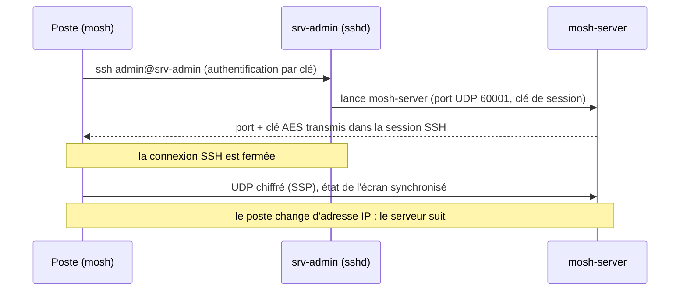

Une session SSH classique meurt dès que la connexion TCP est interrompue : mise en veille du portable, passage du Wi-Fi à la 4G, VPN qui se reconnecte, lien satellite instable. **Mosh** et **Eternal Terminal** (*ET*) gardent la session vivante et la reprennent sans se réauthentifier ; **tmate** sert à autre chose : **partager** son terminal avec un collègue en une commande.

Les trois s'appuient sur [[01-openssh/01-presentation|OpenSSH]] pour l'authentification : vos clés, votre `~/.ssh/config` et la sécurité du serveur SSH restent la référence. Pour conserver des sessions côté serveur (fenêtres, panneaux), combinez-les avec [[10-shells-terminal/01-tmux-screen-zellij|tmux]].

## Comparatif

| | Mosh | Eternal Terminal | tmate |
| --- | --- | --- | --- |
| Usage | Terminal distant itinérant | Terminal distant reconnectable | Partage de terminal |
| Licence | GPL 3 | Apache 2.0 | ISC (comme tmux) |
| Authentification | SSH (amorçage) | SSH (amorçage) | Clé SSH du relais, jeton de session |
| Transport après connexion | **UDP 60000-61000** | **TCP 2022** | SSH vers le relais (tmate.io ou le vôtre) |
| Changement d'adresse IP | Oui, transparent | Oui (reconnexion) | Non (session liée au relais) |
| Historique du terminal (*scrollback*) | Non (utiliser tmux) | Oui | Celui de tmux |
| Redirection de ports | Non | Oui (`-t`, `-r`) | Non |
| Écho local prédictif | Oui | Non | Non |
| Serveur Windows | Non | Non | Non |
| Client Windows | WSL, Termius | WSL | WSL |

> [!TIP]
> Réseau mobile ou très lent : **Mosh**. Réseau d'entreprise où seul TCP passe, besoin de tunnels ou de l'historique : **Eternal Terminal**. Montrer ou dépanner à plusieurs dans le même terminal : **tmate**.

## Mosh

### Fonctionnement



- SSH ne sert qu'à **démarrer** `mosh-server` et à échanger une clé de session ; ensuite tout passe en **UDP**, chiffré et authentifié (AES-128 en mode OCB).
- Le protocole **SSP** (*State Synchronization Protocol*) synchronise l'**état de l'écran**, pas un flux d'octets : après une coupure, seul l'écran courant est renvoyé.
- **Écho local prédictif** : les frappes s'affichent immédiatement (soulignées tant qu'elles ne sont pas confirmées), utile sur un lien à forte latence.
- Limites : pas d'historique (*scrollback*) côté client, pas de redirection de ports ni de X11, pas d'agent SSH relayé. Le trafic UDP doit **atteindre directement** le serveur : un bastion SSH (`ProxyJump`) ne transporte pas la partie UDP.

### Installation

Le paquet `mosh` fournit le client et le serveur ; il doit être installé **des deux côtés**.

| Système | Commande |
| --- | --- |
| Debian / Ubuntu | `sudo apt install mosh` |
| Fedora | `sudo dnf install mosh` |
| RHEL / Rocky / Alma | `sudo dnf install epel-release && sudo dnf install mosh` |
| Alpine | `sudo apk add mosh` |
| Arch | `sudo pacman -S mosh` |
| openSUSE | `sudo zypper install mosh` |
| macOS | `brew install mosh` |
| FreeBSD | `sudo pkg install mosh` |
| Windows | Pas de client natif maintenu : `mosh` dans WSL, ou un client qui le prend en charge comme [[01-acces-administration/02-termius\|Termius]] |

Ouvrir la plage UDP sur le serveur (ou seulement quelques ports, voir plus bas) :

```bash
# Debian / Ubuntu avec UFW
sudo ufw allow 60000:61000/udp

# RHEL / Rocky / Fedora avec firewalld
sudo firewall-cmd --permanent --add-port=60000-61000/udp
sudo firewall-cmd --reload
```

> [!WARNING]
> `mosh-server` exige une **locale UTF-8**. Le message `mosh-server needs a UTF-8 native locale to run` se corrige en générant la locale sur le serveur (`sudo locale-gen fr_FR.UTF-8` sous Debian/Ubuntu, `sudo dnf install glibc-langpack-fr` sous RHEL) et en vérifiant que `LANG` est transmis (`SendEnv LANG LC_*` côté client, `AcceptEnv LANG LC_*` côté `sshd`).

### Utilisation

```bash
# Connexion simple (utilise ~/.ssh/config : utilisateur, clé, port)
mosh admin@srv-admin.corp.exemple.fr

# Options SSH particulières (port, clé)
mosh --ssh="ssh -p 2222 -i ~/.ssh/id_ed25519" admin@srv-admin.corp.exemple.fr

# Port UDP imposé (une seule règle de pare-feu : 60001/udp)
mosh -p 60001 admin@srv-admin.corp.exemple.fr

# Ouvrir directement une session tmux persistante
mosh admin@srv-admin.corp.exemple.fr -- tmux new-session -A -s main

# Écho prédictif : adaptive (défaut), always, never
mosh --predict=always admin@srv-admin.corp.exemple.fr

# IPv6
mosh --family=inet6 admin@srv-admin.corp.exemple.fr
```

Sortie forcée d'une session figée : **Ctrl+^** puis **.** (point).

### Sessions abandonnées

Une session interrompue sans être fermée laisse un `mosh-server` actif (message *« You have a detached Mosh session on this server »* à la connexion suivante). Mosh ne permet pas de s'y rattacher depuis un autre poste : terminez-la.

```bash
pgrep -u "$USER" -a mosh-server        # sessions existantes
pkill -u "$USER" mosh-server           # tout fermer (y compris la session en cours)
```

## Eternal Terminal

### Fonctionnement

ET utilise aussi SSH pour authentifier l'utilisateur, puis ouvre une connexion **TCP** chiffrée vers le démon `etserver` (port **2022**). Si la connexion tombe, le client se reconnecte et le serveur renvoie les données perdues : l'historique du terminal fonctionne normalement, contrairement à Mosh. ET sait aussi créer des **tunnels** et passer par un **hôte de rebond**.

### Installation

`et` doit être installé sur le poste **et** sur le serveur (le serveur fait tourner le service `et`).

| Système | Commande |
| --- | --- |
| Ubuntu | `sudo add-apt-repository ppa:jgmath2000/et && sudo apt update && sudo apt install et` |
| Fedora | `sudo dnf install et` |
| macOS | `brew install MisterTea/et/et` |
| Arch | Paquet AUR `eternalterminal` |
| Autres (Debian, RHEL, BSD) | Compilation depuis les sources (`github.com/MisterTea/EternalTerminal`, CMake) |
| Windows | Client dans WSL ; pas de serveur Windows |

```bash
sudo systemctl enable --now et
sudo systemctl status et
sudo ss -ltnp | grep 2022

# Pare-feu
sudo ufw allow 2022/tcp
sudo firewall-cmd --permanent --add-port=2022/tcp && sudo firewall-cmd --reload
```

Le service lit `/etc/et.cfg` : port d'écoute (`port = 2022`), adresse (`bind_ip`), niveau de journalisation et répertoire des journaux. Selon la version, ce fichier contient aussi une option de **télémétrie** (rapports d'erreur envoyés au projet) : désactivez-la si votre politique l'impose, puis `sudo systemctl restart et`.

### Utilisation

```bash
# Connexion (authentification par la configuration SSH habituelle)
et admin@srv-admin.corp.exemple.fr

# Serveur ET sur un autre port
et admin@srv-admin.corp.exemple.fr:2023

# Tunnel local : http://127.0.0.1:8080 du poste → port 80 du serveur
et -t 8080:80 admin@srv-admin.corp.exemple.fr

# Tunnel inverse : port 9000 du serveur → port 3000 du poste
et -r 9000:3000 admin@srv-admin.corp.exemple.fr

# Rebond par un bastion qui fait aussi tourner etserver
et --jumphost srv-bastion.corp.exemple.fr admin@srv-interne.corp.exemple.fr
```

## tmate

### Principe

**tmate** est un tmux modifié qui, au lancement, ouvre une connexion SSH vers un **relais** (par défaut les serveurs publics `tmate.io`) et affiche des adresses de session :

| Adresse | Accès |
| --- | --- |
| `ssh <jeton>@<relais>` | Lecture-écriture dans le terminal |
| `ssh ro-<jeton>@<relais>` | Lecture seule |
| `https://tmate.io/t/<jeton>` | Lecture-écriture dans un navigateur |
| `https://tmate.io/t/ro-<jeton>` | Lecture seule dans un navigateur |

Le collègue n'a besoin que d'un client SSH : aucun port à ouvrir, le poste qui partage est derrière un NAT ou un pare-feu sans problème.

> [!WARNING]
> Quiconque connaît l'adresse **lecture-écriture** contrôle votre terminal avec vos droits. Ne la publiez jamais dans un ticket ou un canal ouvert, préférez l'adresse **ro-** pour une démonstration, fermez la session (`exit`) dès la fin. Avec le relais public, le trafic transite par un service tiers : pour des serveurs de production, utilisez un **relais auto-hébergé** ou restreignez l'accès par clés (option `-a`), ou interdisez l'outil.

### Installation

| Système | Commande |
| --- | --- |
| Debian / Ubuntu | `sudo apt install tmate` |
| Fedora | `sudo dnf install tmate` |
| RHEL / Rocky / Alma | `sudo dnf install epel-release && sudo dnf install tmate` |
| Arch | `sudo pacman -S tmate` |
| Alpine | `sudo apk add tmate` |
| macOS | `brew install tmate` |
| FreeBSD | `sudo pkg install tmate` |
| Windows | Dans WSL |

### Utilisation

```bash
# Partager le terminal : les adresses s'affichent en bas de l'écran
tmate

# Réafficher les adresses depuis la session
tmate show-messages
tmate display -p '#{tmate_ssh}'        # lecture-écriture (SSH)
tmate display -p '#{tmate_ssh_ro}'     # lecture seule (SSH)
tmate display -p '#{tmate_web_ro}'     # lecture seule (navigateur)

# N'autoriser que les clés publiques listées (collègues identifiés)
tmate -a ~/.ssh/authorized_keys

# Session détachée, par exemple lancée par un script d'assistance
tmate -S /tmp/tmate.sock new-session -d
tmate -S /tmp/tmate.sock wait tmate-ready
tmate -S /tmp/tmate.sock display -p '#{tmate_ssh_ro}'
```

Les raccourcis sont ceux de tmux (préfixe **Ctrl+b**) ; `~/.tmate.conf` reprend la syntaxe de `~/.tmux.conf`.

### Relais auto-hébergé

Le serveur `tmate-ssh-server` (projet `tmate-io/tmate-ssh-server`, image Docker fournie) permet de garder les sessions sur votre réseau. Les clients sont alors configurés dans `~/.tmate.conf` avec l'adresse et les empreintes des clés d'hôte du relais :

```text ~/.tmate.conf
set -g tmate-server-host tmate.corp.exemple.fr
set -g tmate-server-port 22
set -g tmate-server-ed25519-fingerprint SHA256:remplacer-par-l-empreinte-ed25519-du-relais
set -g tmate-server-rsa-fingerprint SHA256:remplacer-par-l-empreinte-rsa-du-relais
```

Les empreintes s'obtiennent sur le relais avec `ssh-keygen -lf <fichier de clé d'hôte>.pub`.

## Sécurité

- L'authentification reste celle de **SSH** (Mosh, ET) : clés, `PermitRootLogin no`, `PasswordAuthentication no` — voir [[01-openssh/03-configuration-durcissement|durcissement d'OpenSSH]].
- Mosh et ET ajoutent un **port d'écoute** (UDP 60000-61000, TCP 2022) : limitez-le par pare-feu aux réseaux d'administration (`10.0.99.0/24`) et ne l'exposez pas sur Internet sans nécessité.
- Une session Mosh ou ET n'expire pas toute seule : fixez un délai d'inactivité dans le shell (`TMOUT=900` dans `/etc/profile.d/`) si la politique de sécurité l'exige.
- tmate : réservez-le aux postes de travail et aux laboratoires, ou à un relais interne.

## Dépannage

| Symptôme | Cause | Correction |
| --- | --- | --- |
| Mosh reste sur `mosh: Nothing received from server on UDP port 60001` | UDP filtré (pare-feu du serveur, de l'entreprise ou NAT) | Ouvrir la plage UDP ; fixer un port avec `-p` ; à défaut utiliser ET ou SSH |
| `mosh-server needs a UTF-8 native locale to run` | Locale absente sur le serveur | Générer `fr_FR.UTF-8` ou `C.UTF-8`, transmettre `LANG` |
| `mosh-server: command not found` | Paquet absent sur le serveur, ou hors du `PATH` non interactif | Installer `mosh` ; sinon `mosh --server=/usr/local/bin/mosh-server` |
| Pas d'historique avec Mosh | Normal (synchronisation d'écran) | Travailler dans tmux, ou utiliser ET |
| `et` : connexion refusée | Service `et` arrêté ou port 2022 filtré | `systemctl status et`, ouvrir 2022/tcp |
| tmate bloqué sur *Connecting to ssh.tmate.io* | SSH sortant (22) filtré par le proxy de l'entreprise | Relais interne ; autoriser le flux ; sinon partager par un autre moyen |

Commandes prêtes à copier : [[90-aide-memoire|aide-mémoire]].
