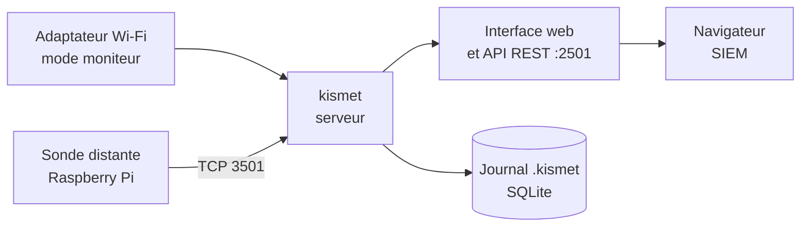

**Kismet** détecte les réseaux et appareils sans fil à portée, sans émettre : points d'accès (SSID, BSSID, canal, chiffrement), clients, et, avec le matériel adapté, Bluetooth et autres radios. Pour un architecte réseau, il sert à trois choses :

- **Inventaire** et **état des lieux radio** d'un site (réseaux présents, canaux encombrés, chiffrement utilisé) ;
- **Détection d'intrusion sans fil** (*WIDS*) : point d'accès pirate qui imite votre SSID, vague de déauthentification, rétrogradation du chiffrement ;
- **Contrôle** après déploiement : vos points d'accès annoncent-ils bien WPA3 et 802.11w ?

Les contrôleurs Wi-Fi d'entreprise (Aruba, Cisco, Ubiquiti, Fortinet…) intègrent souvent une détection de points d'accès pirates ; Kismet complète utilement un réseau sans contrôleur, un audit ponctuel ou un site distant. Pour créer ou configurer un point d'accès Linux, voir [[17-wifi-linux/01-hostapd-wpa-supplicant-iw-iwd|hostapd et wpa_supplicant]] ; pour se protéger des attaques détectées, [[02-defense-homme-du-milieu-wifi|défense contre l'homme du milieu et les attaques Wi-Fi]].

> [!WARNING]
> **Cadre légal.** Ne surveillez que **vos** réseaux et vos locaux. L'interception du contenu de communications de tiers est un délit (articles 226-15 et 323-1 du Code pénal). Les adresses MAC et noms d'appareils des passants sont des **données personnelles** : limitez la durée de conservation des journaux, désactivez l'enregistrement des paquets si vous n'en avez pas besoin et documentez le traitement dans le registre RGPD.

## Architecture



| Élément | Rôle | Port |
| --- | --- | --- |
| `kismet` | Serveur : collecte, analyse, alertes, journalisation | — |
| Interface web et API REST | Consultation, configuration des sources, alertes, export JSON | **TCP 2501** |
| Sonde distante (`kismet_cap_linux_wifi --connect`) | Capture sur un autre appareil, envoi au serveur | TCP 3501 (serveur) |
| `*.kismet` | Journal au format SQLite (appareils, alertes, paquets) | — |

**Matériel** : il faut un adaptateur capable du **mode moniteur** (*monitor mode*). Beaucoup de cartes intégrées de portables ne le permettent pas ; les adaptateurs USB à puces MediaTek (pilotes `mt76`) ou Atheros (`ath9k_htc`) sont bien pris en charge sous Linux. Vérifiez avec `iw list` (ligne `monitor` dans *Supported interface modes*).

## Installation

| Système | Méthode |
| --- | --- |
| Debian / Ubuntu | Dépôt officiel Kismet (version récente) ou paquet de la distribution (`sudo apt install kismet`, plus ancien) |
| Kali Linux | `sudo apt install kismet` |
| Arch | `sudo pacman -S kismet` |
| Raspberry Pi OS | Dépôt officiel (même méthode que Debian) — idéal comme sonde distante |
| Autres Linux, macOS | Compilation depuis les sources (`github.com/kismetwireless/kismet`) ; la capture sous macOS est limitée |
| Windows | Non pris en charge pour la capture : utiliser une machine Linux (ou une VM avec adaptateur USB transmis) |

Dépôt officiel sur Debian 12 (*bookworm*) — remplacez `bookworm` par le nom de votre version (`trixie`, `noble` pour Ubuntu 24.04…) :

```bash
wget -O - https://www.kismetwireless.net/repos/kismet-release.gpg.key --quiet | gpg --dearmor | sudo tee /usr/share/keyrings/kismet-archive-keyring.gpg > /dev/null
echo 'deb [signed-by=/usr/share/keyrings/kismet-archive-keyring.gpg] https://www.kismetwireless.net/repos/apt/release/bookworm bookworm main' | sudo tee /etc/apt/sources.list.d/kismet.list > /dev/null
sudo apt update
sudo apt install kismet
```

L'installation propose d'utiliser des **assistants suid-root** (`kismet_cap_*`) : répondez *oui*, ce qui permet de lancer Kismet sans être root, puis ajoutez votre compte au groupe `kismet` :

```bash
sudo usermod -aG kismet "$USER"
# se déconnecter puis se reconnecter, puis vérifier
groups | grep kismet
```

## Premier lancement

```bash
# Identifier l'adaptateur compatible
iw dev
iw list | grep -A 10 "Supported interface modes"

# Lancer Kismet sur l'adaptateur USB (Kismet le passe lui-même en mode moniteur)
kismet -c wlx00c0ca123456
```

Ouvrez ensuite `http://127.0.0.1:2501` : au premier accès, l'interface demande de **créer le compte administrateur** (enregistré dans `~/.kismet/kismet_httpd.conf`).

<!-- CAPTURE: Kismet — liste des appareils détectés avec type, chiffrement et canal | _assets/kismet-appareils.png -->

L'interface affiche la liste des appareils (filtrable par type : *Wi-Fi AP*, *Wi-Fi Client*…), le détail de chaque réseau (SSID, BSSID, constructeur, chiffrement, canal, puissance du signal, clients associés), les **alertes** et l'état des sources de capture.

<!-- CAPTURE: Kismet — détail d'un point d'accès (chiffrement WPA3, 802.11w, canal, clients) | _assets/kismet-detail-ap.png -->

> [!NOTE]
> Par défaut, l'interface écoute sur toutes les adresses. Sur une sonde permanente, limitez-la au réseau d'administration (pare-feu, ou `httpd_bind_address=127.0.0.1` et accès par tunnel SSH).

## Configuration

Ne modifiez pas les fichiers fournis de `/etc/kismet/` : placez vos réglages dans **`/etc/kismet/kismet_site.conf`**, lu en dernier et conservé lors des mises à jour.

```ini /etc/kismet/kismet_site.conf
# Nom de la sonde et source de capture permanente
server_name=sonde-batiment-a
source=wlx00c0ca123456:name=wifi-batiment-a

# Interface web limitée à la machine (accès par tunnel SSH)
httpd_bind_address=127.0.0.1

# Journaux : appareils et alertes, sans le contenu des paquets (minimisation des données)
log_prefix=/var/log/kismet/
log_types=kismet
kis_log_packets=false

# Alerte si un autre BSSID annonce le SSID de l'entreprise
apspoof=CorpWifi:ssid="Corp-WiFi",validmacs="00:11:22:33:44:55,00:11:22:33:44:56,00:11:22:33:44:57"
```

`validmacs` liste les **BSSID légitimes** de vos points d'accès (visibles dans l'interface du contrôleur ou dans Kismet). Tout autre émetteur du même SSID déclenche l'alerte `APSPOOF` : point d'accès pirate (*evil twin*) ou nouvel AP non déclaré.

### Alertes utiles en WIDS

| Alerte | Signification |
| --- | --- |
| `APSPOOF` | Un BSSID non autorisé annonce un SSID protégé |
| `DEAUTHFLOOD`, `BCASTDISCON` | Vague de trames de déauthentification ou de désassociation : attaque probable pour déconnecter les clients |
| `CRYPTODROP` | Un réseau annonce un chiffrement plus faible qu'auparavant (rétrogradation) |
| `CHANCHANGE` | Un point d'accès change de canal de façon inattendue (usurpation possible) |
| `NULLPROBERESP` | Réponse de sonde anormale, utilisée par d'anciens outils d'attaque |

Ces alertes alimentent la [[02-defense-homme-du-milieu-wifi|réponse aux attaques Wi-Fi]] : activer 802.11w (PMF) neutralise les déauthentifications forgées.

## Journaux et export

Chaque session produit un fichier `Kismet-AAAAMMJJ-HH-MM-SS-1.kismet` (base SQLite). Outils fournis :

```bash
# Statistiques d'un journal
kismetdb_statistics --in /var/log/kismet/Kismet-20261115-09-00-00-1.kismet

# Liste des appareils au format JSON
kismetdb_dump_devices --in /var/log/kismet/Kismet-20261115-09-00-00-1.kismet --out appareils.json

# Retirer les paquets d'un journal avant archivage (minimisation)
kismetdb_strip_packets --in /var/log/kismet/Kismet-20261115-09-00-00-1.kismet --out sonde-a-sans-paquets.kismet
```

Pour le SIEM, l'API REST renvoie les alertes en JSON (authentification par le compte administrateur ou par une clé d'API créée dans l'interface) :

```bash
curl -s -u admin:MotDePasseLongEtUnique http://127.0.0.1:2501/alerts/all_alerts.json | jq '.[] | {date: .["kismet.alert.timestamp"], type: .["kismet.alert.header"], texte: .["kismet.alert.text"]}'
```

## Sonde distante

Un Raspberry Pi avec un adaptateur USB peut capturer sur un site et envoyer les données au serveur Kismet central. Sur le serveur, autorisez les sondes (ici sur le réseau d'administration) :

```ini /etc/kismet/kismet_site.conf
remote_capture_listen=10.0.99.30
remote_capture_port=3501
```

Sur la sonde (paquet Kismet installé, seulement l'outil de capture utilisé) :

```bash
sudo kismet_cap_linux_wifi --connect 10.0.99.30:3501 --source=wlan1:name=sonde-site-lyon
```

Le flux n'est pas chiffré : faites-le passer dans un tunnel ([[03-wireguard/01-presentation-installation|WireGuard]] ou SSH) dès qu'il quitte le réseau d'administration.

## Dépannage

| Symptôme | Cause | Correction |
| --- | --- | --- |
| *Could not set monitor mode* | Carte ou pilote sans mode moniteur, ou NetworkManager qui reprend la carte | Adaptateur compatible ; `nmcli device set wlan1 managed no` |
| Aucun réseau détecté | Mauvaise interface, antenne, ou bande 5/6 GHz non prise en charge par l'adaptateur | `iw list` (bandes), changer d'adaptateur |
| `Permission denied` au lancement | Compte hors du groupe `kismet` | `sudo usermod -aG kismet $USER` puis reconnexion |
| Interface web inaccessible depuis un autre poste | `httpd_bind_address=127.0.0.1` ou pare-feu | Tunnel `ssh -L 2501:127.0.0.1:2501 srv-kismet` |
| Disque plein sur une sonde | Paquets journalisés | `kis_log_packets=false`, rotation des fichiers, `kismetdb_strip_packets` |
| Alerte `APSPOOF` sur votre propre AP | BSSID absent de `validmacs` (nouvel AP, radio 6 GHz) | Compléter la liste des BSSID légitimes |

Commandes prêtes à copier : [[90-aide-memoire|aide-mémoire]].
