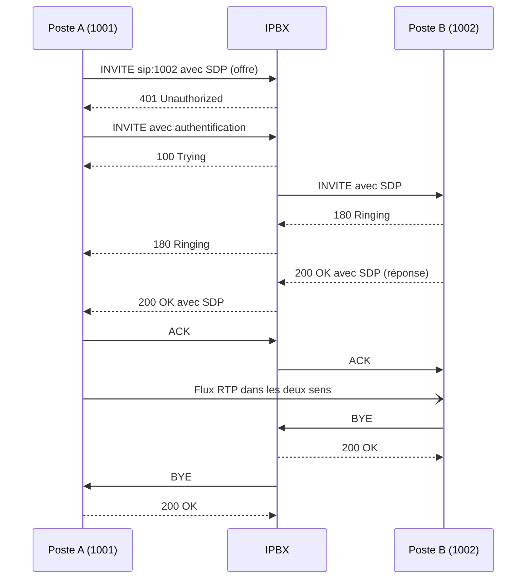

La téléphonie sur IP sépare deux flux : la **signalisation** (établir, modifier, terminer l'appel), presque toujours en **SIP**, et le **média** (la voix ou la vidéo), transporté en **RTP**. Comprendre ces deux flux est la clé de tout dépannage : un appel qui sonne mais reste muet est un problème de média, un appel qui ne sonne pas est un problème de signalisation.

## Architecture SIP

| Élément | Rôle |
| --- | --- |
| **User Agent** (UA) | Poste IP, softphone, passerelle : client (UAC) quand il émet une requête, serveur (UAS) quand il y répond |
| **Registrar** | Reçoit les `REGISTER` : associe l'identité (`sip:1001@exemple.fr`) à l'adresse réelle du poste (contact) |
| **Proxy** | Relaie les requêtes vers la destination (routage, authentification), sans gérer le média |
| **B2BUA** (*back-to-back user agent*) | Termine l'appel d'un côté et en crée un nouveau de l'autre : c'est le cas des **IPBX** (Asterisk, 3CX, CUCM…) et des **SBC** |
| Redirect server | Répond par une redirection (`302`) |
| Location service | Base des enregistrements consultée par le proxy |

Une adresse SIP (URI) ressemble à une adresse électronique : `sip:1001@pbx.exemple.fr`, `sips:` pour TLS, `tel:+33123456789` pour un numéro.

## Méthodes et codes de réponse

| Méthode | Usage |
| --- | --- |
| `REGISTER` | Enregistrement du poste auprès du registrar |
| `INVITE` | Établir (ou modifier : *re-INVITE*) une session |
| `ACK` | Confirmer la réponse finale à un INVITE |
| `BYE` / `CANCEL` | Raccrocher / annuler un appel pas encore décroché |
| `OPTIONS` | Interroger les capacités ; utilisé comme sonde de disponibilité (*qualify*, *keepalive*) |
| `REFER` | Transfert d'appel |
| `SUBSCRIBE` / `NOTIFY` | Abonnement à des événements : voyant de messagerie (MWI), supervision de ligne (BLF) |
| `INFO`, `UPDATE`, `PRACK`, `MESSAGE` | DTMF, modification avant décroché, accusé des réponses provisoires, messagerie instantanée |

| Code | Signification | Cause fréquente |
| --- | --- | --- |
| `100 Trying` | Requête reçue, en cours | — |
| `180 Ringing` / `183 Session Progress` | Sonnerie / tonalités ou annonce avant décroché (média précoce) | — |
| `200 OK` | Succès | — |
| `401` / `407` | Authentification demandée (registrar / proxy) | Normal au premier essai ; en boucle = mauvais identifiants |
| `403 Forbidden` | Refusé | Mot de passe faux, IP non autorisée, destination interdite |
| `404 Not Found` | Destinataire inconnu | Numéro absent du plan de numérotation |
| `408` / `480` | Délai dépassé / indisponible | Poste non enregistré, injoignable |
| `486 Busy Here` | Occupé | — |
| `487 Request Terminated` | Appel annulé (après `CANCEL`) | — |
| `488 Not Acceptable Here` | Média refusé | **Aucun codec commun**, SRTP exigé d'un côté seulement |
| `503 Service Unavailable` | Service indisponible | Trunk hors service, surcharge |
| `603 Decline` | Refusé par l'appelé | — |

## Déroulement d'un appel



Selon sa configuration, l'IPBX reste sur le chemin du média (il relaie le RTP) ou laisse les postes échanger le RTP directement (*direct media*, *reinvite*).

## SDP : la négociation du média

Le corps des messages INVITE/200 OK contient une description **SDP** (modèle offre/réponse) :

```text
v=0
o=1001 3344 1 IN IP4 10.0.40.21
s=Appel
c=IN IP4 10.0.40.21
t=0 0
m=audio 16384 RTP/AVP 9 8 0 101
a=rtpmap:9 G722/8000
a=rtpmap:8 PCMA/8000
a=rtpmap:0 PCMU/8000
a=rtpmap:101 telephone-event/8000
a=fmtp:101 0-16
a=ptime:20
a=sendrecv
```

| Ligne | Sens |
| --- | --- |
| `c=` | Adresse IP où envoyer le média (**une adresse privée ici trahit un problème de NAT**) |
| `m=audio 16384 RTP/AVP 9 8 0 101` | Port RTP et codecs proposés par ordre de préférence (`RTP/SAVP` = SRTP) |
| `a=rtpmap` | Correspondance numéro ↔ codec |
| `telephone-event` | DTMF RFC 4733 |
| `a=sendrecv` / `sendonly` / `inactive` | Sens du média (`sendonly` = mise en attente) |

## RTP, RTCP, SRTP

- **RTP** (UDP, ports pairs d'une plage, souvent 10000–20000) transporte des paquets de voix toutes les 20 ms (*ptime*), avec numéro de séquence et horodatage.
- **RTCP** (port impair suivant) remonte les statistiques : pertes, gigue, délai.
- **SRTP** chiffre le média ; les clés sont échangées par **SDES** (dans le SDP, donc la signalisation doit être en **TLS**) ou par **DTLS-SRTP** (WebRTC).

## DTMF

| Méthode | Principe | Remarque |
| --- | --- | --- |
| **RFC 4733** (ex-2833) | Événements dans le flux RTP (`telephone-event`) | Recommandée |
| SIP INFO | Messages de signalisation | Utilisée par certains opérateurs |
| Inband | Tonalités dans l'audio | Ne fonctionne qu'avec G.711 (détruite par la compression) |

## Codecs

| Codec | Débit codec | Bande passante IP par sens (20 ms, Ethernet) | Usage |
| --- | --- | --- | --- |
| **G.711** A-law (PCMA, Europe) / µ-law (PCMU, Amérique du Nord, Japon) | 64 kbit/s | ≈ 87 kbit/s | Qualité de référence sur LAN, trunks opérateurs, fax T.38 en repli |
| **G.722** | 64 kbit/s | ≈ 87 kbit/s | **HD voice** (bande élargie 7 kHz) entre postes |
| **G.729** | 8 kbit/s | ≈ 31 kbit/s | Liens WAN faibles ; plus de licence depuis 2017 |
| **Opus** | 6–510 kbit/s (adaptatif) | variable | WebRTC, softphones, Internet (résiste aux pertes) |
| iLBC, GSM | 13–15 kbit/s | ≈ 30–40 kbit/s | Historique |

En-têtes par paquet de 20 ms : RTP 12 + UDP 8 + IP 20 + Ethernet 18 (+ préambule et inter-trame) octets ; avec 50 paquets par seconde, ces en-têtes ajoutent ≈ 23 kbit/s au débit du codec. Comptez aussi les VPN (IPsec ajoute 50 à 70 octets par paquet).

## Ports usuels

| Flux | Port |
| --- | --- |
| SIP UDP/TCP | 5060 |
| SIP TLS | 5061 |
| RTP/RTCP | Plage UDP configurée (10000–20000 sur Asterisk, 9000–10999 sur 3CX, 16384–32767 sur Cisco…) |
| IAX2 (Asterisk) | UDP 4569 |
| SCCP (Skinny, Cisco) | TCP 2000 |
| H.323 | TCP 1720 |
| MGCP | UDP 2427/2727 |

## NAT : la principale source de problèmes

Derrière un NAT, un poste annonce son adresse **privée** dans les en-têtes SIP (`Contact`, `Via`) et dans le SDP (`c=`) : l'autre extrémité envoie alors la voix vers une adresse injoignable → **audio unidirectionnel ou absent**, appels coupés au bout de 30 s (ACK perdu).

| Mécanisme | Rôle |
| --- | --- |
| `rport` (RFC 3581) | Le serveur répond au port source réel |
| Réécriture côté serveur | L'IPBX ignore l'adresse annoncée et utilise l'adresse source (`force_rport`, `rewrite_contact`, `rtp_symmetric` sur Asterisk) |
| Adresse externe annoncée | Le serveur derrière NAT annonce son adresse publique (`external_media_address`) |
| **STUN** | Le client découvre son adresse publique |
| **TURN** | Relais du média quand la connexion directe est impossible |
| **ICE** | Teste les chemins possibles (WebRTC) |
| Keepalive | `OPTIONS` ou paquets vides réguliers pour garder la translation ouverte |
| **ALG SIP** | Réécriture par le routeur/pare-feu : **à désactiver** dans la plupart des cas (souvent buggée) |
| **SBC** | Solution professionnelle à la frontière du réseau |

## Trunks SIP et numérotation

- Un **trunk SIP** relie l'IPBX à un opérateur : authentification par **enregistrement** (identifiant/mot de passe, `REGISTER`) ou par **adresse IP** (l'opérateur n'accepte que l'IP publique de l'IPBX).
- Les numéros sont au format **E.164** (`+33123456789`) ou national (`0123456789`) selon l'opérateur : la normalisation se fait dans les routes entrantes/sortantes.
- **SDA** (sélection directe à l'arrivée, *DID*) : chaque utilisateur a un numéro direct présenté par l'opérateur dans l'en-tête `To` ou la *Request-URI*.
- En France, l'acheminement des **numéros d'urgence** (112, 15, 17, 18, 114…) et la localisation de l'appelant sont des obligations : testez-les après chaque modification des routes.

## Autres protocoles

| Protocole | Usage |
| --- | --- |
| **H.323** | Ancien standard ITU (visioconférence, passerelles) |
| **SCCP** (Skinny) | Postes Cisco historiques avec CUCM/CME |
| **MGCP** | Pilotage centralisé de passerelles (Cisco) |
| **IAX2** | Protocole d'Asterisk (signalisation et média sur un seul port) |
| **WebRTC** | Téléphonie dans le navigateur (SIP over WebSocket, DTLS-SRTP, ICE) |
| **T.38** | Fax sur IP |

Suite : [[02-qualite-securite-dimensionnement|qualité de service, sécurité et dimensionnement]].
