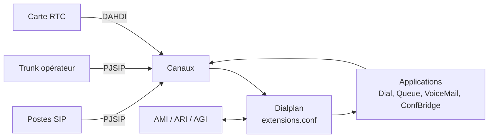

**Asterisk** (créé en 1999 par Mark Spencer, maintenu par **Sangoma**) est un IPBX logiciel libre (GPLv2) qui transforme un serveur Linux en autocommutateur complet : postes SIP, trunks opérateurs, serveur vocal interactif, files d'attente, messagerie vocale, conférences, enregistrement, passerelles vers le RTC. Il est au cœur de **FreePBX**, Issabel, Wazo (historiquement), VitalPBX et de nombreuses offres commerciales.

## Architecture



| Composant | Rôle |
| --- | --- |
| **Canaux** | `chan_pjsip` (SIP, le seul pilote SIP depuis Asterisk 21), `chan_iax2`, `chan_dahdi` (cartes T1/E1/analogiques), `Local` (appels internes au dialplan) |
| **Dialplan** | Script de routage des appels (`extensions.conf` ou AEL/Lua) |
| **Applications** | `Dial`, `Queue`, `VoiceMail`, `ConfBridge`, `Playback`, `Record`, `MixMonitor`… |
| **Fonctions** | `CALLERID()`, `CHANNEL()`, `DB()`, `CURL()`… lisibles et modifiables dans le dialplan |
| **AMI** (*Asterisk Manager Interface*) | Supervision et commandes par TCP (5038) |
| **ARI** (*Asterisk REST Interface*) | Applications de communication en REST + WebSocket |
| **AGI** | Scripts externes appelés depuis le dialplan |

## Versions

Asterisk publie une version majeure par an ; une sur deux est **LTS** (support étendu, environ 4 ans + 1 an de correctifs de sécurité), par exemple **20 LTS** et **22 LTS**. Choisissez une LTS en production et suivez les avis de sécurité (`AST-AAAA-NNN`).

## Installation sous Linux (depuis les sources)

C'est la méthode recommandée par le projet (versions à jour, choix des modules) :

```bash
sudo apt update && sudo apt install -y wget build-essential
cd /usr/src
sudo wget https://downloads.asterisk.org/pub/telephony/asterisk/asterisk-22-current.tar.gz
sudo tar xzf asterisk-22-current.tar.gz && cd asterisk-22.*/
sudo contrib/scripts/install_prereq install
sudo ./configure --with-jansson-bundled --with-pjproject-bundled
sudo make menuselect          # choisir modules, codecs, sons (FR : CORE-SOUNDS-FR-*)
sudo make -j"$(nproc)"
sudo make install
sudo make samples             # fichiers d'exemple dans /etc/asterisk (à alléger ensuite)
sudo make config              # service système
sudo make install-logrotate
sudo ldconfig
```

Exécuter Asterisk sous un compte dédié :

```bash
sudo groupadd --system asterisk
sudo useradd --system -g asterisk -d /var/lib/asterisk -s /usr/sbin/nologin asterisk
sudo chown -R asterisk:asterisk /etc/asterisk /var/{lib,log,spool,run}/asterisk /usr/lib/asterisk
sudo sed -i 's/^;runuser = asterisk/runuser = asterisk/; s/^;rungroup = asterisk/rungroup = asterisk/' /etc/asterisk/asterisk.conf
sudo systemctl enable --now asterisk
sudo asterisk -rvvv
```

### Autres méthodes

| Méthode | Remarques |
| --- | --- |
| Paquets de la distribution | Ubuntu (`apt install asterisk`, dépôt *universe*), Fedora/EPEL : simple mais versions plus anciennes ; Asterisk n'est plus dans les dépôts de Debian 12 |
| Distribution prête à l'emploi | **FreePBX Distro** / FreePBX 17 sur Debian 12 (voir [[03-freepbx/01-installation-interface\|FreePBX]]), VitalPBX, Issabel |
| Docker | Images communautaires (`andrius/asterisk`…) ; réseau `host` recommandé à cause de la plage RTP |

### Windows et macOS

Asterisk ne fonctionne **pas nativement sous Windows**. Pour un laboratoire : machine virtuelle Linux (Hyper-V, VirtualBox), **WSL2** (Ubuntu) ou conteneur Docker Desktop ; en production, un serveur ou une VM Linux. Sous **macOS**, la compilation est possible pour des tests mais non supportée en production : utilisez une VM (UTM, Parallels) ou Docker. Pour un IPBX natif Windows, voir [[06-3cx/01-installation-configuration|3CX]] ou [[04-freeswitch/01-presentation-installation|FreeSWITCH]].

## Fichiers et répertoires

| Chemin | Contenu |
| --- | --- |
| `/etc/asterisk/asterisk.conf` | Paramètres généraux, utilisateur, répertoires |
| `/etc/asterisk/modules.conf` | Chargement des modules (`autoload`, `noload`) |
| `/etc/asterisk/pjsip.conf` | Transports, postes, trunks ([[02-pjsip-postes-trunks\|PJSIP]]) |
| `/etc/asterisk/extensions.conf` | Dialplan ([[03-dialplan-fonctions\|dialplan]]) |
| `/etc/asterisk/rtp.conf` | Plage de ports RTP |
| `/etc/asterisk/voicemail.conf`, `queues.conf`, `confbridge.conf` | Messagerie, files d'attente, conférences |
| `/etc/asterisk/logger.conf` | Journaux |
| `/var/lib/asterisk/sounds/` | Annonces (sons français dans `fr/`) |
| `/var/spool/asterisk/` | Messages vocaux, enregistrements, fichiers d'appel (`outgoing`) |
| `/var/log/asterisk/` | `messages`, `full`, `security`, `cdr-csv/` |

## Premiers pas dans la CLI

```text
*CLI> core show version
*CLI> core show uptime
*CLI> module show like pjsip
*CLI> core show channels
*CLI> pjsip show endpoints
*CLI> dialplan show
*CLI> core set verbose 5
*CLI> core reload
*CLI> core stop gracefully
```

`asterisk -rx "commande"` exécute une commande sans entrer dans la console (scripts, supervision). La CLI complète est détaillée dans [[04-securite-exploitation-cli|sécurité, exploitation et CLI]].
